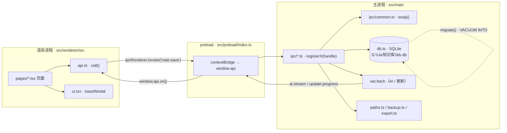
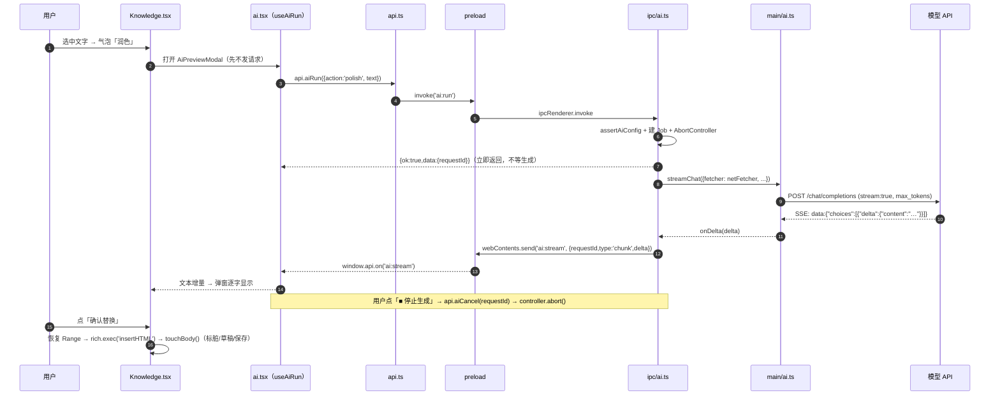
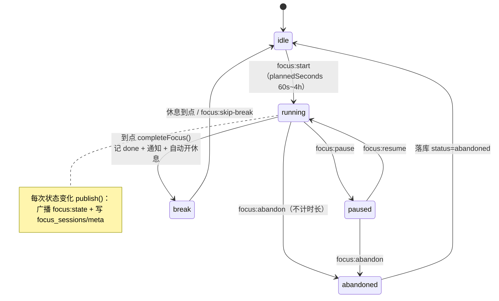
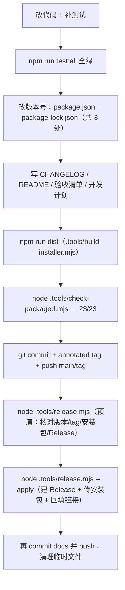

# Jw 知识库 · 架构与开发者导航指南（DEVELOPER_GUIDE）

> 目标读者：**第一次接手这个仓库的人**。读完应该能在 30 分钟内跑起项目、对每个「我想改 X」知道去哪个文件，并且清楚哪些操作会放倒用户数据。
> 版本基线：**0.12.3**。文中所有 `路径:行号` 都是当前 HEAD 的真实坐标，提交前用 `node .tools/check-guide.cjs` 机器校验（会逐条检查文件存在 + 行号不越界 + Mermaid 图数量）。
> 坐标约定：`路径:行号` 指该行所在文件；区间写作 `路径:起-止`。行号会随代码移动，**改完代码顺手改行号**是交接的一部分。

---

## 目录

| # | 章节 | 你会得到什么 |
|---|---|---|
| 1 | [极速上手与环境重置](#1-极速上手与环境重置day-1-sop) | 跑起来、隔离数据、一键重置 |
| 2 | [架构决策记录（ADR）](#2-架构决策记录adr) | 6 个「为什么」，防止盲改 |
| 3 | [代码导航地图](#3-代码导航地图我想改-x-去哪) | 「我想改 X → 去这」对照表 |
| 4 | [核心架构与可视化流转](#4-核心架构与可视化流转) | 进程边界 + 3 张 Mermaid 图 |
| 5 | [隐形全局逻辑](#5-隐形全局逻辑防踩坑) | 错误兜底、设计令牌、env 注入 |
| 6 | [跨平台与运行限制](#6-跨平台与运行限制) | Windows 绑定清单、Mac/Linux 会挂什么 |
| 7 | [调试与故障排查](#7-调试与故障排查) | 日志/截图在哪、常见坑怎么破 |
| 8 | [开发防坑与工程红线](#8-开发防坑与工程红线) | 安全、Electron、性能、事务 |
| 9 | [拓展 Recipes 与测试准入](#9-拓展开发-recipes-与测试准入) | 加表/加通道/加页面/加断言 |
| 10 | [打包发布与技术债](#10-打包发布与技术债) | 发版 SOP + 最脆弱模块清单 |
| A | [附录：文件规模](#附录-a文件规模机器统计) | 大文件排行 |
| B | [附录：IPC 通道清单](#附录-bipc-通道按域149-个) | 149 个通道按域分布 |
| C | [附录：文档自检](#附录-c文档自检) | 路径核对报告怎么跑 |

---

## 1. 极速上手与环境重置（Day 1 SOP）

### 1.1 环境矩阵

| 项 | 要求 | 依据 |
|---|---|---|
| 操作系统 | Windows 10/11 x64（交付物只针对 Windows） | `electron-builder.yml:31-32` |
| Node.js | v24.x（本机实测 `v24.19.0` / `npm 11.17.0`） | `README.md:142` |
| Electron | 44.8.0（自带 Node 24 运行时，主进程不依赖系统 Node） | `package.json:28` |
| 原生依赖 | 无：`node:sqlite` 内置，不需要编译 native 模块 | `package.json:35-41` |
| 包源 | npmmirror + 仓库内缓存（`.npm-cache/`、`.electron-cache/`） | `.npmrc:1-6` |
| 亚克力材质 | Windows 11 build ≥ 22000 才生效，否则 CSS 渐变兜底 | `src/main/index.ts:116-119` |

### 1.2 三条命令跑起来

```powershell
npm install
$env:JWKB_DATA_DIR = "C:\Users\29785\Desktop\Jw的app\.dev-data"   # 必须，见 1.3
npm run dev
```

- `dev` = `electron-vite dev`（`package.json:9`）：主进程热重启 + 渲染层 HMR。
- 依赖下载卡在 Electron 二进制时：`node .tools/fetch-electron.mjs`（把 zip 落到 `.electron-cache/`）。
- dev 模式渲染层地址由 electron-vite 注入 `ELECTRON_RENDERER_URL`（`src/main/index.ts:180-185`），**不要手动设**。

### 1.3 数据隔离红线（严禁污染真实库）

数据根目录解析优先级（`src/main/paths.ts:67-79`）：

| 优先级 | 来源 | 代码位置 |
|---|---|---|
| 1 | 环境变量 `JWKB_DATA_DIR` | `src/main/paths.ts:68` |
| 2 | `%APPDATA%\Jw知识库\locator.json` 记录的路径 | `src/main/paths.ts:21-24`、`:74` |
| 3 | 默认 `D:\Jw知识库` | `src/main/paths.ts:14` |
| 4 | 都不可写 → `app.getPath('userData')/data` | `src/main/paths.ts:79` |

**三条红线**：

1. 开发/测试一律设 `JWKB_DATA_DIR`，指向仓库内被 `.gitignore` 忽略的目录：`.dev-data/`、`.e2e-data/`、`.kill-data/`、`.pack-data/`（`.gitignore:12-24`）。
2. 设了 `JWKB_DATA_DIR` 时主进程**不会**写 locator（`src/main/index.ts:314-316`），开发路径不会污染真实环境。
3. **绝不要**把 `JWKB_DATA_DIR` 指到 `D:\Jw知识库`、`%APPDATA%\Jw知识库` 或 `C:\JwKB` —— 那三处是用户真实数据与交付产物。

### 1.4 本地数据重置（弄坏了怎么回到初始状态）

测试脚本都是「启动前自删目录」：e2e `tests/e2e/cdp-check.mjs:22`、强杀 `tests/e2e/kill-test.mjs:22`、打包自检 `.tools/check-packaged.mjs:19-20`。

| 目录 | 谁在用 | 一键重置 |
|---|---|---|
| `.dev-data/` | 你自己 `npm run dev` | `Remove-Item -Recurse -Force .dev-data` |
| `.e2e-data/` | e2e（启动前自删） | 无需手动；要手动就 `Remove-Item -Recurse -Force .e2e-data` |
| `.kill-data/` | 强杀测试（启动前自删） | `Remove-Item -Recurse -Force .kill-data` |
| `.pack-data/` | 打包自检（启动前自删） | `Remove-Item -Recurse -Force .pack-data` |

- 删目录后下一次启动会自动重建：`openDatabase()` 依次跑 `migrate()` → `runCleanGithubBugMigration()` → `ensureDefaultCategories()` → `purgeExpiredTrash()`（`src/main/db.ts:315-327`）。
- **只想让库归零**：删 `kb.db`、`kb.db-wal`、`kb.db-shm` 三个文件即可；**保留 `attachments/`**，否则正文里的图片会全变「附件不在了」（`src/main/attachments` 路径由 `src/main/paths.ts:84-90` 决定）。
- 想留后路：应用内设置页「立即备份」（`src/renderer/src/pages/Settings.tsx:388-409`），备份是 `VACUUM INTO` 一致性快照（`src/main/backup.ts:53-69`）。

### 1.5 常用命令

| 命令 | 做什么 | 坑 |
|---|---|---|
| `npm run typecheck` | `tsc --noEmit`（`package.json:12`），必须 0 错 | `noUnusedLocals/noUnusedParameters` 会卡住未使用变量（`tsconfig.json:16-17`） |
| `npm run test:unit` | Vitest 35 文件 / 485 条（`package.json:14`） | electron 被替身顶替（`vitest.config.ts:9`），库测试串行（`:18`） |
| `npm run build` | 产出 `out/`（`package.json:10`） | **`test:e2e` 不会自动 build** |
| `npm run test:e2e` | 真 Electron + CDP（325 条，`package.json:15`） | 需要能创建命名管道；端口 9333 被占会卡住 |
| `npm run test:kill` | 写数据后 SIGKILL、重启校验（6 条，`package.json:16`） | 端口 9334 |
| `npm run test:all` | 以上按序全跑（`package.json:17`） | 最稳的一键验收 |
| `npm run pack` | 只出绿色版 `release/win-unpacked/`（`package.json:18`） | 不影响交付目录 |
| `npm run dist` | 安装包 + 绿色版到 `C:\JwKB`（`package.json:19`） | 见 §10 |
| `npm run release` | Release 预演（`package.json:20`）；**真发用** `node .tools/release.mjs --apply` | PowerShell 5.1 下 `npm run release -- --apply` 的 `--apply` 会被 npm 吞掉，只跑预演 |
| `npm run diag:github` | GitHub Device Flow 全链路诊断（`package.json:21`） | 不打印 device_code 全文、不落盘 Token |

---

## 2. 架构决策记录（ADR）

> 每条给出「当前实现位置 / 为什么 / 换掉要付什么」。**没读完不要重构这些点。**

### ADR-1 数据库用 SQLite（WAL + FTS5），不用 JSON 文件

- 实现：`src/main/db.ts:315-327` 打开时 `journal_mode=WAL`、`synchronous=NORMAL`、`foreign_keys=ON`、`busy_timeout=5000`；表结构 `src/main/schema.ts:9`（20 张普通表 + 1 张 FTS5 虚表 `note_fts`，`:233`）；schema 版本 `SCHEMA_VERSION = 8`（`src/main/db.ts:158`），迁移在 `migrate()`（`:220-303`）。
- 为什么：
  1. 应用是「逐条写入 + 随时断电」的使用方式，JSON 全量重写无法保证原子性（强杀用例 `tests/e2e/kill-test.mjs:167` 就是拿这个验收的）；
  2. 笔记/标签/附件/版本点/复习卡跨表引用，外键 + 事务是刚需；
  3. 中文全文搜索用 FTS5 虚表（`src/main/schema.ts:233`）+ `searchNotes()`（`src/main/db.ts:823`）；
  4. 备份可不锁库拿一致快照：`VACUUM INTO`（`src/main/backup.ts:53-69`）。
- 代价：改表必须写幂等的迁移（`src/main/db.ts:220-303`），老库补列靠 `addColumnIfMissing()`（`src/main/db.ts:161`）。

### ADR-2 状态管理：不引 Redux/Zustand，用「hash 路由 + 页面自取数 + App 少量全局 state」

- 实现：路由是 `window.location.hash` 监听（`src/renderer/src/App.tsx:40-44`）；页面切换 `App.tsx:338-346`；App 全局只有 6 个 state：`collapsed/inboxCount/openNoteId/searchOpen/theme/drawerOpen`（`App.tsx:126-131`）；数据由页面在 `useEffect` 里经 `window.api` 拉（示例 `Knowledge.tsx:270` 的 `loadList`）。
- 为什么：单窗口、9 个页面、跨页共享状态极少；数据「真相」在 SQLite，前端缓存越多越容易和库里不一致；少一层依赖 = 少一次升级冲突。
- 代价：`navigate/refreshCount` 逐层 prop drilling（`App.tsx:338-346`）；`Knowledge.tsx` 单文件 20+ 个 `useState`（见 §10.3）。
- 什么时候该换：出现「跨页共享编辑态」或三处以上级联刷新时，再引 Context/Zustand。

### ADR-3 API Key 用 `safeStorage` 加密进 SQLite，绝不明文进渲染层

- 实现：`src/main/ipc/ai.ts:39` 判 `safeStorage.isEncryptionAvailable()`；`:45-53` 解密读取；`:66` `encryptString(key).toString('base64')` 落 `meta` 表；`:83-95` 只向渲染层暴露 `hasKey/keyHint`。
- 为什么：Windows 上 `safeStorage` 走 DPAPI，**同机同用户**才能解密；即使 `kb.db` 被拷走也解不开。渲染层一旦持有明文 Key，任何 XSS/恶意插件都能带走。
- 代价：换机器/换 Windows 用户需重填 Key；极端环境下 `isEncryptionAvailable()===false` 会退化为明文存储并在设置页提示「未加密」。
- 红线：**任何新功能都不许把 Key 读进渲染层**；日志一律打码（`src/main/ai.ts:490-509` 的 `redactSecret` / `maskAiKey`）。

### ADR-4 所有网络请求只在主进程（`net.fetch`），渲染层零网络

- 实现：AI 请求 `src/main/ipc/ai.ts:96-109`（`netFetcher`）；更新检查/下载 `src/main/ipc/update.ts:22-27`；附件协议读盘 `src/main/index.ts:49-61`。渲染层 CSP `default-src 'self'`（`src/renderer/index.html:11-14`），构建时再把 `connect-src` 收紧成仅 `'self'`（`electron.vite.config.ts:9-19`）。
- 为什么：超时、取消、白名单、Key、打码日志集中在一处；渲染层拿不到任意 URL；e2e 能把 fetcher 换成本地 stub（`tests/e2e/cdp-check.mjs:78-79`）而**不真联网、不花 AI 额度**。
- 代价：流式输出必须「invoke 启动 + 事件推送」两段式（见 §4.3 时序图）。
- 自检命令（0 命中即合规）：`git grep -n -E "fetch\(|XMLHttpRequest|axios" -- src/renderer`。

### ADR-5 笔记正文用 `contenteditable + execCommand`，不用 CodeMirror/ProseMirror

- 实现：编辑器容器 `Knowledge.tsx:1645`（`.rt-editor`）；工具条 `Knowledge.tsx:1417` 起；命令封装 `src/renderer/src/rich.ts:24-72`（`exec/bold/foreColor/insertTable…`）。
- 为什么：
  1. 需求是「所见即所得 + 粘图 + 表格 + 高亮」，`contenteditable` 原生支持；
  2. 原生撤销栈可用 → AI 摘要插入后一次 `Ctrl+Z` 能整块撤掉（`Knowledge.tsx:798-830`）；
  3. 不引重型编辑器依赖（ProseMirror/TipTap 会显著增加包体和复杂度）。
- 代价：所有入库 HTML 必须过 `sanitizeHtml()`（`src/shared/html.ts:201`，白名单 `:86-140`）；`execCommand` 已被标准标记废弃但 Chromium 仍稳定支持。
- 现状：`package.json:36-38` 仍声明三个 CodeMirror 依赖，但 `src/` 里零 import（见 §10.3 技术债）。

### ADR-6 IPC 统一信封 + 单点注册（149 个通道）

- 实现：`Result<T> = {ok:true,data}|{ok:false,error}`（`src/main/ipc/common.ts:5`）；`wrap()` 统一 try/catch + `console.error('[IPC] 处理失败：')`（`:19-28`）；注册器在 `src/main/ipc/index.ts:21-55`（`handle()` 先 `removeHandler` 再 `handle`，重复注册幂等）；preload 把信封解包成「成功返回 data、失败 throw Error」（`src/preload/index.ts:16-25`）。
- 为什么：渲染层永远不用判断两套错误形态；e2e 多次启动不冲突；错误文案可直接给用户看。
- 代价：错误没有结构化 code，只有中文 message（需要分类时靠前缀，如 `src/shared/ai.ts` 的 AI 配置错误分类）。

---

## 3. 代码导航地图（「我想改 X，去哪？」）

> 图例：`文件:行` 是入口坐标；改完记得跑 §9.5 的门槛。

| 我想改… | 去这里 | 备注 |
|---|---|---|
| **UI 主题 / 配色 / 圆角 / 字体** | 浅色令牌 `src/renderer/src/styles.css:6-103`；深色令牌 `:105-147`；运行时挂 `data-theme`：`src/renderer/src/App.tsx:156-163`；首帧主题：`src/renderer/src/main.tsx:12-22` | 只吃 CSS 变量，别硬编码颜色 |
| **毛玻璃质感** | `src/renderer/src/styles.css:2735`（`.glass`）+ 令牌 `:83-86` | 深色令牌在 `:105-147` |
| **拖拽窗口的标题栏区域** | `src/renderer/src/styles.css:2762`（`-webkit-app-region: drag`）、`:2773`（`no-drag` 白名单） | 新按钮/浮层要显式 `no-drag`，否则点不动（番茄钟踩过此坑） |
| **全局快捷键（应用内）** | `Ctrl+K/N/1-9`：`src/renderer/src/App.tsx:208-227`；按键→页面映射 `NAV` 在 `App.tsx:24-35` | 在渲染层注册，随窗口存活 |
| **全局快捷键（系统级）** | 快速记录 `Ctrl+Alt+Space`：`src/main/index.ts:336`；托盘菜单加速键：`src/main/index.ts:258` | 用 `globalShortcut.register`，退出时统一 `unregisterAll()`（`:370-372`） |
| **编辑器快捷键（Ctrl+B / Ctrl+S 等）** | 保存：`Knowledge.tsx:393`；工具条按钮：`Knowledge.tsx:1417-1585` | 按钮用 `onMouseDown={e=>e.preventDefault()}` 防失焦 |
| **AI 的提示词（Prompt）** | 划词/全文 System Prompt：`src/main/ai.ts:171`；按动作拼消息：`src/main/ai.ts:179`；GitHub 提炼 Prompt：`src/main/ai.ts:784-828` | 改完跑 `tests/unit/ai-client.test.ts` / `repo-extract-echo.test.ts` |
| **AI 的模型参数（max_tokens / 超时）** | 每个动作的 token 上限：`src/shared/ai.ts:56-67`；请求体：`src/main/ai.ts:281-300`；三道超时闸：`src/main/ai.ts:23-27`（头 10s / 空闲 60s / 总 180s） | 温度等参数在 `buildChatRequest` 里，改前看单测 |
| **AI 设置页 UI** | `src/renderer/src/pages/Settings.tsx:546`（`.ai-settings-card`）；保存/测试连接：`:241-308` | Key 从不回填输入框 |
| **AI 划词气泡 / 弹窗组件** | `src/renderer/src/ai.tsx`：`useAiRun()` `:51`、`AiBubble` `:180`、`AiPreviewModal` `:223`、`AiSummaryModal` `:354`、`AiTagsModal` `:487`、`AiRelatedModal` `:640`、`AiPrivacyModal` `:751` | 样式 `.ai-*` 在 `styles.css` 末尾 |
| **番茄钟（规则 / 计时 / 休息）** | 共享常量 `src/shared/focus.ts:10-13`；主进程引擎 `src/main/focus.ts:83`；IPC `src/main/ipc/focus.ts:68-80`；悬浮球 UI `src/renderer/src/focus.tsx:73`；位置纯函数 `src/renderer/src/fabPos.ts:77-124` | 计时只在主进程，渲染层每秒重算显示 |
| **安装包图标 / 应用名 / 安装行为** | 图标 `electron-builder.yml:32`；产品名 `electron-builder.yml:4`；安装包文件名 `:50`；NSIS 行为 `:38-53`；图标生成 `.tools/gen-icon.mjs`、`.tools/make-ico.mjs`；NSIS 定制 `resources/installer.nsh` | 改完 `npm run dist` 重打 |
| **数据表结构** | `src/main/schema.ts:9`（`SCHEMA`）、`:233`（`note_fts`）、`:245`（`FOCUS_SCHEMA`，加表最佳范例） | 版本号与迁移在 `src/main/db.ts:158`、`:220-303` |
| **新增 IPC 通道** | 域文件 `src/main/ipc/*.ts` + 注册 `src/main/ipc/index.ts:43-55` + 渲染层封装 `src/renderer/src/api.ts:125-360` | 事件型通道还要进 `src/preload/index.ts:3-13` 白名单 |
| **GitHub 项目导入 / 授权** | 主进程 `src/main/github.ts`（`requestDeviceCode` `:278`、`pollAccessToken` `:380`、`fetchRepoInfo` `:508`）；提炼 `src/main/repo-extract.ts:29`、`:111`；通道 `src/main/ipc/github.ts:344-470`；渲染层 `src/renderer/src/pages/Inbox.tsx:73`、`src/renderer/src/github.tsx:23` | Token 加密见 ADR-3 |
| **导出为 Markdown** | HTML→MD：`src/main/html-to-md.ts:313`；目录/文件/图片拷贝：`src/main/export.ts:109`；IPC：`src/main/ipc/export.ts:29`；UI：`Settings.tsx:311-336` | e2e 用 `JWKB_EXPORT_DIR` 跳过系统对话框 |
| **备份 / 恢复 / 数据库自检** | `src/main/backup.ts:29`（列表）、`:53`（备份）、`:94`（每日）、`:111`（恢复）、`:136`（删除）；IPC `src/main/ipc/system.ts:37-48`；自检 `src/main/db.ts:355` | 恢复前自动备份当前库，可反悔 |
| **检查更新 / 下载安装包** | 检查 `src/main/update.ts:132`；下载+SHA256 `src/main/updater.ts:78`；IPC `src/main/ipc/update.ts:101-166`；URL 白名单 `src/main/ipc/update.ts:27-43` | 测试用 `JWKB_UPDATE_URL` / `JWKB_UPDATE_DRYRUN` |
| **密码学（加密/解密）** | 全仓只有一处：`src/main/ipc/ai.ts:39-70`（`safeStorage`） | 没有其它加密需求 |
| **应用启动 / 单实例 / 托盘 / 全局异常** | `src/main/index.ts:304-379` | 启动失败 `dialog.showErrorBox` + `app.exit(1)`（`:349-360`） |

> 快速定位技巧：中文文案用 `git grep -n "文案片段" -- src`；英文标识符用 `git grep -n "标识符" -- src`；看谁调用了某通道用 `git grep -n "'note:save'" -- src`。

---

## 4. 核心架构与可视化流转

### 4.1 进程边界与物理路径

| 进程 | 物理位置 | 能做什么 | 禁止做什么 |
|---|---|---|---|
| Main（Node + Electron） | `src/main/**`，入口 `src/main/index.ts`（`package.json:7` 指向 `out/main/index.js`） | SQLite、文件系统、`net.fetch`、托盘/通知/全局热键、`safeStorage` | 直接渲染 HTML（没有 DOM） |
| Preload（隔离上下文） | `src/preload/index.ts` | 只暴露 `invoke / on / pathForFile` 三个方法（`:15-47`） | 暴露 `ipcRenderer` 本体或 Node API |
| Renderer（Chromium） | `src/renderer/src/**`，入口 `src/renderer/src/main.tsx` | React 界面、`window.api` 调用 | 联网、读写文件、拿明文 Key |
| Shared（纯逻辑） | `src/shared/**` | 类型、HTML/Markdown 清洗、时间格式、AI/GitHub 协议常量 | import `electron` 或 DOM 之外的东西 |

窗口安全参数：`contextIsolation: true`、`nodeIntegration: false`、`sandbox: false`（`src/main/index.ts:142-147`；preload 需要 Node 能力所以关了 sandbox，动这块要非常小心）。



### 4.2 IPC 的两条路径（必须分清楚）

| 形态 | 用法 | 代码 | 例子 |
|---|---|---|---|
| 请求/响应 | 渲染层 `invoke` → 主进程 `handle` → 返回 `Result` | 注册 `src/main/ipc/index.ts:23-26`；解包 `src/preload/index.ts:16-25` | `api.getSettings()`（`api.ts:137`） |
| 主进程推送 | `webContents.send('域:事件')` → preload 白名单 → 渲染层 `on` | 白名单 `src/preload/index.ts:3-13`；订阅 `api.ts:93-118` | `ai:stream`、`focus:state`、`github:auth`、`update:progress`、`export:progress` |

**新增事件必须进 `ALLOWED_EVENTS`**，否则 `window.api.on()` 直接抛「未开放的事件通道」（`src/preload/index.ts:26-29`）。

### 4.3 时序图：点「AI 润色」→ 主进程流式请求 → 逐字返回 → 确认替换

关键点：`ai:run` **立刻**返回 `requestId`，正文通过 `ai:stream` 推回；渲染层 `useAiRun()` 用 `requestId` 过滤，避免多窗口串台（`src/renderer/src/ai.tsx:51-128`）。主进程编排在 `src/main/ipc/ai.ts:159-216`，流式解析在 `src/main/ai.ts:518-630`。



### 4.4 全局状态流转：番茄钟为什么「切页不丢」

- 唯一真相在主进程：`createFocus(deps)` 的 `state`（`src/main/focus.ts:83-120`）；进行中会话 id 持久化在 `meta` 表（`deps.persist`，`src/main/focus.ts:103-107`）。
- 任何变化都走 `publish()`：广播 `focus:state` + 落库（`src/main/ipc/focus.ts:44-66` 的 `emit` 遍历所有窗口）。
- 渲染层 `FocusDock` 订阅事件、只保存快照，每秒按 `endAt - now` 重算显示（`src/renderer/src/focus.tsx:73-130`）；切页/最小化/刷新都不打断计时。
- 应用重启后 `runtime.restore()` 把进行中的会话接回来（`src/main/ipc/focus.ts:70`），残留会话收成 `abandoned` 且不计入统计（`src/main/focus.ts:288-296`）。



其余跨页状态都在渲染层 App：主题（`App.tsx:156-163`）、侧栏折叠（`:126`）、收集箱角标（`inboxCount`，各页保存后调 `refreshCount`）、跨页打开笔记（`openNoteId`，首页/收集箱点笔记 → `navigate('/knowledge')`）。

---

## 5. 隐形全局逻辑（防踩坑）

### 5.1 错误捕获：**没有**全局兜底（已知缺口）

| 层次 | 现状 | 位置 |
|---|---|---|
| 主进程启动失败 | `app.whenReady().then(startup).catch(...)` → `dialog.showErrorBox` + `app.exit(1)` | `src/main/index.ts:349-360` |
| IPC 调用异常 | `wrap()` 统一 catch → 日志前缀 `[IPC] 处理失败：` + `{ok:false,error}` | `src/main/ipc/common.ts:19-28` |
| 渲染层业务异常 | 每个 `catch` 手动 `toastError()` / `errText()` | `src/renderer/src/errors.ts:9-22` |
| 保存失败分诊 | `describeSaveError()` 把 SQLITE_BUSY / EACCES / ENOSPC 翻成人话 | `src/renderer/src/save.tsx:24-45` |
| ErrorBoundary / `window.onerror` / `unhandledrejection` / `uncaughtException` | **均不存在** | 校验：`git grep -n -E "ErrorBoundary|window\.onerror|unhandledrejection|uncaughtException" -- src`（0 行） |

> 实践后果：未捕获的渲染层异常会白屏且无提示。新增异步代码必须自己 `try/catch` 并用 `toastError`；这一项在 §10.3 技术债里是 P2。

### 5.2 设计令牌、`.glass` 与断点

- 浅色令牌 `src/renderer/src/styles.css:6-103`（`--bg/--text/--brand/--radius/--shadow/--spring-ease/--sidebar-w` 等）；深色令牌 `:105-147`（挂 `<html data-theme="dark">`）。
- 第二段 `:root`（`:4264-4268`）只加滚动条/焦点环令牌（`--scroll-thumb`、`--focus-ring`），改主题别漏这处。
- 毛玻璃：`.glass` 在 `src/renderer/src/styles.css:2735-2742`，配 `--glass-bg/--glass-border/--glass-blur`（`:83-86`）。
- 布局断点：`readLayout()` 返回 `wide|rail|drawer|single`（`src/renderer/src/App.tsx:57-65`），`--sidebar-w: 232px` / `--rail-w: 60px`（`styles.css:65-68`）；样式断点 `@media (max-width: 1199px)`（`:3891`）、`1023px`（`:3903`）、`767px`（`:3989`）。
- 时间常量与 CSS 对齐：`src/renderer/src/timing.ts:8-34`（动画时长两处一起改，注释里标了「跟 CSS 对齐」）。

### 5.3 环境变量怎么进来（没有 dotenv）

全部在**主进程**直接读 `process.env`，渲染层没有任何构建期变量注入：

| 变量 | 作用 | 读取位置 |
|---|---|---|
| `JWKB_DATA_DIR` | 指定数据根目录（开发/测试隔离） | `src/main/paths.ts:68`；`src/main/index.ts:314-316` 决定是否写 locator |
| `ELECTRON_RENDERER_URL` | dev 时渲染层地址（electron-vite 注入） | `src/main/index.ts:180-185`、`:209-213` |
| `JWKB_FOCUS_MIN_SECONDS` | 番茄钟最短专注秒数（测试用） | `src/main/focus.ts:60` |
| `JWKB_EXPORT_DIR` | 导出 Markdown 的目标目录（跳过系统对话框） | `src/main/ipc/export.ts:29` |
| `JWKB_UPDATE_URL` | 检查更新地址（测试 stub） | `src/main/ipc/update.ts:34`、`:104` |
| `JWKB_UPDATE_DIR` | 安装包下载目录 | `src/main/ipc/update.ts:69` |
| `JWKB_UPDATE_DRYRUN` | `1` = 不真跑安装程序 | `src/main/ipc/update.ts:74` |
| `JWKB_GITHUB_CLIENT_ID` / `JWKB_GITHUB_API_BASE` / `JWKB_GITHUB_OAUTH_BASE` | GitHub 授权身份与测试地址 | `src/main/ipc/github.ts:56-66` |
| `JWKB_DIAG_CLIENT_ID` | `diag:github` 诊断用的 Client ID | `.tools/diag-github.js:17` |
| `JWKB_OUT_DIR` / `JWKB_BUILD_DIR` / `JWKB_EXE` | 打包交付目录 / 英文暂存目录 / 自检 exe 路径 | `.tools/build-installer.mjs:19`、`:126`；`.tools/check-packaged.mjs:13` |

构建期唯一的变化是 CSP 收紧（把 dev 的 `ws:`/`localhost` 去掉）：`electron.vite.config.ts:9-19`。

### 5.4 附件协议 `jw-att://`

正文里 `` 由主进程映射到数据目录真实文件，并做「只在数据目录内」的越界检查（`src/main/index.ts:49-61`）。改附件路径要同步 `src/shared/html.ts:22-49`（`attachmentUrl/attachmentRelFromUrl`）。

### 5.5 GitHub 项目导入链路的三个隐形约束

- 地址清洗是**入口唯一闸门**：`parseRepoUrl()`（`src/shared/github.ts:184`）把脏 URL 收成 `owner/repo`；非法地址抛中文错误、**不发请求**。
- 提炼是**非流式**一次返回，Prompt 在 `src/main/ai.ts:784-828`；并发闸是计数限流器 `RepoExtractLimiter`（`src/main/repo-extract.ts:29`），上限 `GITHUB_MAX_EXTRACT_JOBS = 2`（`src/shared/github.ts:36`），`release()` 必须在 `finally` 里调。
- 失败降级：先落 `inbox_item` 再提炼；AI 报错时 `extract_status = ai_failed`，卡片给「重试提炼」（`github:retry-extract`，`src/main/ipc/github.ts:429`）。

---

## 6. 跨平台与运行限制

| Windows 绑定项 | 位置 | 在 mac/Linux 的后果 |
|---|---|---|
| NSIS 安装包（`electron-builder --win`） | `electron-builder.yml:31-53`、`package.json:19` | `npm run dist` 直接失败；只能 `npm run build` |
| DPAPI 加密 Key（`safeStorage`） | `src/main/ipc/ai.ts:39-70` | Linux 需要 libsecret，未装则 `isEncryptionAvailable=false` → 退化为明文并在设置页提示「未加密」 |
| 自绘标题栏 + 红黄绿灯 | `src/main/index.ts:135-137`、`src/renderer/src/App.tsx:96-123`、`styles.css:2762` | 可跑但视觉/习惯不一致；`-webkit-app-region` 行为不同 |
| Windows 11 亚克力 | `src/main/index.ts:116-119`、`:150-160` | 自动退回 CSS 渐变，不报错 |
| 托盘图标 16px 缩放 | `src/main/index.ts:76-79` | mac 菜单栏图标规范不同，需另出模板图 |
| E2E / 强杀 / 打包自检 | `tests/e2e/cdp-check.mjs:16`、`tests/e2e/kill-test.mjs:29`、`.tools/check-packaged.mjs:13` | 硬编码 `node_modules/electron/dist/electron.exe`，mac 上要先改可执行名 |
| 构建镜像（npmmirror） | `.npmrc:1-6` | 境外机器可去掉 mirror；Electron 下载失败用 `.tools/fetch-electron.mjs` |
| 全局热键 `Ctrl+Alt+Space` | `src/main/index.ts:336` | mac 沿用 Control 语义，用户会不习惯 |

**结论**：源码是跨平台写法，但**交付物与测试链路是 Windows-only**。在 mac 上开发，至少先改 3 个测试脚本的 exe 路径，并且不要指望 `dist` 能跑通。

---

## 7. 调试与故障排查

### 7.1 日志与现场在哪

| 现场 | 位置 | 怎么看 |
|---|---|---|
| 主进程 stdout/stderr（dev） | 终端 | `npm run dev` 直接打印；异常前缀 `[IPC] 处理失败：`、`[启动] 失败：`、`[数据]` |
| e2e 主进程日志 | 子进程 `stdio: 'inherit'`（`tests/e2e/cdp-check.mjs:312`） | 跟着终端输出；失败断言会打印 detail |
| e2e 结果快照 | `tests/e2e/last-result.txt`（写盘：`tests/e2e/cdp-check.mjs:6218`） | 每次覆盖，含逐条 PASS/FAIL 与 detail |
| 强杀测试结果 | `tests/e2e/last-kill-result.txt`（写盘：`tests/e2e/kill-test.mjs:204`） | 同上 |
| 界面截图 | `tests/e2e/shots/*.png`（46 张，目录常量 `tests/e2e/cdp-check.mjs:18`） | 失败时先看对应页截图 |
| 打包产物自检结果 | `.tools/last-packaged-result.txt`（写盘：`.tools/check-packaged.mjs:379`） | 截图在 `.tools/pack-shots/` |
| 数据库完整性 | 启动自检 `src/main/index.ts:323-325`，实现 `src/main/db.ts:355` | 返回非 `ok` 会打 `[数据] 完整性检查未通过` |
| 交互演示截图 | `docs/screenshots/`（19 张，01-home.png … 19-github.png） | 文档/Release 配图来源 |

### 7.2 常见坑逐个破

| 现象 | 根因 | 处理 |
|---|---|---|
| e2e 报 `No handler registered for 'xxx'` / 按钮不存在 | 跑了旧 `out/`（`test:e2e` 不 build） | 先 `npm run build`，或直接 `npm run test:all` |
| e2e 卡在「等不到渲染进程调试目标」 | 端口被占（e2e 9333 / 强杀 9334 / 打包自检 9335、9336）或 Electron 已崩 | 关掉残留进程；端口常量见 `tests/e2e/cdp-check.mjs:19`、`tests/e2e/kill-test.mjs:19`、`.tools/check-packaged.mjs:17` |
| `npm install` 卡在 electron 下载 | 访问不到 github | `.npmrc` 已配镜像；仍失败 `node .tools/fetch-electron.mjs` |
| 安装包双击报 `Error writing temporary file` | 安装包放在项目目录（沙箱 ACL 拒绝删除） | 必须从 `C:\JwKB\setup\` 运行（`README.md:47-52`） |
| `makensis: !tempfile: Unable to create temporary file` | 中文路径 | 打包走英文暂存目录（`JWKB_BUILD_DIR`，`.tools/build-installer.mjs:28`） |
| 保存报「数据文件被其他软件占用」 | SQLite 被另一个实例/编辑器锁住 | 关掉别的程序；单实例锁在 `src/main/index.ts:304-308` |
| 界面白屏且无报错 | 没有 ErrorBoundary（§5.1） | dev 模式开 DevTools 看 Console；临时在 `src/renderer/src/main.tsx` 挂 `window.onerror` |
| 改了 CSS 不生效 | 样式为追加式，同名选择器多段靠特异性覆盖 | 搜同名类出现处（如 `.sidebar` 在 `styles.css:227`、`:1879`、`:2850`、`:3230`），确认最终生效那段 |
| 浮层/按钮点不动 | 顶部 52px 是 `-webkit-app-region: drag` 系统拖拽区 | 给可点元素加 `no-drag`（`styles.css:4600`）；番茄钟安全区见 `fabPos.ts:28` |

### 7.3 两条最快的自检命令

```powershell
node .tools/check-guide.cjs      # 本文档路径/行号/Mermaid 自检
node .tools/check-doc.cjs TECH_REPORT.md README.md   # 其它文档的路径引用自检
```

---

## 8. 开发防坑与工程红线

### 8.1 密钥与数据**永不入库**

`.gitignore:2-14` 覆盖 `node_modules/`、`out/`、`release/`、仓库内缓存；`:12-24` 覆盖全部测试数据目录；`:27-29` 忽略日志；`:33-37` 忽略曾经写进仓库的安装包/绿色版/数据备份副本与临时脚本产物。

真实数据在仓库外（`D:\Jw知识库` 或 `%APPDATA%\Jw知识库`）；API Key 只以加密形态存 SQLite `meta` 表（ADR-3）。提交前自查：

```powershell
git status --porcelain                                  # 不应出现 .dev-data / *.db / .env
git grep -n -I -E "sk-[A-Za-z0-9]{16,}" -- src          # 0 命中 = 没有真实 Key 形态的字符串入库
git grep -n "as any" -- src                             # 0 命中，别开这个口子
git grep -n -E "fetch\(|XMLHttpRequest|axios" -- src/renderer   # 0 命中
```

### 8.2 Electron 安全

- `contextIsolation: true` + `nodeIntegration: false`（`src/main/index.ts:144-145`）：页面拿不到 `require`。
- 渲染层没有 `ipcRenderer`，只有 `window.api.invoke/on/pathForFile`（`src/preload/index.ts:15-47`）；事件白名单在 `:3-13` —— **新增事件必须进白名单**。
- 所有网络在主进程（ADR-4），CSP 默认 `default-src 'self'`（`src/renderer/index.html:11-14`）。
- 外链一律 `shell.openExternal` 且拒绝新窗口（`src/main/index.ts:175-178`）。
- 更新下载三道闸：URL 白名单（`src/main/ipc/update.ts:27-43`）、目录校验、大小 + SHA256（`src/main/updater.ts:78-143`）。

### 8.3 UI 性能

- 侧栏收起/展开只动 `transform` + `opacity`，不碰 `left/top/width`：动画中给 `<html>` 挂 `sidebar-animating`，CSS 在 `src/renderer/src/styles.css:3847-3851`；状态控制 `src/renderer/src/App.tsx:192-206`。目的：只触发合成层，不触发布局重排。
- 番茄钟悬浮球拖动同样只写 `transform`，用 Pointer Events + `setPointerCapture`，位置记忆在 `localStorage` 键 `jw-focus-fab-pos`（`src/renderer/src/focus.tsx:49-63`），坐标换算/夹取/吸附全在纯函数 `src/renderer/src/fabPos.ts`（`clampFabPos` `:77`、`snapFabEdge` `:90`、`parseFabPos` `:119`，有单测）。
- 编辑器：`htmlRef` 存正文、`editorEpoch` 控制何时回填 DOM（`src/renderer/src/pages/Knowledge.tsx:151-168` 附近），避免每敲一个字 `setState` 大 HTML。

### 8.4 事务一致性

批量写必须在一个事务里，否则中途失败会留下「一半的排序 / 一半的标签合并」。标准形状（拖动排序 `reorderNotes`，`src/main/db.ts:762-773`）：

```ts
const database = requireDb();
database.exec('BEGIN');
try {
  clean.forEach((id, index) => run('update note set sort_order = ? where id = ?', index + 1, id));
  database.exec('COMMIT');
} catch (err) {
  database.exec('ROLLBACK');
  throw err;
}
```

同类实现：标签重命名合并 `src/main/db.ts:915-940`、标签删除 `:943-958`、迁移批量回填 `src/main/db.ts:246-252`。**不要指望 `DatabaseSync` 自动事务。**

### 8.5 其它硬规矩

- `strict: true` + `noUnusedLocals/noUnusedParameters`（`tsconfig.json:9-17`）：留下没用到的变量会编译失败。
- 用户可见文案一律中文、不吞异常（`src/renderer/src/errors.ts:9-22`）。
- 笔记 HTML 必须过 `sanitizeHtml()`（`src/shared/html.ts:201`），禁止把未清洗内容 `dangerouslySetInnerHTML`。
- GitHub 导入是**只读**：只拉仓库信息与 README，不给渲染层任何回写远端的通道；Token 只以密文存 `meta`。

---

## 9. 拓展开发 Recipes 与测试准入

### 9.1 Recipe：加一张数据表

1. 表结构写在 `src/main/schema.ts`（参考 `FOCUS_SCHEMA`，`:245`；主 `SCHEMA` 在 `:9`；FTS 虚表在 `:233`）。
2. `src/main/db.ts:158` 把 `SCHEMA_VERSION` +1；在 `migrate()`（`:220-303`）末尾加 `if (current < N) { database.exec(NEW_SCHEMA) }`，最后统一 `PRAGMA user_version`（`:301-302`）。
3. 新表放独立常量再在迁移里执行更安全（番茄钟就是这么做的）；别指望改主 `SCHEMA` 会作用到老库。
4. 补迁移单测：`tests/unit/migrate.test.ts` 里断言 `PRAGMA user_version` 等于新版本。
5. 仓储函数加进 `src/main/db.ts`（每域一段，函数名即语义），再按 9.2 加通道。
6. 备份/恢复是全库快照（`src/main/backup.ts:53`），新表自动带上，无需额外处理。

### 9.2 Recipe：加一个 IPC 通道

```ts
// 1) 域文件 src/main/ipc/notes.ts 里（handle 由 index.ts 注入）
handle('note:your-action', (payload: YourPayload) => {
  if (!payload?.id) throw new Error('缺少参数');   // 中文错误，wrap() 会转成 {ok:false}
  return db.yourRepoFn(payload.id);
});
```

```ts
// 2) 注册：src/main/ipc/index.ts 里对应 registerX(handle) 已存在则不用改
// 3) 渲染层封装：src/renderer/src/api.ts:125 的 api 对象里加一行
yourAction: (p: YourPayload) => call<YourResult>('note:your-action', p),
```

4. **主进程推送**类通道：`webContents.send('域:事件', payload)` + 把通道名加进 `src/preload/index.ts:3-13` 的 `ALLOWED_EVENTS` + 在 `api.ts` 加 `onXxx(listener)`（参考 `onAiStream` `api.ts:103`、`onFocusState` `:108`）。
5. 纯逻辑抽到可注入依赖的函数（参考 `src/main/ai.ts:37-45` 的 `AiFetcher`、`src/main/focus.ts:17-30` 的 `FocusDeps`），这样单测不用起 Electron。

### 9.3 Recipe：加一个新页面

1. 新建 `src/renderer/src/pages/<你的页面>.tsx`（示例组件名 `YourPage`），签名 `export default function YourPage(props: RouteProps)`（`RouteProps` 在 `src/renderer/src/App.tsx:20-22`）。
2. `src/renderer/src/App.tsx:24-35` 的 `NAV` 加一行；`Ctrl+1..9` 按数组顺序自动生效（`:219-223`）。
3. `src/renderer/src/App.tsx:338-346` 的页面分支加 `{route === '/your' && <YourPage navigate={navigate} />}` 并在顶部 import。
4. 样式只往 `src/renderer/src/styles.css` 末尾追加类（按现有「新增段」习惯），不要改既有类名。
5. 需要角标/跨页状态就复用 App 的 `refreshCount`/`navigate`；页面数据自己 `useEffect` 拉。

### 9.4 Recipe：加一条 e2e 断言

e2e 是「在渲染层跑一大段脚本」的模式（`tests/e2e/cdp-check.mjs:402` 的 `CHECK_SCRIPT`，`rec()` 在 `:404`）：

```js
// 在 CHECK_SCRIPT 内、按现有页面顺序插入（顺序敏感，别打断已有步骤）
const before = await window.api.invoke('note:list', {});   // 用真实 IPC，别直接读库
rec('你的断言名', Array.isArray(before), JSON.stringify(before).slice(0, 120));
await cdp.shot('your-feature');    // 截图落到 tests/e2e/shots/
```

- `rec(name, ok, detail)` 的 detail 会被截断到 220 字符（`:404`），关键数值自己 `JSON.stringify` 塞进去。
- 需要独立数据就自建（`window.api.invoke('note:create', …)`），不要依赖前一条断言留下的现场。
- 交互类断言优先在 `Runtime.evaluate` 里 `.click()`；确需真实鼠标才用 `Input.dispatchMouseEvent`。
- 动画/慢 UI 断言要轮询等待（仓库里有多次抗抖动改造），别一次读结果。

### 9.5 测试准入（提 PR / 交付前必须全绿）

| 门槛 | 命令 | 当前基线（0.12.3） |
|---|---|---|
| 类型 | `npm run typecheck` | 0 错 |
| 单元 | `npm run test:unit` | 534 项 / 38 文件 |
| 构建 | `npm run build` | 成功 |
| 端到端 | `npm run test:e2e` | 344/344 |
| 强杀 | `npm run test:kill` | 6/6 |
| 一键 | `npm run test:all` | 以上顺序全跑 |
| 打包产物 | `npm run dist` 后 `node .tools/check-packaged.mjs` | 23/23 |

单元测试写法：`tests/unit/*.test.ts` 跑在 Node 里，`electron` 被 `tests/stubs/electron.ts` 顶替（`vitest.config.ts:9`）；数据库测试用真临时目录且串行（`:18`）；需要「时间/网络/定时器」的地方一律注入依赖，不要在业务代码里直接 `fetch`/`setTimeout`。

---

## 10. 打包发布与技术债

### 10.1 发版 SOP（照着做，10 步）



- 版本号在 `package.json:3` 与 `package-lock.json:3`、`:9`，共 3 处；漏一处会导致安装包名与界面版本不一致。
- 交付产物：`C:\JwKB\setup\Jw知识库-安装包-<版本>.exe`、绿色版 `C:\JwKB\portable\Jw知识库.exe`（`.tools/build-installer.mjs:126-138`；README 说明 `README.md:168-176`）。
- 发 Release 别手敲 curl：`node .tools/release.mjs`（预演，只读）核对版本/tag/安装包/SHA256/Release 现状/CHANGELOG 小节/占位符数量；`node .tools/release.mjs --apply` 完成「建或更新 Release + 上传/替换附件 + 回填 `__REL_LINK__`/`__BYTES__`」（占位符清单 `.tools/release.mjs:32`，发布说明抠取 `:112-129`，回填 `:241-252`）。
- **PowerShell 5.1 坑**：`npm run release -- --apply` 里的 `--apply` 会被 npm 当自己的参数吞掉，只跑预演（cmd.exe 下正常）；真发一律 `node .tools/release.mjs --apply`。
- 已存在的 Release 默认**不覆盖**说明（保留手写补丁段落）；`--update-body` 才覆盖。附件字节数一致会跳过重传。
- 发版后必跑一次安装包自检（`node .tools/check-packaged.mjs`），它才是用户真正拿到的东西。

### 10.2 发版前置的隐藏依赖

| 项 | 说明 |
|---|---|
| `resources/installer.nsh` | NSIS 定制（替换默认 `customCheckAppRunning`，避免需要写临时文件导致的安装失败）；`electron-builder.yml:42-46` |
| 英文暂存目录 | 中文路径会让 `makensis` 的 `!tempfile` 失败，构建脚本会切到 `C:\jwkb-build`（`.tools/build-installer.mjs:5-28`） |
| GitHub 凭据 | release 脚本优先读 `GITHUB_TOKEN`，否则 `git credential fill`；内部统一 `curl.exe --ssl-no-revoke`（本机吊销检查会失败） |
| Release 说明来源 | `CHANGELOG.md` 对应版本小节；发布前必须有 `## [<版本>]` 段（`.tools/release.mjs:110-128`） |

### 10.3 技术债直击（按优先级）

| 优先级 | 问题 | 证据（当前 HEAD） | 建议动作 |
|---|---|---|---|
| **P0** | `Knowledge.tsx` 2347 行单组件：编辑器、AI、标签、分类树、版本抽屉、拖拽排序全在一个文件 | `src/renderer/src/pages/Knowledge.tsx:48` 起 | 先抽 hooks（`useNoteEditor`/`useAiActions`/`useTagActions`）+ 子组件，保持 DOM 与类名不变；每抽一步靠 e2e 325 条兜底 |
| **P0** | `cdp-check.mjs` 6221 行单脚本、顺序强耦合、跑一轮数分钟 | `tests/e2e/cdp-check.mjs:402` 的 `CHECK_SCRIPT` 巨串 | 拆成 `specs/*.mjs` + 共享 e2e harness（Cdp/stub/rec/shot），主入口按顺序 import；断言之间禁止共享状态 |
| **P1** | `styles.css` 5275 行，同一选择器多段重复（`.sidebar` 4 段、`.modal-backdrop` 3 段），靠特异性互相覆盖 | `styles.css:227`、`:1879`、`:2850`、`:3230` | 按域拆文件（tokens/base/sidebar/modal/editor/ai/focus）+ `@layer` 固定优先级；拆之前先把最终生效值写成快照 |
| **P1** | `db.ts` 2484 行巨型仓储，所有域混在一起 | `src/main/db.ts:529` 起各域函数连续排 | 按域拆 `db/{notes,tasks,goals,review,focus}.ts`，各域 index 重导出；已有单测可作护栏 |
| **P1** | GitHub 集成要用户自备 OAuth App 的 Client ID：`GITHUB_DEFAULT_CLIENT_ID` 默认空串 | `src/shared/github.ts:24`、`src/main/ipc/github.ts:63-66` | 发行方注册公开 OAuth App 把 client id 内置（Device Flow 不需要 secret），或让用户自建 |
| **P1** | 没有 CI：所有门槛只在本地跑 | 仓库无 `.github/workflows/` | 加 Windows runner 跑 `typecheck + unit`；e2e 依赖图形环境，可先只跑单测 + build |
| **P2** | 无 ErrorBoundary / 全局未捕获异常兜底 | §5.1，`git grep` 0 命中 | 加 `ErrorBoundary` + `window.onerror/unhandledrejection` 上报 Toast；主进程加 `process.on('uncaughtException')` 打日志后退出 |
| **P2** | `App.tsx` 用 prop drilling 传 `navigate/refreshCount` 到 9 个页面 | `src/renderer/src/App.tsx:338-346` | 页面数不再增长就先不动；要加「跨页编辑态」时引一个轻 Context |
| **P2** | 3 个 CodeMirror 依赖声明但 `src/` 零 import | `package.json:36-38`；`git grep -n "codemirror" -- src` 0 命中 | 下一版移除依赖并修正 README 技术栈（会缩小安装包） |
| **P3** | 时间比较用「带本地时区偏移的 ISO 字符串」做字符串比较 | `src/main/ipc/focus.ts` 与 `src/main/db.ts` 的统计区间 | 跨时区/夏令时边缘会错；统一转 epoch ms 或 UTC 再比 |
| **P3** | e2e 多处 sleep/重试抗抖动（软件渲染下偶发丢事件） | `tests/e2e/cdp-check.mjs` 内多处 `sleep` | 换成「等条件成立」的轮询 helper，逐步替换固定 sleep |
| **P3** | 没有 ESLint/Prettier、没有 `engines` 字段 | 根目录无 `.eslintrc*`；`package.json` 无 `engines` | 加最小 ESLint（只开 no-unused-vars/eqeqeq）+ `engines.node>=24` |

### 10.4 交接检查清单（新维护者第一周）

- [ ] 用 `JWKB_DATA_DIR` 跑通 `npm run dev`，确认数据写在 `.dev-data/`
- [ ] `npm run test:all` 全绿（约 5 分钟，e2e 最慢）
- [ ] 打开 `tests/e2e/last-result.txt` 通读断言名，理解覆盖了什么
- [ ] 按 §3 改一处样式 + 按 §9.4 加一条 e2e 断言，跑通
- [ ] 读 §8.4，理解为什么批量写要事务
- [ ] 读 §10.3，认领一项 P1（建议从样式拆分或 e2e 拆分开始，风险最低）

---

## 11. 0.12.0 五个阶段功能索引（2026-10-22）

这一版按「一个阶段一套全量测试 + 一次原子提交」做完五个横向功能，全部只加新文件 / 新通道，老页面老逻辑保持不动。想改其中某块，先看这张表定位文件。

| 阶段 | 能力 | 关键文件 | 关键不变量 |
|---|---|---|---|
| 1 | 全局命令面板（Ctrl+Shift+P） | `src/renderer/src/palette.ts`、`src/renderer/src/CommandPalette.tsx` | 模糊匹配 + ↑↓ + Enter；>50 条走虚拟列表（行高 44、视口 352、overscan 3）；耗时动作期间输入禁用 + Loading；焦点闭环；z-index 60 |
| 2 | 高级检索语法（`tag:` / `is:`） | `src/shared/search-query.ts`、`src/main/db.ts` 的 `searchNotesAdvanced` | 语法词必须从 FTS5 MATCH 里剔除，只做索引过滤；严禁 `LIKE '%x%'`；未知标签/状态与 0 结果都要给出防呆提示 |
| 3 | 智能上下文关联（🧠 相关笔记） | `src/shared/backlinks.ts`、`src/main/db.ts` 的 `searchRelatedNotes`、`src/renderer/src/RelatedNotes.tsx` | 关键词提取前先过滤停用词（的/了/是…）；SQL 固定 `and n.id != ?` 排除当前笔记；面板是编辑器底部正常流，不是浮层 |
| 4 | AI 对话侧边栏 | `src/shared/ai-chat.ts`、`src/renderer/src/AiChatDrawer.tsx`、`src/main/ipc/ai.ts` 的 `ai:chat*` | 正文截 8000 字符优先在换行处切 + `<note_content>` 隔离防注入；独立 requestId / AbortController（不与划词共用）；切笔记清空历史并中止；rAF 节流；抽屉让位用 `margin-right`（z-index 40） |
| 5 | 云端灾备（WebDAV / GitHub 单向备份） | `src/shared/cloud.ts`、`src/main/cloud.ts`、`src/main/snapshot.ts`、`src/renderer/src/CloudBackupCard.tsx` | WebDAV 密码 safeStorage(DPAPI) 加密；快照必须 `VACUUM INTO`（SQLITE_BUSY → 中文提示）；所有 WebDAV 请求 `AbortSignal.timeout(30000)`；大附件流式上传；恢复必须 CONFIRM/勾选，UI 与主进程双重校验 |

测试基线（0.12.0）：单测 **485** 项 / **35** 个文件、e2e **325** 项、强杀 **6** 项、typecheck 0 错；0.11.2 的 404 条单测与 305 条 e2e 断言**一条未修改**。


## 12. 0.12.1 AI 提炼成重点文档（2026-10-23）

工具栏「✨ AI」新增的入口（`src/renderer/src/pages/Knowledge.tsx` 的 `openAiMenu`），把当前笔记压成一份可独立保存的结构化文档，落库为**新笔记**，原笔记一行不改。

| 层 | 关键位置 | 不变量 |
|---|---|---|
| 共享契约 | `src/shared/extract-doc.ts`：`EXTRACT_MAX_CHARS`、`truncateForExtraction`、`buildExtractPrompt`、`normalizeExtractTitle`、`uniqueExtractTitle`、`splitExtractionOutput`、`extractResultError`、`buildExtractHtml` | 截断按最近换行，无换行才硬截断且不能劈开代理对；标题只留纯文本、重名 ` (2)`；空 / 纯空白 / 只有标题一律视为失败 |
| 动作枚举 | `src/shared/ai.ts` 的 `AiFullAction` 增加 `extract`、`AI_ACTION_LABELS`、`aiMaxTokens` 给 1600 | 新动作必须同时出现在三处枚举，否则 `ai:run` 的前置判断与按钮文案会漏 |
| 主进程 AI | `src/main/ai.ts` 的 `buildMessages` 对 `extract` 在 switch 前提前 return 自己的 `EXTRACT_SYSTEM_PROMPT` | 默认 `SYSTEM_PROMPT` 禁 Markdown 标题，提炼必须换成「首行纯文本标题 + 允许小标题」的新 Prompt；禁开场白 / 代码块包裹 / 脑补 |
| 并发锁 | `src/main/ipc/ai.ts` 的模块级 `extractJobRequestId` | 同一时刻只允许一个提炼任务；`finally` 里按 `requestId` 释放；并发生成直接中文拒绝（防刷额度） |
| 落库 | `src/main/db.ts` 的 `createExtractedNote`、`src/main/ipc/notes.ts` 的 `note:extract-save` | `BEGIN IMMEDIATE` 必须包住「查重标题 → createNote → setNoteTags」，失败 `ROLLBACK`；继承 `category_id` 与原标签；正文末尾追加 `<blockquote class="ai-extract-source">`；`SQLITE_BUSY` 翻成中文 |
| 弹窗 | `src/renderer/src/AiExtractDocModal.tsx`；`src/renderer/src/ui.tsx` 的 `Modal.beforeClose` | rAF 合并流式块并自动滚到底；生成中关闭必须二次确认；保存前 `extractResultError` 再拦一道；保存成功用 `setOpenId` 触发既有 `putIntoEditor → setEditorEpoch` |
| 样式 | `src/renderer/src/styles.css` 的 `.rt-editor table/th/td`、`.rt-editor pre`、`overflow-wrap` | 表格有边框、代码块 `overflow-x: auto`、长串不撑破编辑区 |

测试基线（0.12.1）：单测 **500** 项 / **36** 个文件、e2e **338** 项、强杀 **6** 项、typecheck 0 错；0.12.0 的 485 条单测与 325 条 e2e 断言**一条未修改**。


## 13. 0.12.2 AI 长时记忆与习惯适配（2026-10-23）

设置页「🧠 AI 长时记忆」+ AI 主链路里的静默提取 / 注入。改动全部落在既有 AI 域，新增 4 条 IPC；**不提升 `SCHEMA_VERSION`**（仍为 8）。

| 层 | 关键位置 | 不变量 |
|---|---|---|
| 共享契约 | `src/shared/ai-memory.ts`：`AI_MEMORY_MAX_INJECT`、`AI_MEMORY_MIN_SOURCE_CHARS`、`sanitizeMemoryText`、`buildPreferenceBlock`、`parseMemoryJson`、`shouldSkipMemoryExtraction`、`buildMemoryExtractPrompt` | 存库与拼 Prompt 前把 `<` / `>` 清成空格；`<user_preferences>` 必须声明「优先级低于上面的核心指令」；最多注入 3 条、每条截 120 字；JSON 用 `/\{[\s\S]*\}/` 剥离围栏，解析失败返回 `[]` |
| 表结构 | `src/main/schema.ts` 的 `AI_MEMORY_SCHEMA`；`src/main/db.ts` 的 `migrate()` | 每次打开幂等 `CREATE TABLE IF NOT EXISTS`，`try...catch` 失败只打日志（防白屏）；`user_version` 保持 8，**不要**为新表提升版本号（会打挂 `tests/unit/migrate.test.ts` 的既有断言）；按 `module_target` 建索引 |
| 读写 | `src/main/db.ts`：`aiMemoryEnabled`、`setAiMemoryEnabled`、`listAiMemory`、`aiMemoryPage`、`aiMemoryCount`、`addAiMemory`、`deleteAiMemory`、`clearAiMemory` | 表不存在 / 读失败一律静默降级（list 返回 []、enabled 默认关）；`addAiMemory` 同场景同名去重并累加 `hit_count`，每场景只留最近 20 条 |
| 注入 | `src/main/ai.ts` 的 `buildSystemPrompt(preferences)`、`buildMessages(action, payload, preferences)`；`src/main/ipc/ai.ts` 的 `loadPreferencesSafely` | 80ms 预算 + try/catch，查库超时或失败返回 [] → 正常请求继续；只对 `AI_MEMORY_TEXT_ACTIONS`（润色 / 扩写 / 缩写 / 翻译 / 摘要）注入 |
| 提取 | `src/main/ipc/ai.ts`：`scheduleMemoryExtraction`、`runPendingMemoryExtraction`、`broadcastMemory` | 只在用户请求 `done` 之后排程；1.5 秒防抖；`jobs.size` / `chatJobs.size` 非 0 时 1.2 秒后重试（绝不并发）；`chatOnce` 300 tokens、15 秒总超时；失败只 `console.warn`；提取成功推 `ai:memory:updated`（preload 白名单） |
| 设置页 | `src/renderer/src/AiMemoryCard.tsx`、`src/renderer/src/pages/Settings.tsx`、`src/renderer/src/api.ts` 的 `aiMemory*` | 分页每页 5 条；单删 / 清空后重拉；`onAiMemoryUpdated` 一到就显示一行小字并回第 1 页 |

测试基线（0.12.2）：单测 **520** 项 / **37** 个文件、e2e **344** 项、强杀 **6** 项、typecheck 0 错；0.12.1 的 500 条单测与 338 条 e2e 断言**一条未修改**。


## 14. 0.12.3 AI 搜索直达（精准跳转与高亮，2026-10-23）

搜索弹窗点开结果时把查询词随笔记 id 带到知识库页，正文渲染完先本地秒级定位、AI 8 秒内兜底纠偏。高亮是**纯 DOM 展示层**，不进正文、不落库。

| 层 | 关键位置 | 不变量 |
|---|---|---|
| 共享纯函数 | `src/shared/locate.ts`：`extractCoreChars`、`findQuoteRanges`、`takeAround`、`parseLocateQuote`、`buildLocateMessages` | `extractCoreChars` 剥全/半角标点、空白与连字符并保留「清洗索引 → 原文索引」映射；精确匹配失败先多词组合、再前 15 个核心字符；AI 结果必须用 `/\{[\s\S]*\}/` 剥围栏，解析失败返回空串 |
| DOM 层 | `src/renderer/src/dom-find.ts`：`buildTextMap`、`rangesFromOffsets`、`highlightRanges`、`clearHighlights`、`stripHighlights`、`scrollRangeIntoView` | TreeWalker 跳过 `script/style` 与隐藏节点，块级标签和 `<br>` 补 `\n`；CSS Custom Highlight API 优先、`<mark class="jw-hit">` 只作降级；滚动必须用 `range.getClientRects()` 手动居中，**禁止 `scrollIntoView`**（会贴顶） |
| 主进程 AI | `src/main/ipc/ai.ts` 的 `ai:locate` / `ai:locate:cancel`、模块级 `locateJobs` | 只回一句原文引文、`maxTokens 160`、8 秒硬超时（头 4s / 空闲 6s / 总 8s）；`assertAiConfig` 失败或超时直接返回空，渲染层保留本地高亮；取消按 requestId abort |
| 渲染接入 | `src/renderer/src/pages/Knowledge.tsx` 的 `useLocateHighlight`；`App.tsx` 的 `locate` state + `armLocate`；`api.ts` 的 `aiLocate` / `aiLocateCancel` | 本地兜底必须等 `setEditorEpoch` 的渲染 effect 之后；`AbortController` + 打开 `openId` 比对防串台；AI 返回后重算 Range、替换高亮并重新聚焦 |
| 防脏写 | `touchBody` / `scheduleDraft` 的 1 秒计时 / `manualSave` 前 `stripHighlights()`；`htmlRef` 只存无高亮 HTML | 高亮只改 DOM；即使踩 mark 降级，任何草稿/保存路径也必须先剥离，否则 `<mark>` 会进 SQLite |
| 滚动容器 | `src/renderer/src/styles.css` 的 `::highlight(jw-locate-hit)`、`.rt-editor mark.jw-hit`、`.rt-editor` 的 `scroll-margin-block` | 高亮色跟随明暗主题；滚动容器是 `.editor-body`，`.rt-editor` 只提供滚动余量 |

测试基线（0.12.3）：单测 **534** 项 / **38** 个文件、e2e **344** 项、强杀 **6** 项、typecheck 0 错；0.12.2 的 520 条单测与 344 条 e2e 断言**一条未修改**。


## 附录 A：文件规模（机器统计）

行数按 `wc -l` 口径（当前 HEAD）：

| 文件 | 行数 | 说明 |
|---|---|---|
| `src/renderer/src/styles.css` | 6095 | 全部样式（含多段历史追加） |
| `src/main/db.ts` | 2784 | SQLite 访问 + 全部业务读写 |
| `src/renderer/src/pages/Knowledge.tsx` | 2552 | 知识库页（编辑器 + AI + 标签 + 树 + 搜索定位） |
| `src/main/ai.ts` | 978 | AI 协议、流式解析、错误文案、提炼 Prompt |
| `src/renderer/src/pages/Settings.tsx` | 794 | 设置页（AI / 导出 / 更新 / 备份 / 长时记忆） |
| `src/renderer/src/ai.tsx` | 767 | AI 气泡与 5 个弹窗 |
| `src/renderer/src/App.tsx` | 623 | 外壳：路由/侧栏/顶栏/快捷键/主题 + 搜索直达状态 |
| `src/shared/types.ts` | 574 | 跨进程 DTO |
| `src/main/index.ts` | 380 | 启动、窗口、托盘、协议、热键 |
| `src/renderer/src/dom-find.ts` | 305 | DOM 文本地图 / 高亮 / 居中滚动 |
| `src/main/focus.ts` | 298 | 番茄钟纯引擎（可注入时钟） |
| `src/main/schema.ts` | 283 | 表结构 + FTS + 增量 schema（含 ai_memory） |
| `src/shared/locate.ts` | 253 | 搜索直达纯函数（核心字符映射 / 引文查找 / AI 解析） |
| `src/shared/ai-memory.ts` | 180 | 长时记忆纯函数（转义/JSON 剥离/注入块） |
| `src/renderer/src/AiMemoryCard.tsx` | 168 | 设置页长时记忆管理卡片 |
| `src/preload/index.ts` | 51 | 唯一桥接面 |
| `tests/e2e/cdp-check.mjs` | 7307 | e2e harness + 全部断言 |
| `tests/e2e/kill-test.mjs` | 199 | 强杀恢复测试 |
| `.tools/check-packaged.mjs` | 386 | 打包产物自检 |

源码：**82 个 TS/TSX 文件、24,219 行**；单测：38 文件 **6,866 行**；e2e：2 文件 **7,506 行**。

## 附录 B：IPC 通道（按域，149 个）

| 域 | 数量 | 文件 |
|---|---|---|
| notes（分类/笔记/标签/搜索/版本/回收站/提炼落库） | 28 | `src/main/ipc/notes.ts` |
| goals（目标/KR/里程碑/目标池） | 20 | `src/main/ipc/goals.ts` |
| system（附件/备份/窗口/剪贴板） | 21 | `src/main/ipc/system.ts` |
| review（复习卡/复盘） | 15 | `src/main/ipc/review.ts` |
| tasks（收集箱/任务/首页概览） | 15 | `src/main/ipc/tasks.ts` |
| plans（计划/条目/日历） | 11 | `src/main/ipc/plans.ts` |
| github（授权/导入/重试提炼/转笔记/解绑） | 9 | `src/main/ipc/github.ts` |
| focus（番茄钟） | 7 | `src/main/ipc/focus.ts` |
| ai（配置/运行/取消/对话/长时记忆/搜索定位） | 13 | `src/main/ipc/ai.ts` |
| update（检查/下载/安装） | 6 | `src/main/ipc/update.ts` |
| core（app:info / settings） | 3 | `src/main/ipc/core.ts` |
| export（导出 Markdown） | 2 | `src/main/ipc/export.ts` |
| **合计** | **149** | `src/main/ipc/index.ts:43-55` |

## 附录 C：文档自检

本文档的路径/行号是可机器验证的，改完文档或重构代码后跑：

```powershell
node .tools/check-guide.cjs
```

它会做三件事（实现见 `.tools/check-guide.cjs:1-186`）：

1. 抽出文中所有 `路径:行号`，逐条检查文件存在、行号不越界（`:94-122`）；
2. 统计 Mermaid 图数量并要求 ≥ 2 张、首行关键字合法（`:124-142`）；
3. 输出《路径核对报告》，有任一 MISSING / BAD-LINE / MERMAID-BAD 就以非 0 退出（`:175-186`）。

其它文档用 `node .tools/check-doc.cjs TECH_REPORT.md README.md`（它额外要求 TECH_REPORT/DEVELOPER_GUIDE 带 Mermaid，`.tools/check-doc.cjs:118`）。
