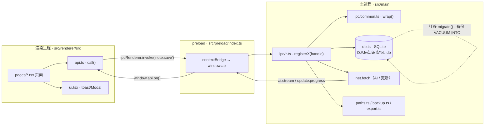
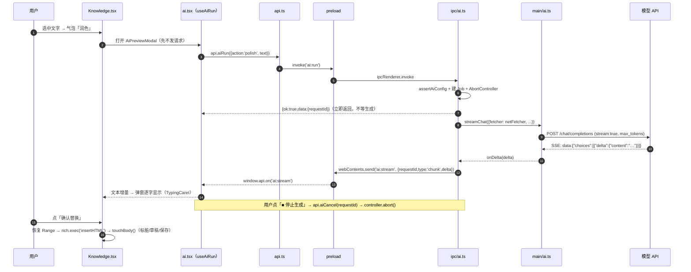
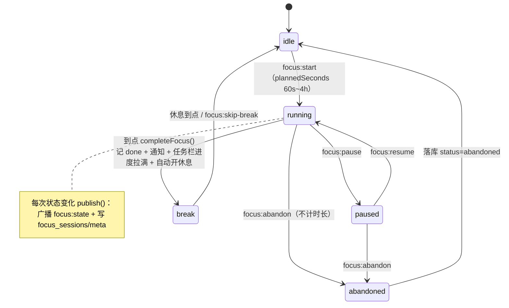
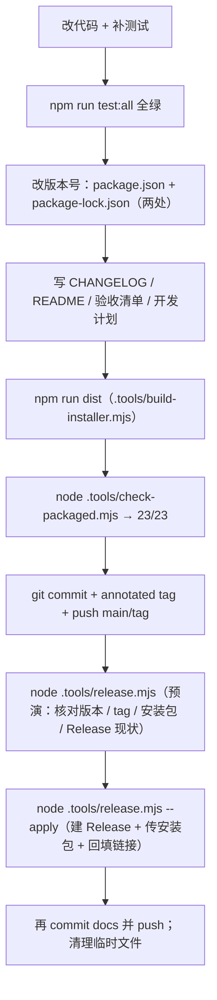

# Jw 知识库 · 架构与开发者导航指南

> 目标读者：**第一次接手这个仓库的人**。看完这份文档，你应该能在 30 分钟内跑起项目、说清每个「我想改 X」该动哪个文件，并且知道哪些地方动了会放倒别人的数据。
> 所有路径与行号都来自当前提交（0.9.2），并经过 `.tools/check-guide.cjs` 机器校验（见文末《路径核对报告》）。
> 约定：`路径:行号` 指**该行所在文件**；行号是本仓库当前 HEAD 的真实行号，重构后需要同步更新。

---

## 目录

| # | 章节 | 你会得到什么 |
|---|---|---|
| 1 | 极速上手与环境重置 | 跑起来、隔离数据、一键重置 |
| 2 | 架构决策记录（ADR） | 7 个「为什么」，防止盲改 |
| 3 | 代码导航地图 | 「我想改 X → 去这」对照表 |
| 4 | 核心架构与流转图 | 进程边界 + 两张 Mermaid 图 |
| 5 | 隐形全局逻辑 | 错误兜底、设计令牌、env 注入 |
| 6 | 跨平台与运行限制 | Windows 绑定清单、Mac/Linux 会挂什么 |
| 7 | 调试与故障排查 | 日志在哪、常见坑怎么跑 |
| 8 | 开发防坑与工程红线 | 安全、Electron、性能、事务 |
| 9 | 拓展 Recipes 与测试准入 | 加表/加通道/加页面/加断言 |
| 10 | 打包发布与技术债 | 发版 SOP + 最脆弱模块 |

---

## 1. 极速上手与环境重置（Day 1 SOP）

### 1.1 环境要求

| 项 | 值 | 依据 |
|---|---|---|
| 操作系统 | Windows 10/11 x64（本项目只针对 Windows 交付） | `electron-builder.yml:31-32` |
| Node.js | v24.x（本机实测 `v24.19.0`，`npm 11.17.0`） | `README.md:142` |
| Electron | 44.8.0（自带 Node 24 运行时；**主进程代码不依赖系统 Node 版本**） | `package.json:26` |
| 原生依赖 | 无（`node:sqlite` 内置，不需要编译 native 模块） | `package.json:33-39` |
| 亚克力材质 | Windows 11 build ≥ 22000 才生效，否则纯 CSS 渐变兜底 | `src/main/index.ts:115-119` |

### 1.2 安装与启动

```powershell
npm install                          # .npmrc 已把源指向 npmmirror，缓存也落在工作区
$env:JWKB_DATA_DIR = "C:\Users\29785\Desktop\Jw的app\.dev-data"
npm run dev                          # electron-vite dev：主进程热重启 + 渲染层 HMR
```

- 依赖源与缓存全部在工作区内（`\.npmrc:1-7`），避免沙箱下写 `%LOCALAPPDATA%` 失败。
- 如果 `npm install` 卡在 Electron 二进制下载，跑 `node .tools/fetch-electron.mjs`（`.tools/fetch-electron.mjs:1-18`）手动落盘到 `.electron-cache/`。
- 开发模式渲染层地址来自 `process.env.ELECTRON_RENDERER_URL`（`src/main/index.ts:179-184`），由 electron-vite 注入，**你不需要手动设**。

### 1.3 数据隔离红线（不要污染真实库！）

数据根目录解析优先级（`src/main/paths.ts:60-78`）：

1. 环境变量 `JWKB_DATA_DIR`（开发/测试专用）— `src/main/paths.ts:68`
2. `%APPDATA%\Jw知识库\locator.json` 里记录的路径 — `src/main/paths.ts:22-24`
3. 默认 `D:\Jw知识库` — `src/main/paths.ts:13`
4. 都不可写 → 退到 `app.getPath('userData')\data` — `src/main/paths.ts:74-77`

**红线三条**：

- 开发/测试**一律**设 `JWKB_DATA_DIR` 指到仓库内被 `.gitignore` 忽略的目录（`.dev-data/`、`.e2e-data/`、`.kill-data/`、`.pack-data/`），见 `.gitignore:12-27`。
- 设了 `JWKB_DATA_DIR` 时主进程**不会**写 locator（`src/main/index.ts:313`），所以不会把开发路径写进你的真实环境。
- **绝对不要**把 `JWKB_DATA_DIR` 指到 `D:\Jw知识库`、`%APPDATA%\Jw知识库` 或 `C:\JwKB`：那三处是用户真实数据与交付产物。

### 1.4 本地数据重置（弄坏了怎么回到初始状态）

各测试/开发目录都是「自清理」的：每次跑测试脚本先把目录删掉再重建。

| 目录 | 谁在用 | 重置命令 |
|---|---|---|
| `.dev-data/` | `npm run dev`（你手动设的） | `Remove-Item -Recurse -Force .dev-data` |
| `.e2e-data/` | e2e（每次启动前自删） | `tests/e2e/cdp-check.mjs:23` 自动重置 |
| `.kill-data/` | 强杀测试（自删） | `tests/e2e/kill-test.mjs:21` 自动重置 |
| `.pack-data/` | 打包产物自检（自删） | `.tools/check-packaged.mjs:16` 自动重置 |

删掉目录后下一次启动会自动重建：`openDatabase()` 里依次跑 `migrate()` → `ensureDefaultCategories()` → `purgeExpiredTrash()`（`src/main/db.ts:291-301`）。**只需要 `kb.db` 归零时**：删 `kb.db`（以及同目录的 `kb.db-wal`、`kb.db-shm`），但保留 `attachments/`，否则笔记里的图片会全部变成「附件不在了」（`src/main/index.ts:58`）。想留后路就先在设置页点「立即备份」（`src/main/backup.ts:53`）。

### 1.5 常用命令

| 命令 | 做什么 | 坑 |
|---|---|---|
| `npm run typecheck` | `tsc --noEmit`，必须 0 错 | — |
| `npm run test:unit` | Vitest 29 个文件（含真临时库） | 用 `tests/stubs/electron.ts` 顶替 electron（`vitest.config.ts:9`） |
| `npm run build` | 产出 `out/` | **`test:e2e` 不会自动 build**，跑 e2e 前必须先 `build` |
| `npm run test:e2e` | 真启动 Electron + CDP 驱动（305 条） | 需要能创建命名管道（沙箱要放宽） |
| `npm run test:kill` | 写数据后强杀、重启校验（6 条） | 同上 |
| `npm run test:all` | 上述按序全跑 | 最稳的一键验收 |
| `npm run dist` | 打安装包 + 绿色版到 `C:\JwKB` | 见 §10 |
| `npm run release` | 发 GitHub Release：预演（只读）核对版本/tag/安装包；真发用 `node .tools/release.mjs --apply`（Windows PowerShell 5.1 会把 `npm run release -- --apply` 里的 `--apply` 吞掉，只剩预演） | 见 §10.1，脚本 `.tools/release.mjs` |

---

## 2. 架构决策记录（ADR）

> 这一节回答「为什么不能随便换掉它」。每条都给出**当前实现位置**、**为什么**、**换掉会付出什么**。

### ADR-1 数据库用 SQLite（WAL + FTS5），不用 JSON 文件

- 实现：`src/main/db.ts:291-301` 打开时 `journal_mode=WAL`、`synchronous=NORMAL`、`foreign_keys=ON`、`busy_timeout=5000`；表结构在 `src/main/schema.ts:9`（20 张表 + 1 张 FTS5 虚表 `note_fts`；schema 版本 `SCHEMA_VERSION = 7`）。
- 为什么：
  1. 这个应用是「**逐条写入、随时断电**」的使用方式（README 里的「数据不丢七条保障」），JSON 全量重写无法保证原子性；
  2. 需要跨表一致性（笔记/标签/附件/版本点/复习卡互相引用），外键 + 事务是刚需；
  3. 需要中文全文搜索 → FTS5 虚表 `note_fts`（`src/main/schema.ts:233`）+ `searchNotes()`（`src/main/db.ts:791`）；
  4. 备份可以直接 `VACUUM INTO` 出一致快照（`src/main/backup.ts:53-92`），不用停写。
- 代价：**每次改表都要写迁移**，且升级必须幂等（`src/main/db.ts:218-280`）；老库形态要靠 `addColumnIfMissing()`（`src/main/db.ts:159`）。
- 替代方案为什么不行：JSON/低代码方案会在「强杀进程不丢数据」验收项（`tests/e2e/kill-test.mjs:1-10`）上直接失败。

### ADR-2 状态管理：不引 Redux/Zustand，用「hash 路由 + 页面自取数 + App 少量全局 state」

- 实现：路由 `src/renderer/src/App.tsx:39-50`（监听 `hashchange`，`navigate()` 只改 hash）；页面切换在 `src/renderer/src/App.tsx:338-346`；全局只有 6 个 state：`route/collapsed/inboxCount/openNoteId/searchOpen/theme/drawerOpen`（`src/renderer/src/App.tsx:125-131`）。数据统一由页面在 `useEffect` 里 `api.xxx()` 拉取（如 `Knowledge.tsx:264` 的 `loadList`）。
- 为什么：
  1. 单窗口、9 个页面、页面间共享状态极少（只有主题、侧栏折叠、收集箱角标、跨页打开笔记）；
  2. 数据「真相」在 SQLite，前端缓存越多越容易和库里不一致（这个项目历史上踩过「改完不刷新」的坑）；
  3. 少一层依赖 = 少一次升级冲突，作者能读懂全部代码。
- 代价：**prop drilling**（`navigate`/`refreshCount` 逐层传，`App.tsx:338-346`）；页面内大组件状态多（`Knowledge.tsx` 有 20+ 个 `useState`）。
- 什么时候该换：页面间需要共享「正在编辑的笔记」这类连续状态，或者出现三处以上 `refreshCount` 级联时，再引 Context/Zustand。

### ADR-3 API Key 用 `safeStorage` 加密存 SQLite，绝不明文进渲染层

- 实现：`src/main/ipc/ai.ts:30-70` —— `ai.apiKeyEnc` 存 `safeStorage.encryptString(key).toString('base64')`；`readApiKey()` 用 `decryptString` 还原；渲染层只能拿到 `publicConfig()` 的 `hasKey/keyHint`（`src/main/ipc/ai.ts:82-95`）。
- 为什么：Key 等价于钱（模型调用额度）。Windows 上 `safeStorage` 走 DPAPI，**同机同用户**才能解密；即使 `kb.db` 被拷走也解不开。渲染层一旦持有明文 Key，任何 XSS/恶意插件都能顺手带走。
- 代价：换电脑/换 Windows 用户后需要重新填 Key（符合直觉）；`isEncryptionAvailable()===false` 时退化为明文存储（`src/main/ipc/ai.ts:38-68`），此时设置页会显示「未加密」提示。
- 红线：**任何新功能都不许把 Key 读进渲染层**；不要在日志里打印 Key（`src/main/ai.ts` 里统一用 `redactSecret()`/`maskAiKey()`）。

### ADR-4 所有网络请求只在主进程（`net.fetch`），渲染层零网络

- 实现：主进程只有 5 个联网点：AI（`src/main/ipc/ai.ts:96`）、更新检查（`src/main/ipc/update.ts:23`）、安装包下载（`src/main/ipc/update.ts:48`）、附件协议回读（`src/main/index.ts:59`）、以及单测可注入的抽象（`src/main/ai.ts:28-36`）。
- 渲染层约束：CSP `default-src 'self'`（`src/renderer/index.html:14-17`），构建时进一步把 `connect-src` 收成仅 `'self'`（`electron.vite.config.ts:8-18`）。
- 为什么：超时、取消、重试、白名单、Key、打码日志集中在一处；渲染层拿不到任意 URL；e2e 能把 fetcher 换成 stub（`tests/e2e/cdp-check.mjs:26-59`）而**不真联网、不花钱**。
- 代价：流式输出必须「invoke 启动 + 事件推送」两段式（见 §4.2 时序图），比前端 `EventSource` 啰嗦。
- 校验命令（0 处命中即为合规）：在 `src/renderer` 里搜 `fetch(` / `XMLHttpRequest` / `axios`。

### ADR-5 笔记正文用 `contenteditable + execCommand`，不用 CodeMirror/ProseMirror

- 实现：编辑器容器 `src/renderer/src/pages/Knowledge.tsx:1639`；工具条 `Knowledge.tsx:1411-1610`；底层命令封装在 `src/renderer/src/rich.ts:24-72`（`exec/bold/italic/insertTable…`）。
- 为什么：
  1. 需求是「所见即所得 + 粘图 + 表格 + 颜色高亮」，`contenteditable` 原生支持；
  2. 原生撤销栈可用 → AI 摘要插入后一次 `Ctrl+Z` 能整块撤掉（`Knowledge.tsx:793-818`，依赖浏览器 undo）；
  3. 没有引入重型编辑器依赖（ProseMirror/TipTap 会显著增加包体和复杂度）。
- 代价：必须自己洗 HTML —— 所有入库 HTML 都过 `sanitizeHtml()`（`src/shared/html.ts:201`，白名单在 `:86-124`）；`execCommand` 已被标准标为废弃但 Chromium 仍稳定支持。
- 现状：`package.json:34-36` 仍声明了三个 CodeMirror 依赖，但 `src/` 里**没有任何 import**（实测 grep 0 命中）——属于历史遗留，见 §10 技术债。

### ADR-6 IPC 统一信封 + 单点注册（133 个通道）

- 实现：`Result<T> = {ok:true,data}|{ok:false,error}`（`src/main/ipc/common.ts:5`）；`wrap()` 统一 try/catch 并 `console.error('[IPC] 处理失败：')`（`src/main/ipc/common.ts:20-29`）；所有域在 `src/main/ipc/index.ts:16-49` 里一次性注册；preload 把 `invoke` 解包成「成功返回 data、失败 throw Error」（`src/preload/index.ts:13-23`）。
- 为什么：渲染层永远不用判断两套错误形态；`ipcMain.removeHandler(channel)` 让重复注册幂等（`src/main/ipc/index.ts:18-21`），e2e 多次启动不冲突；错误文案能直接给用户看。
- 代价：错误没有结构化 error code（只有中文 message），需要分类时靠文案前缀（如 AI 配置错误，`src/shared/ai.ts:221` 的 `classifyAiConfigError`）。
- 通道规模（机器统计）：**133** 个；按域：notes 25、goals 20、review 15、tasks 15、system 15、plans 11、focus 7、update 6、ai 5、core 3、github 9、export 2。

### ADR-7 e2e 用「自写 CDP 客户端」驱动真 Electron，不用 Playwright

- 实现：`tests/e2e/cdp-check.mjs:243-307`（`class Cdp`：`send/eval/shot`），断言脚本是一整段在渲染层里执行的 `CHECK_SCRIPT`（`:309` 起），`rec(name, ok, detail)` 收集结果（`:311`）。
- 为什么：零新增依赖；能直接驱动**打包后的**应用（`node_modules/electron/dist/electron.exe`，`:17`）；用真实 `window.api` 走完 preload→IPC→SQLite 全链路；同一套 harness 还能跑「强杀恢复」和「打包产物自检」。
- 代价：单文件 5711 行、断言之间共享浏览器状态（顺序敏感）、失败定位靠日志（见 §7）。见 §10 技术债。

---

## 3. 代码导航地图（「我想改 X，去哪？」）

| 我想改… | 去这里 | 备注 |
|---|---|---|
| **配色/主题/圆角/字体** | `src/renderer/src/styles.css:6`（`:root` 令牌）、`:100`（`[data-theme='dark']`）；主题切换 `src/renderer/src/App.tsx:156-166` | 只吃 CSS 变量；不要硬编码颜色 |
| **毛玻璃质感** | `src/renderer/src/styles.css:2730` `.glass`；令牌 `:66-98` | 深色令牌在 `:100-160` |
| **拖拽窗口的标题栏区域** | `src/renderer/src/styles.css:2757`（`-webkit-app-region: drag`）、`:2768`（no-drag 白名单） | 新按钮要显式加 `no-drag`，否则点不动（0.8.1 的番茄钟就是踩这个坑） |
| **全局快捷键** | `Ctrl+K/N/1-9`：`src/renderer/src/App.tsx:208-227`；快速记录全局热键：`src/main/index.ts:331`；托盘菜单加速键：`src/main/index.ts:255` | Esc 关闭在 `src/renderer/src/ui.tsx` 的 Modal 内 |
| **编辑器快捷键（Ctrl+B/Ctrl+S 等）** | 保存：`src/renderer/src/pages/Knowledge.tsx:387-394`；工具条按钮：`Knowledge.tsx:1411-1610` | 按钮用 `onMouseDown={e=>e.preventDefault()}` 防失焦 |
| **AI 的提示词（Prompt）** | `src/main/ai.ts:170`（`SYSTEM_PROMPT`）+ `:178-260`（每个动作的 user prompt） | 改完跑 `tests/unit/ai-client.test.ts` |
| **AI 的模型参数（max_tokens/温度/超时）** | `src/shared/ai.ts:56`（`aiMaxTokens`）；超时 `src/main/ai.ts:22`（`AI_TIMEOUTS`）；请求体 `buildChatRequest` 在 `src/main/ai.ts` 内 | 3 道超时闸：响应头 10s / 空闲 60s / 总 180s |
| **AI 的设置页 UI** | `src/renderer/src/pages/Settings.tsx:545`（`.ai-settings-card`）；保存/测试连接：`:241`、`:266` | Key 从不回填到输入框 |
| **AI 划词气泡/弹窗组件** | `src/renderer/src/ai.tsx`：`useAiRun()` `:51`、`AiBubble` `:180`、`AiPreviewModal` `:223`、`AiSummaryModal` `:354`、`AiTagsModal` `:487`、`AiRelatedModal` `:640`、`AiPrivacyModal` `:751` | 样式 `.ai-*` 在 `styles.css` 末尾 |
| **番茄钟（规则/计时/休息）** | 共享常量 `src/shared/focus.ts:7-13`；主进程引擎 `src/main/focus.ts:83`；IPC `src/main/ipc/focus.ts`；悬浮球 UI `src/renderer/src/focus.tsx:73`、`:312`；位置纯函数 `src/renderer/src/fabPos.ts:77-119` | 计时**只在主进程**，渲染层每秒重算显示 |
| **安装包图标 / 应用名 / 安装行为** | `electron-builder.yml:32`（ico）、`:50`（artifactName）、`:38-53`（NSIS）；图标生成脚本 `.tools/gen-icon.mjs`；NSIS 定制 `resources/installer.nsh` | 改完要 `npm run dist` 重打 |
| **数据表结构** | `src/main/schema.ts:9`（`SCHEMA`）、`:245`（`FOCUS_SCHEMA` 是「加表」的最好范例） | 别忘了 `db.ts:156` 的版本号和迁移分支 |
| **新增 IPC 通道** | 域文件 `src/main/ipc/*.ts` + 注册 `src/main/ipc/index.ts:37-47` + 渲染层封装 `src/renderer/src/api.ts:111` | 事件型通道还要加 `src/preload/index.ts:3-11` 白名单 |
| **改 GitHub 项目导入 / 授权** | 主进程 `src/main/github.ts`（fetchRepoInfo、Device Flow）、`src/main/repo-extract.ts`（AI 提炼 + 并发限流）、`src/main/ipc/github.ts`（通道）、渲染层 `src/renderer/src/pages/Inbox.tsx`（导入弹窗 + 卡片）与 `src/renderer/src/github.tsx`（授权卡） | 提炼链路见 §5.5；Token 加密见 ADR-3 |
| **导出为 Markdown** | HTML→MD：`src/main/html-to-md.ts:313`；目录/文件名/图片拷贝：`src/main/export.ts:109`；IPC：`src/main/ipc/export.ts:26`；UI：`Settings.tsx:313`、`:435` | e2e 用 `JWKB_EXPORT_DIR` 跳过系统对话框 |
| **备份 / 恢复 / 数据库自检** | `src/main/backup.ts:29`（列表）、`:53`（备份）、`:94`（每日）、`:111`（恢复）、`:136`（删除）；IPC `src/main/ipc/system.ts:39-52` | 恢复前自动备份当前库，可反悔 |
| **检查更新 / 下载安装包** | 检查：`src/main/update.ts:132`；下载+SHA256：`src/main/updater.ts:78`；IPC：`src/main/ipc/update.ts`；URL 白名单 `:31-45` | 测试用 `JWKB_UPDATE_URL` / `JWKB_UPDATE_DRYRUN` |
| **密码学相关（加密/解密）** | 只有一处：`src/main/ipc/ai.ts:38-70`（`safeStorage`） | 没有其它加密需求 |
| **应用启动顺序 / 单实例 / 托盘 / 全局异常** | `src/main/index.ts:301-375` | 启动失败弹 `dialog.showErrorBox` 后 `app.exit(1)` |

---

## 4. 核心架构与可视化流转

### 4.1 进程边界与物理路径

| 进程 | 物理位置 | 能做什么 | 禁止做什么 |
|---|---|---|---|
| Main（Node + Electron） | `src/main/**`（`src/main/index.ts` 是入口；`package.json:7` 指向 `out/main/index.js`） | SQLite、文件系统、`net.fetch`、托盘/通知/全局热键、`safeStorage` | 直接渲染 HTML（没有 DOM） |
| Preload（隔离上下文） | `src/preload/index.ts` | 只暴露 `invoke/on/pathForFile` 三个方法（`:13-45`） | 暴露 `ipcRenderer` 本体或 Node API |
| Renderer（Chromium） | `src/renderer/src/**`（入口 `src/renderer/src/main.tsx`） | React 界面、`window.api` 调用 | 联网、读写文件、拿明文 Key |
| Shared（纯逻辑，双端共享） | `src/shared/**` | 类型、HTML/Markdown 清洗、时钟格式化、AI 协议常量 | import `electron` 或 DOM 之外的东西 |

窗口参数（关键安全项）：`contextIsolation: true`、`nodeIntegration: false`、`sandbox: false`（`src/main/index.ts:141-147`，preload 需要 Node 能力所以关了 sandbox，改这块要非常小心）。



### 4.2 时序图：点「AI 润色」→ 流式逐字返回 → 确认替换

关键点：`ai:run` **立刻**返回 `requestId`，正文通过 `ai:stream` 事件推回来；渲染层`useAiRun` 用 `requestId` 过滤，避免多窗口串台（`src/renderer/src/ai.tsx:51-115`）。主进程 `streamChat` 在 `src/main/ai.ts:517`，IPC 编排在 `src/main/ipc/ai.ts:114-200`。



### 4.3 全局状态流转：番茄钟为什么「切页不丢」

- 唯一真相在主进程：`createFocus(deps)` 的 `state`（`src/main/focus.ts:83`），进行中的会话 id 存在 `meta` 表的 `focus:current`（`src/main/db.ts:2371`）。
- 任何变化都走 `publish()`：广播 `focus:state` + 落库（`src/main/ipc/focus.ts` 里 `emit` 遍历所有窗口）。
- 渲染层 `FocusDock` 订阅事件、只保存快照，每秒按 `endAt - now` 重算显示（`src/renderer/src/focus.tsx:73` 起）；切页/最小化/刷新都不会打断计时。
- 应用重启后 `runtime.restore()`（注册 IPC 时执行，`src/main/ipc/focus.ts`）把进行中的会话接回来，残留会话收成 `abandoned`，且不计入统计。



其余「跨页状态」都在渲染层 App：主题（`App.tsx:156`）、侧栏折叠（`:123`）、收集箱角标（`:124`，各页 save 后调 `refreshCount`）、跨页打开笔记（`:125`，首页/收集箱点笔记 → `navigate('/knowledge')` + `openNote`）。

---

## 5. 隐形全局逻辑（防踩坑）

### 5.1 错误捕获：**没有**全局兜底，这是已知缺口

| 层次 | 现状 | 位置 |
|---|---|---|
| 主进程启动失败 | `app.whenReady().then(startup).catch(...)` → `dialog.showErrorBox` + `app.exit(1)` | `src/main/index.ts:344-355` |
| IPC 调用异常 | `wrap()` 统一 catch → 日志 `[IPC] 处理失败：` + `{ok:false,error}` | `src/main/ipc/common.ts:20-29` |
| 渲染层业务异常 | 每个 `catch` 手动 `toastError()` / `errText()` | `src/renderer/src/errors.ts:11-21` |
| 保存失败分诊 | `describeSaveError()` 把 SQLITE_BUSY/EACCES/ENOSPC 翻成人话 | `src/renderer/src/save.tsx:24-45` |
| ErrorBoundary / `window.onerror` / `unhandledrejection` / `uncaughtException` | **均不存在**（全仓 grep 0 命中） | 加兜底前先看 §10 P2 |

> 实践后果：未捕获的渲染层异常会白屏且无提示；新增异步代码时必须自己 `try/catch` 并用 `toastError`。

### 5.2 设计令牌与 `.glass`

- 浅色令牌：`src/renderer/src/styles.css:6-98`（`--bg/--text/--brand/--radius/--shadow/--spring-ease/--sidebar-w` 等）。
- 深色令牌：`src/renderer/src/styles.css:100-160`（挂载在 `<html data-theme="dark">`，由 `App.tsx:156` 设置）。
- 毛玻璃：`src/renderer/src/styles.css:2730` `.glass`（配 `--glass-bg/--glass-border/--glass-blur`，`:78-81`）。
- 时间常量与 CSS 对齐：`src/renderer/src/timing.ts:8-35`（改动画时长要两处一起改，注释里标了「跟 CSS 对齐」）。
- 布局断点：`readLayout()` 返回 `wide|rail|drawer|single`（`src/renderer/src/App.tsx:57-65`），侧栏宽度令牌 `--sidebar-w: 232px` / `--rail-w: 60px`（`styles.css:60-64`）。

### 5.3 环境变量怎么进来

- 没有 `dotenv`、没有构建期变量注入到渲染层。主进程直接读 `process.env`：
  - `JWKB_DATA_DIR`（`src/main/paths.ts:68`）、`JWKB_UPDATE_URL` / `JWKB_UPDATE_DIR` / `JWKB_UPDATE_DRYRUN`（`src/main/ipc/update.ts:34,69,74`）、`JWKB_EXPORT_DIR`（`src/main/ipc/export.ts:29`）、`JWKB_FOCUS_MIN_SECONDS`（`src/main/focus.ts:60`）。
  - 打包期脚本另有 `JWKB_OUT_DIR`/`JWKB_BUILD_DIR`（`.tools/build-installer.mjs:28-31`、`README.md:179`）和 `JWKB_EXE`（`.tools/check-packaged.mjs:11`）。
- 渲染层唯一的环境差异是 dev 地址（`ELECTRON_RENDERER_URL`），且只在主进程用（`src/main/index.ts:179`）。
- GitHub 集成另有三个测试/自建 App 用的变量：`JWKB_GITHUB_CLIENT_ID`（OAuth App 的 Client ID）、`JWKB_GITHUB_API_BASE`、`JWKB_GITHUB_OAUTH_BASE`（默认 `https://api.github.com` / `https://github.com`，e2e 指向本地 stub），读取点在 `src/main/ipc/github.ts` 的 `clientIdOf/apiBase/oauthBase`。
- 构建时 CSP 收紧（dev 放开 ws/localhost，构建只留 `'self'`）：`electron.vite.config.ts:8-18`。

### 5.4 附件协议 `jw-att://`

笔记正文里 ``，主进程把它映射到数据目录真实文件，并做「只在数据目录内」的越界检查（`src/main/index.ts:40-61`）。改附件路径逻辑要同时动 `src/shared/html.ts:22-49`（`attachmentUrl/attachmentRelFromUrl`）。

### 5.5 GitHub 项目导入的清洗、提炼与并发锁

- 地址清洗是**入口唯一闸门**：`parseRepoUrl()`（`src/shared/github.ts`）把脏 URL 收成 `owner/repo`；非法地址抛中文错误，**不发任何请求**。
- 拉取只走主进程：`fetchRepoInfo()`（`src/main/github.ts`）拿仓库元信息 + README（截 `GITHUB_README_LIMIT = 8000` 字符）；README 404 不算失败。
- AI 提炼是**非流式**一次性返回（`src/main/repo-extract.ts` 的 `extractRepoNote`），Prompt 在 `src/main/ai.ts` 的 `buildRepoExtractMessages()`，含「严禁编造 README 中未提及的技术栈」与字数硬限。
- 并发锁是**计数限流器**（`RepoExtractLimiter`，上限 `GITHUB_MAX_EXTRACT_JOBS = 2`）：`acquire()` 满了抛「同时最多提炼 2 个项目，请等待当前任务完成」，`release()` 必须在 `finally` 里调。
- 失败降级：先落 `inbox_item` 再提炼；AI 报错时 `extract_status = ai_failed`，条目与 Markdown 都保留，卡片给「重试提炼」（`github:retry-extract`）。
- 转笔记：`github:convert-note` 用 `db.createNote({ plain })` 把完整 YAML + Markdown 存进 `note.content`，正文 HTML 走 `renderRepoNoteHtml()` + `sanitizeHtml()`。

---

## 6. 跨平台与运行限制

| Windows 绑定项 | 位置 | 在 mac/Linux 的后果 |
|---|---|---|
| NSIS 安装包（`electron-builder --win`） | `package.json:19`、`electron-builder.yml:31-53` | `npm run dist` 直接失败；只能 `npm run build` 跑渲染层 |
| DPAPI 加密 Key（`safeStorage`） | `src/main/ipc/ai.ts:38-70` | Linux 需要 libsecret，未装则 `isEncryptionAvailable=false` → 退化为明文（会显示「未加密」） |
| 自绘标题栏 + 红黄绿灯 | `src/main/index.ts:135`、`src/renderer/src/App.tsx:96-123`、`styles.css:2757` | 行为可跑，但视觉与系统习惯不一致；`-webkit-app-region` 在 Linux 上表现不同 |
| Windows 11 亚克力材质 | `src/main/index.ts:115-119,149-159` | 自动退回 CSS 渐变，不报错 |
| 托盘图标 16px 缩放 | `src/main/index.ts:75-78` | mac 菜单栏图标规范不同，需另出模板图 |
| e2e/强杀/打包自检 | `tests/e2e/cdp-check.mjs:17`、`kill-test.mjs:16`、`.tools/check-packaged.mjs:11` | 硬编码 `node_modules/electron/dist/electron.exe`，mac 上要先改可执行名 |
| 构建镜像（npmmirror） | `\.npmrc:1-7` | 境外机器可去掉 mirror；Electron 二进制下载失败用 `.tools/fetch-electron.mjs` |
| 全局热键 `Ctrl+Alt+Space` | `src/main/index.ts:331` | mac 沿用 Control 语义，用户会不习惯 |

**结论**：这个仓库的源码是「Electron 跨平台写法」，但**交付物和测试链路是 Windows-only**。想在 mac 上开发，至少先改三个测试脚本的 exe 路径，并且不要指望 `dist` 能跑通。

---

## 7. 调试与故障排查

### 7.1 日志与现场在哪

| 现场 | 位置 | 怎么看 |
|---|---|---|
| 主进程 stdout/stderr（dev） | 终端 | `npm run dev` 直接打印；IPC 异常带前缀 `[IPC] 处理失败：` |
| e2e 主进程日志 | 子进程 `stdio: 'inherit'`（`tests/e2e/cdp-check.mjs:219`） | 跟着终端输出；失败断言会打印 detail |
| e2e 结果快照 | `tests/e2e/last-result.txt` | 每次跑完覆盖，含逐条 PASS/FAIL 与 detail |
| 强杀测试结果 | `tests/e2e/last-kill-result.txt` | 同上 |
| 界面截图 | `tests/e2e/shots/*.png`（约 50 张） | 失败时先看对应页截图；`cdp.shot()` 在 `:293-306` |
| 打包产物自检结果 | `.tools/last-packaged-result.txt`、`tests/e2e/last-result.txt` | `.tools/check-packaged.mjs` 每次运行覆盖写（临时 `.log` 不入库，`.gitignore` 已拦） |
| 数据库完整性 | 设置页「数据库自检」（`src/main/db.ts:329`） | 返回非 `ok` 时日志 `[数据] 完整性检查未通过`（`src/main/index.ts:320-322`） |

### 7.2 常见坑逐个破

| 现象 | 根因 | 处理 |
|---|---|---|
| e2e 报 `No handler registered for 'xxx'` 或按钮不存在 | 跑了旧 `out/`（`test:e2e` 不 build） | 先 `npm run build`，或直接 `npm run test:all` |
| e2e 卡在 `等不到渲染进程调试目标` | 端口 9333 被占用，或 Electron 已崩 | 关掉残留进程；强杀脚本用 9334、打包自检用 9335（`kill-test.mjs:16`、`check-packaged.mjs:17`） |
| `npm install` 卡在 electron 下载 | 访问不到 github | `.npmrc` 已配镜像；仍失败用 `node .tools/fetch-electron.mjs` |
| 安装包双击报 `Error writing temporary file` | 安装包放在项目目录（沙箱 ACL 拒绝删除） | 必须从 `C:\JwKB\setup\` 运行（`README.md:181-187`、`.tools/build-installer.mjs:1-20`） |
| `makensis: !tempfile: Unable to create temporary file` | 中文路径 | 打包走英文暂存目录（`JWKB_BUILD_DIR`，`.tools/build-installer.mjs:28-31`） |
| 保存报「数据文件被其他软件占用」 | SQLite 被另一个实例/编辑器锁住 | 关掉别的程序；单实例锁在 `src/main/index.ts:301` |
| 界面白屏且无报错 | 没有 ErrorBoundary（§5.1） | 开 DevTools（dev 模式）看 Console；临时在 `main.tsx` 加 `window.onerror` |
| 改了 CSS 不生效 | 样式为追加式，多段同名规则靠特异性覆盖 | 搜同名类出现多处（如 `.sidebar` 在 `styles.css:222/1874/2845/3225`），确认你改的是最终生效那段 |
| 番茄钟拖到标题栏区域点不动 | 顶部 52px 是 `-webkit-app-region: drag` 系统拖拽区 | 已在 0.8.1 加安全区（`src/renderer/src/fabPos.ts:28`）与 `no-drag`（`styles.css:4590-4603`）；新浮层同理 |

---

## 8. 开发防坑与工程红线

### 8.1 密钥与数据**永不入库**

`.gitignore:2-40` 已覆盖：`node_modules/`、`out/`、各测试数据目录（`.e2e-data/`、`.kill-data/`、`.pack-data/`、`.dev-data/`）、`*.log`、交付目录副本（`/Jw知识库安装包/`、`/Jw知识库（绿色版）/`、`/Jw知识库数据备份-*/`）、本机插件目录（`/dsh-memory-plugin/`）。

真实数据在仓库外（`D:\Jw知识库` 或 `%APPDATA%\Jw知识库`），API Key 只以加密形态存在 SQLite 的 `meta.ai.apiKeyEnc`（§ADR-3）。提交前自查：

```powershell
git status --porcelain                   # 不应出现 .dev-data / *.db / .env
git grep -n -I "sk-" -- . ':!*.md'       # 不应命中真实 Key
```

### 8.2 Electron 安全

- `contextIsolation: true` + `nodeIntegration: false`（`src/main/index.ts:143-144`）：页面拿不到 `require`。
- 渲染层没有 `ipcRenderer`，只有 `window.api.invoke/on/pathForFile`（`src/preload/index.ts:13-45`），事件通道白名单在 `:3-11`——**新增事件必须进白名单**，否则 `on()` 直接抛「未开放的事件通道」。
- 所有网络在主进程（§ADR-4），CSP 默认 `default-src 'self'`（`src/renderer/index.html:14-17`）。
- 外链一律 `shell.openExternal` 且拒绝新窗口（`src/main/index.ts:174-177`）。
- 更新下载有三道闸：URL 白名单、目录校验、大小+SHA256（`src/main/ipc/update.ts:31-45`、`src/main/updater.ts:78`）。

### 8.3 UI 性能

- 侧栏收起/展开、悬浮球拖动都只动 `transform`/`opacity`，不碰 `left/top/width`（悬浮球：`styles.css:4590-4603` + `src/renderer/src/focus.tsx` 里写 `style.transform`）。目的：只触发合成层，不触发布局重排。
- 拖动用 Pointer Events + `setPointerCapture`，松手/窗口失焦统一收尾（`src/renderer/src/focus.tsx` 里 `onFabPointerDown`）；位置记忆在 `localStorage` 键 `jw-focus-fab-pos`（`focus.tsx:49`），坐标换算与边界在纯函数 `src/renderer/src/fabPos.ts`（可单测）。
- 长列表/编辑器：`htmlRef` 存正文、`editorEpoch` 控制何时回填 DOM（`Knowledge.tsx:145-162`），避免每敲一个字就 `setState` 大 HTML。

### 8.4 事务一致性

批量写必须在一个事务里，否则中途失败会留下「一半的排序/一半的标签合并」。仓库里的标准写法：

```ts
// src/main/db.ts:731-744（拖动排序）
const database = requireDb();
database.exec('BEGIN');
try {
  clean.forEach((id, index) => run('update note set sort_order = ? where id = ?', index + 1, id));
  database.exec('COMMIT');
} catch (err) {
  database.exec('ROLLBACK');
  throw err;
}
```

同类实现：标签重命名合并 `src/main/db.ts:877-911`、标签删除 `src/main/db.ts:912-933`、迁移 v3 批量回填 `src/main/db.ts:244-252`、GitHub 项目落库（`src/main/ipc/github.ts` 里的 `db.addGithubInbox` / `db.updateGithubInboxExtract`）。**新写多语句操作时照抄这个形状**，不要指望 `DatabaseSync` 自动事务。

### 8.5 其它硬规矩

- `strict: true` + `noUnusedLocals/noUnusedParameters`（`tsconfig.json:10-19`）：留下没用到的变量会编译失败。
- 全仓 `as any` 命中数为 **0**（机器统计）；不要开这个口子。
- 用户可见文案一律中文、不吞异常（`src/renderer/src/errors.ts:11-21`）。
- 笔记 HTML 必须过 `sanitizeHtml()`（`src/shared/html.ts:201`），渲染时禁止直接 `dangerouslySetInnerHTML` 未经清洗的内容。
- GitHub 项目导入是**只读**的：只从 GitHub 拉仓库信息与 README，不给渲染层任何回写远端的通道；Token 只以密文存 `meta`（§ADR-3），不要把 token 放进 IPC 返回值。

---

## 9. 拓展开发 Recipes 与测试准入

### 9.1 Recipe：加一张数据表

1. 表结构写到 `src/main/schema.ts`（参考 `FOCUS_SCHEMA`，`:245-259`）。
2. `src/main/db.ts:156` 把 `SCHEMA_VERSION` +1；在 `migrate()`（`:218-280`）末尾加 `if (current < N) { database.exec(NEW_SCHEMA) }`。
3. 在 `openDatabase()` 之前建表要谨慎：`migrate()` 每次启动都会 `exec(SCHEMA)`（`:220`），新表放独立常量更安全（番茄钟就是这么做的）。
4. 补迁移单测：`tests/unit/migrate.test.ts` 里断言 `PRAGMA user_version` 等于新版本（文件里有多处 `toBe(6)`，**每处都要改**）。
5. 仓储函数加到 `src/main/db.ts`（每域一段，函数名即语义），IPC 层加通道（§9.2）。
6. 注意备份/恢复是全库快照（`src/main/backup.ts:53`），新表自动被带上，无需额外处理。

### 9.2 Recipe：加一个 IPC 通道

1. 域文件里 `handle('域:动作', (payload) => …)`（参考 `src/main/ipc/notes.ts` / `src/main/ipc/ai.ts`）；payload 类型尽量放 `src/shared/types.ts`。
2. 在 `src/main/ipc/index.ts:37-47` 注册（新域要新建 `registerX(handle)`）；错误直接 `throw new Error('中文原因')`，`wrap()` 会转成 `{ok:false}`。
3. 渲染层：`src/renderer/src/api.ts:111` 的 `api` 对象里加一行 `xxx: (p) => call('域:动作', p)`。
4. 如果是**主进程主动推送**的事件：`webContents.send('域:事件', payload)` + 把通道名加进 `src/preload/index.ts:3-11` 的 `ALLOWED_EVENTS` + 在 `api.ts` 加 `onXxx(listener)`（参考 `onAiStream` / `onGithubProgress`）。
5. 补单测（纯逻辑函数放 `src/main/*.ts` 里并注入依赖，参考 `src/main/ai.ts` 的 `AiFetcher` 设计），e2e 里用 `window.api.invoke` 真打一次。

### 9.3 Recipe：加一个新页面

1. 新建 `src/renderer/src/pages/<你的页面>.tsx`（示例名 `YourPage`，按实际页面命名），签名 `export default function YourPage(props: RouteProps)`（`RouteProps` 在 `src/renderer/src/App.tsx:19-22`）。
2. `src/renderer/src/App.tsx:24-34` 的 `NAV` 加一行（`Ctrl+1..9` 会自动按数组顺序生效，`:216-219`）。
3. `App.tsx:338-346` 的路由渲染里加 `{route === '/your' && <YourPage … />}`，并在顶部 import。
4. 样式只往 `styles.css` 末尾追加类（按现有「新增段」习惯），不要改既有类名。
5. 需要侧栏角标就在 `refreshCount` 链路外单独取；页面内数据自己 `useEffect` 拉。

### 9.4 Recipe：加一条 e2e 断言

e2e 是「在渲染层跑一大段脚本」的模式（`tests/e2e/cdp-check.mjs:309` 起）：

```js
// 在 CHECK_SCRIPT 内、按页面顺序插入（顺序敏感，别打断已有步骤）
const before = await inv('note:list', {});          // 用真实 IPC，别直接读库
rec('你的断言名', before.length === 0, JSON.stringify(before));
await cdp.shot('your-feature');                      // 截图落到 tests/e2e/shots/
```

- `rec(name, ok, detail)` 定义在 `:311`，`detail` 会被截断到 220 字符，**关键数值要自己 `JSON.stringify` 塞进去**。
- 需要独立数据就自建（如 `window.api.invoke('note:create', …)`），不要依赖前一条断言留下的现场。
- 交互类断言优先用 `Runtime.evaluate` 里点 `.click()`；需要真实鼠标才用 `Input.dispatchMouseEvent`（如 `:0.8.1 死区` 那条）。
- 慢 UI/动画断言要轮询等待，别一次读结果（仓库里已有多次抗抖动改造，见 `tests/e2e/cdp-check.mjs:293-306` 的截图重试）。

### 9.5 测试准入（提 PR / 交付前必须全绿）

| 门槛 | 命令 | 当前基线（0.11.2） |
|---|---|---|
| 类型 | `npm run typecheck` | 0 错误 |
| 单元 | `npm run test:unit` | 404 项 / 29 文件 |
| 构建 | `npm run build` | 成功 |
| 端到端 | `npm run test:e2e` | 305/305 |
| 强杀 | `npm run test:kill` | 6/6 |
| 一键 | `npm run test:all` | 以上顺序全跑 |
| 打包产物 | `npm run dist` 后 `node .tools/check-packaged.mjs` | 23/23 |

单元测试写法：`tests/unit/*.test.ts`，跑在 Node 里，`electron` 被 `tests/stubs/electron.ts` 顶替（`vitest.config.ts:9`）；数据库测试用真临时目录（`fileParallelism: false`，`vitest.config.ts:15-19`）；需要「时间」「网络」「定时器」的地方一律**注入依赖**（参考 `src/main/focus.ts:17-49` 的 `FocusDeps`、`src/main/ai.ts:28` 的 `AiFetcher`），不要在业务代码里直接 `fetch`/`setTimeout`。

---

## 10. 打包发布与技术债

### 10.1 发版 SOP（照着做，10 步）



- 版本号在 `package.json:3` 和 `package-lock.json` 顶层/`packages[""]` 共三处，漏一处会导致安装包名与界面显示不一致。
- 安装包产物：`C:\JwKB\setup\Jw知识库-安装包-<版本>.exe`、绿色版 `C:\JwKB\portable\Jw知识库.exe`（`README.md:171-177`）。
- 发 Release 别手敲 curl：`npm run release` 先预演（核对 package.json 版本、tag 是否已 push、安装包字节数与 SHA256、Release/附件现状、CHANGELOG 小节、文档占位符数量），确认后 `node .tools/release.mjs --apply` 一条命令完成「建/更新 Release（说明自动取 CHANGELOG 小节）+ 上传或替换 `JwKB-Setup-<版本>.exe` + 回填 `__REL_LINK__`/`__BYTES__`」，最后按提示 commit docs。**注意**：Windows PowerShell 5.1 里 `npm run release -- --apply` 的 `--apply` 会被 npm 当自己的参数吞掉、只跑预演（cmd.exe 下正常）；所以真发一律用 `node .tools/release.mjs --apply`。已存在的 Release 默认**不覆盖**说明（保留手写的补丁段落），要覆盖加 `--update-body`；同名字节数一致的附件会跳过重传。脚本在 `.tools/release.mjs`，token 优先读 `GITHUB_TOKEN`，否则走 `git credential fill`；内部统一 `curl.exe --ssl-no-revoke`（本机证书吊销检查会失败）。
- 发版后必跑一次安装包自检，它才是「用户真正拿到的东西」。

### 10.2 技术债直击（按优先级）

| 优先级 | 问题 | 证据 | 建议动作 |
|---|---|---|---|
| **P0** | `src/renderer/src/pages/Knowledge.tsx` 2294 行单组件：编辑器、AI、标签、分类树、版本抽屉、拖拽排序全在一个文件 | `Knowledge.tsx:42` 起；文件 85 KB | 先抽 hooks（`useNoteEditor` / `useAiActions` / `useTagActions`）+ 子组件，保持 DOM 与类名不变；每抽一步靠 e2e 305 条兜底 |
| **P0** | `tests/e2e/cdp-check.mjs` 5711 行单脚本、顺序强耦合、跑一轮数分钟 | `:309` 的 `CHECK_SCRIPT` 巨串；`rec()` 追加式 | 拆成 `specs/*.mjs` + 共享的 e2e harness 模块（Cdp/stub/rec/shot），主入口按顺序 import；断言之间禁止共享状态 |
| **P1** | `src/renderer/src/styles.css` 5149 行，同一选择器多段重复（`.sidebar` 4 段、`.modal-backdrop` 3 段），靠特异性互相覆盖 | `styles.css:222/1874/2845/3225`、`:1003/2521/3544` | 按域拆文件（tokens/base/sidebar/modal/editor/ai/focus）+ `@layer` 固定优先级；拆之前先把最终生效值写成快照测试 |
| **P1** | `src/main/db.ts` 2400 行巨型仓储，所有域混在一起 | 241 个 `export`（`db.ts:124-2387`） | 按域拆 `db/{notes,tasks,goals,review,focus}.ts`，各域 index.ts 重导出；已有单测可作护栏 |
| **P1** | GitHub 集成要用户自备 OAuth App 的 Client ID：`GITHUB_DEFAULT_CLIENT_ID` 默认空串（`src/shared/github.ts:19`），没配就报「还没配置 GitHub Client ID」 | `src/main/ipc/github.ts:59` `clientIdOf()`（env → setting → none） | 发行方注册一个公开 OAuth App 把 client id 内置（Device Flow 不需要 secret），或让用户自建 |
| **P1** | 没有 CI：所有门槛只在本地跑 | 无 `.github/workflows/` | 加 Windows runner 跑 `typecheck + unit`；e2e 目前依赖图形环境，可先只跑单测 + build |
| **P2** | 无 ErrorBoundary / 全局未捕获异常兜底 | §5.1，grep 0 命中 | 加 `ErrorBoundary` + `window.onerror/unhandledrejection` 上报到 toast + 写入 `.log`；主进程加 `process.on('uncaughtException')` 打日志后 `app.exit(1)` |
| **P2** | `App.tsx` 用 prop drilling 传 `navigate/refreshCount` 到 9 个页面 | `App.tsx:338-346` | 页面数不再增长就先不动；要加「跨页编辑态」时引一个轻 Context |
| **P2** | 3 个 CodeMirror 依赖（约 3 个包）声明但 `src/` 零 import | `package.json:34-36`；grep 0 命中；README:7 技术栈写得像在用 | 下一版移除依赖并修正 README 技术栈描述（会缩小安装包） |
| **P3** | 时间比较用「带本地时区偏移的 ISO 字符串」做字符串比较 | 如 `src/main/ipc/focus.ts` 与 `src/main/db.ts:2344` 的统计 | 跨时区/夏令时边缘会错；统一转 epoch ms 或 UTC 再比 |
| **P3** | e2e 多处靠 sleep/重试抗抖动（软件渲染下偶发丢点击） | `cdp-check.mjs:293-306`、首页可视化重测、导出重试 | 换成「等条件成立」的轮询式 helper（已有先例），逐步替换固定 sleep |
| **P3** | 没有 ESLint/Prettier 配置、没有 `engines` 字段 | 根目录无 `.eslintrc*`；`package.json` 无 engines | 加最小 ESLint（只开 no-unused-vars/eqeqeq）+ engines.node>=24 |

### 10.3 交接检查清单（新维护者第一周）

- [ ] 用 `JWKB_DATA_DIR` 跑通 `npm run dev`，确认数据写在 `.dev-data/`
- [ ] `npm run test:all` 全绿（约 5 分钟，e2e 最慢）
- [ ] 打开 `tests/e2e/last-result.txt` 看一遍断言名，理解覆盖了什么
- [ ] 读 §3 表格，手动改一处样式 + 加一条 e2e 断言，跑通
- [ ] 读 §8.4，理解为什么批量写要事务
- [ ] 读 §10.2，认领一项 P1（建议从样式拆分或 e2e 拆分开始，风险最低）

---

## 附录 A：关键文件规模（机器统计，0.9.2）

| 文件 | 行数 | 说明 |
|---|---|---|
| `src/main/db.ts` | 2400 | SQLite 访问 + 全部业务读写 |
| `src/renderer/src/styles.css` | 5149 | 全部样式（含多段历史追加） |
| `src/renderer/src/pages/Knowledge.tsx` | 2331 | 知识库页（编辑器 + AI + 标签 + 树） |
| `tests/e2e/cdp-check.mjs` | 5711 | e2e harness + 全部断言 |
| `src/renderer/src/pages/Settings.tsx` | 786 | 设置页（AI / 导出 / 更新 / 备份） |
| `src/renderer/src/ai.tsx` | 790 | AI 气泡与 5 个弹窗 |
| `src/main/ai.ts` | 741 | AI 协议、流式解析、错误文案 |
| `src/main/index.ts` | 376 | 应用启动、窗口、托盘、协议、热键 |
| `src/main/focus.ts` | 313 | 番茄钟纯引擎（可注入时钟） |
| `src/shared/types.ts` | 538 | 跨进程 DTO |
| `src/preload/index.ts` | 47 | 唯一桥接面 |

源码总量：58 个 TS/TSX 文件、17,237 行；测试：单测 24 文件 4,605 行、e2e 2 文件 5,918 行。

## 附录 B：IPC 通道按域（133 个）

| 域 | 数量 | 文件 |
|---|---|---|
| notes（分类/笔记/标签/搜索/版本/回收站） | 25 | `src/main/ipc/notes.ts` |
| goals（目标/KR/里程碑/目标池） | 20 | `src/main/ipc/goals.ts` |
| tasks（收集箱/任务/首页概览） | 15 | `src/main/ipc/tasks.ts` |
| review（复习卡/复盘） | 15 | `src/main/ipc/review.ts` |
| system（附件/备份/窗口/剪贴板） | 15 | `src/main/ipc/system.ts` |
| plans（计划/条目/日历） | 11 | `src/main/ipc/plans.ts` |
| focus（番茄钟） | 7 | `src/main/ipc/focus.ts` |
| update（检查/下载/安装） | 6 | `src/main/ipc/update.ts` |
| ai（配置/运行/取消） | 5 | `src/main/ipc/ai.ts` |
| core（app:info / settings） | 3 | `src/main/ipc/core.ts` |
| export（导出 Markdown） | 2 | `src/main/ipc/export.ts` |
| github（授权/导入/重试提炼/转笔记/解绑） | 9 | `src/main/ipc/github.ts` |

**文档维护**：改完代码顺手改这里的行号；提交前跑 `node .tools/check-guide.cjs`，它会校验本文引用的每个路径与行号是否仍然存在。
