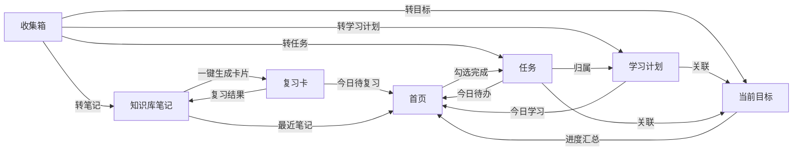

# 私人工作学习知识库 · PRD（第一版）

| 项 | 内容 |
|---|---|
| 文档版本 | v1.0 |
| 日期 | 2026-10-16 |
| 形态 | Windows 桌面单机应用（Electron） |
| 用户 | 只有一个人用，只在这台电脑上跑 |
| 数据位置 | 默认 `D:\Jw知识库` |
| 第一版范围 | 首页总览 + 快速收集箱 + 知识库分类 + 任务待办与提醒 + 设置（最小） |
| 本文作用 | 后续开发的唯一依据。与本文冲突的旧讨论以本文为准 |

---

## 1. 产品目标和使用场景

### 1.1 一句话目标

把「想法进来 → 整理成知识 → 排成任务 → 按目标推进 → 定期复习」这一条链条收进一个只跑在自己电脑上的软件里，不联网、不登录、不丢数据。

### 1.2 要解决的三件现实问题

1. **记了不用**：随手记的地方和真正整理的地方是两个工具，记完就断了，收集箱里堆着一堆没人看。
2. **各自为政**：笔记、任务、目标散在多个软件里，互相不知道对方存在；完成一件事，没有任何地方自动反映出来。
3. **学过就忘**：没有复习机制，写过的笔记再也没打开过第二次。

### 1.3 四个真实使用场景

| 场景 | 时长 | 发生的时候 | 用到的模块 |
|---|---|---|---|
| A 随手收集 | 30 秒 | 干活干到一半突然想起一件事 | 快速记录小窗 → 收集箱 |
| B 晚间整理 | 10–20 分钟 | 一天结束，清空收集箱 | 收集箱（逐条清理）→ 知识库 / 任务 / 目标 |
| C 专注写作 | 30–60 分钟 | 想认真写一篇笔记 | 知识库三栏 + 手动保存 + 版本点 |
| D 晨间俯视 | 2 分钟 | 早上开机第一眼 | 首页（今日待办 / 目标进度 / 复习提醒） |

### 1.4 产品边界（不做成什么）

- 不是多人协作工具，没有分享、没有评论、没有权限。
- 不是云端服务，没有账号体系，没有服务器。
- 不是内容采集器，不抓网页、不抓公众号、不做 AI 生成内容。
- 不是通用笔记软件，它的价值在「收集 → 整理 → 执行 → 复习」这条闭环，而不是编辑器功能多。

---

## 2. 整体页面框架和导航结构

### 2.1 窗口与外壳

- **单窗口应用**，默认尺寸 1280×820，最小 1024×680；记住上次的大小和位置。
- **左侧导航栏** 200px，可折叠成 64px 只留图标。
- **顶栏**：左侧当前页面标题，右侧「全局搜索 Ctrl+K」和「快速新建 Ctrl+N」。
- **内容区**：所有页面共用三种骨架之一（见 2.3）。
- **托盘**：关闭窗口 = 缩到右下角托盘，程序继续在后台跑（提醒才有效）。托盘图标右键菜单：打开主窗口 / 快速记录 / 今日待办 / 退出。
- **快速记录小窗**：全局热键 `Ctrl+Alt+Space`，任何时刻（即使主窗口没开）都能呼出一个输入框，回车即存进收集箱，Esc 关闭。
- **单实例**：重复双击图标不会开出第二个窗口，而是把已有窗口拉到前面。

### 2.2 导航结构

左侧导航自上而下固定 8 项，设置放最底部：

| 顺序 | 导航项 | 页面 | 骨架 |
|---|---|---|---|
| 1 | 首页 | Home | 单栏 |
| 2 | 收集箱 | Inbox | 单栏列表 |
| 3 | 知识库 | Notes | 三栏 |
| 4 | 学习计划 | Plans | 两栏 |
| 5 | 任务 | Tasks | 两栏 |
| 6 | 当前目标 | Goals | 两栏 |
| 7 | 下一阶段目标 | Pool | 两栏 |
| 8 | 复习与复盘 | Review | 单栏 + 专注模式 |
| — | 设置（底部） | Settings | 单栏 |

### 2.3 三种页面骨架

- **单栏**（首页 / 复习 / 设置）：整块内容区，卡片或分区纵向排布。
- **两栏**（任务 / 学习计划 / 当前目标 / 下一阶段目标）：左栏固定 240px 放「视图与筛选」，右栏自适应放列表 + 详情抽屉。
- **三栏**（知识库）：左栏 240px 分类树，中栏 300px 笔记列表，右栏自适应编辑器。

### 2.4 全局交互规则

| 规则 | 内容 |
|---|---|
| 快捷键 | `Ctrl+K` 全局搜索与命令面板；`Ctrl+N` 快速新建；`Ctrl+S` 手动保存；`Ctrl+Alt+Space` 全局快速记录；`Ctrl+1…8` 跳模块；`Esc` 关闭浮层 |
| 撤销优先 | 转换、删除、移动都给 5 秒「撤销」提示，不拦用户 |
| 确认框 | 只在三处：清空回收站、从备份还原、删除含子内容的分类 |
| 空状态 | 每个页面、每张卡片都有自己的一句空状态文案 + 一个明确的下一步按钮，不留白屏 |
| 拖拽 | 分类拖分类可嵌套；笔记拖到分类即移动；文件拖进编辑器即成附件 |
| 通知 | 只有任务到期和复习到期会弹 Windows 系统通知；点通知打开应用并定位到该条目 |
| 主题 | 浅色 / 深色两套，跟随设置，不跟随系统 |

---

## 3. 首页的内容结构

首页是**驾驶舱**：只展示，不产生数据（唯一例外是勾选待办）。所有内容都是其他模块聚合过来的。

### 3.1 结构

1. **顶部今日条**（通栏）
   `今天是 10 月 16 日 · 今天 3 件事 · 待复习 12 张`
   右边的日期可点，跳到复习页的日历。

2. **卡片网格**（宽屏两列，窄屏一列；今日待办占两格宽）
   - **今日待办**（宽卡）：今天的 + 已逾期的未完成任务；勾一下即完成；逾期的整行标红；底部「查看全部 →」跳任务页。
   - **当前目标**（窄卡）：正在推的 1–3 个目标名 + 进度条 + 距目标日还剩几天；点了跳当前目标页。
   - **复习提醒**（窄卡）：今天到期张数 + 一颗「开始复习」按钮；张数为 0 时显示「今天没有要复习的」。
   - **最近笔记**（窄卡）：最近编辑的 5 篇，点一下直接进编辑器对应笔记。
   - **今日学习**（窄卡）：今天排的学习内容（来自学习计划）；没排就显示引导「去定个学习计划」。

3. **右下角悬浮加号**：呼出快速记录，不离开首页也能记一条。

### 3.2 首页的规则

- 每张卡都有「空状态」形态，**数据为空时不隐藏卡片**，而是显示一句说明 + 一个动作按钮（避免首页空荡，也避免用户不知道该干什么）。
- 卡片顺序可拖动调整，顺序记在设置里。
- **跨天自动刷新**：过了 0 点，今日条日期、今日待办、今日学习、复习张数自动重算。
- 数据变化即时反映：在任务页勾掉一条，回到首页立刻少了那一条。

---

## 4. 每个模块的用途

每个模块都要有符合自己场景的功能，不能是同一个任务列表换名字。以下是 9 个模块各自「为什么存在」以及**它明确不干什么**（用来和容易混淆的邻居划清界限）。

| # | 模块 | 一句话用途 | 它不干什么 |
|---|---|---|---|
| 1 | 首页总览 | 早上花 2 分钟看清「今天做什么、目标推进到哪、该复习多少」 | 不产生数据；不在首页做复杂编辑 |
| 2 | 快速收集箱 | 想法冒出来时 30 秒内接住，不要求当场分类 | 不是长期仓库，不允许在收集箱里堆积超过一周还不处理（首页会提醒） |
| 3 | 知识库分类 | 想清楚的东西长期存下来、分好类、能搜到、带附件 | 不负责「待办」；笔记没有完成状态 |
| 4 | 学习计划 | 定「这段时间学什么、每周投入多少」，铺到日历上 | 不是任务清单的别名：计划是周期安排，任务是具体动作 |
| 5 | 任务待办与提醒 | 具体到某天某时要做完的事，带优先级、截止、重复、提醒 | 不做长期方向规划；任务一定是可以被「完成」的 |
| 6 | 当前目标 | 正在推的 1–3 个目标，拆成关键结果 / 里程碑 / 任务，进度自动汇总 | 最多 3 个，不允许无限堆积；不归档就不换新的 |
| 7 | 下一阶段目标 | 还没启动的方向池：想做什么、为什么、什么条件满足才启动 | 不是当前目标的草稿本；进池的目标不会被安排任何任务和提醒 |
| 8 | 复习与复盘 | 让写过的东西被重新打开，让做过的事被回头看 | 不做知识管理本身，只做「再读一遍」和「回看一遍」 |
| 9 | 数据与设置 | 数据在哪、怎么备份、怎么恢复、怎么导入导出、界面偏好 | 不做账号、不做同步（第一版） |

### 4.1 容易混的几组，一次说清

- **收集箱 vs 知识库**：收集箱是「还没想清楚的东西」，知识库是「想清楚了要长期留的东西」。收集箱里的东西必须被处理掉（转走或丢弃）。
- **收集箱 vs 任务**：收集箱只记事实和想法，不需要被完成；转成任务之后它才「可以被完成」。
- **学习计划 vs 任务**：学习计划回答「这周学什么、每天几小时」；任务回答「今天 20:00 前把这一节看完」。
- **当前目标 vs 下一阶段目标**：当前目标是正在占用你时间的（受 3 个上限约束）；下一阶段目标是「以后可能做」的，不占时间。
- **复习 vs 知识库**：知识库负责存和找；复习负责让你按时再看一遍。

---

## 5. 每个模块第一版最必要的数据和操作

图例：**✅ 第一版做** ｜ **⬜ 第一版占位**（导航有入口，进去是说明页）

### 5.1 首页总览 ✅

- **数据**：自己不存业务数据，只存「卡片顺序」这一条偏好。展示内容全部实时聚合自任务、目标、复习、笔记、学习计划。
- **操作**：
  1. 勾选 / 取消勾选今日待办
  2. 点任意卡片跳到对应模块
  3. 拖动调整卡片顺序
  4. 右下角呼出快速记录
  5. 跨天自动重算

### 5.2 快速收集箱 ✅

- **数据** `inbox_item`
  | 字段 | 说明 |
  |---|---|
  | id | 主键 |
  | content | 内容（纯文本，第一版不做富文本） |
  | source | 来源：主窗口 / 快速记录小窗 |
  | created_at | 记录时间 |
  | status | 待处理 / 已处理 / 已丢弃 |
  | handled_to | 处理去向：笔记 / 任务 / 目标 / 学习计划 / 无 |
  | handled_id | 转换后目标的 id（便于撤销） |
- **操作**：
  1. 顶部输入框回车即存，光标留在框内可连续记
  2. 编辑已有条目内容
  3. 转笔记（进知识库指定分类）/ 转任务（标题 + 截止日 + 优先级）/ 转目标 / 转学习计划
  4. 逐条清理模式：一屏一条，键盘 `1/2/3/4` 选去向，`D` 丢弃，`Esc` 退出
  5. 删除条目
  6. 每次转换后 5 秒内可撤销
  7. 超过 7 天未处理的条目在首页给出提醒条数

### 5.3 知识库分类 ✅

- **数据**
  | 表 | 关键字段 |
  |---|---|
  | `category` | id, name, parent_id, sort, created_at |
  | `note` | id, title, body(Markdown), category_id, status(正常/回收站), created_at, updated_at |
  | `tag` | id, name |
  | `note_tag` | note_id, tag_id |
  | `attachment` | id, note_id, file_name, rel_path, size, mime, created_at |
  | `note_version` | id, note_id, body_snapshot, char_count, created_at |
  | `draft` | note_id, body, updated_at（防丢草稿，不是正式内容） |
- **索引**：`note_fts` 全文索引（标题 + 正文 + 标签），中文按 3 字滑窗切分，可搜到词中间。
- **操作**：
  1. 分类树：新建 / 改名 / 删除 / 拖动嵌套（删除含子内容需确认）
  2. 新建笔记、编辑标题与正文（Markdown，编辑 / 预览可切）
  3. **手动保存**（按钮 + `Ctrl+S`）写入正文，并生成一个版本点
  4. 自动草稿：停顿 1 秒写一次草稿，只用于防丢
  5. 版本历史：预览 / 与当前对比 / 回滚（保留最近 20 个，可调）
  6. 标签：给笔记加 / 删标签，按标签筛选
  7. 全文搜索：标题、正文、标签一起搜
  8. 附件：拖入编辑器即存到附件目录，图片插入光标处，其他文件挂在附件区
  9. 删除进回收站，可恢复；回收站可清空

### 5.4 学习计划 ⬜

- **数据**
  | 表 | 关键字段 |
  |---|---|
  | `plan` | id, title, goal_id, start_date, end_date, rhythm(每周几 / 每天几小时), status, created_at |
  | `plan_item` | id, plan_id, date, content, done, done_at |
- **操作**：建学习方向 → 排周期 → 日历视图增删某天内容 → 记完成 → 关联当前目标 → 首页「今日学习」取当天内容。
- **第一版**：导航留位置，页面显示「这里还没做」+ 说明。首页「今日学习」卡片显示占位形态。

### 5.5 任务待办与提醒 ✅

- **数据** `task`
  | 字段 | 说明 |
  |---|---|
  | id | 主键 |
  | title | 标题 |
  | note | 备注 |
  | status | 未完成 / 已完成 / 搁置 |
  | priority | 高 / 中 / 低 / 无 |
  | due_at | 截止时间（可含时分） |
  | remind_at | 提醒时间 |
  | repeat_rule | 重复规则：不重复 / 每天 / 每周几 / 每月几号 |
  | goal_id | 所属当前目标（可空） |
  | plan_id | 所属学习计划（可空） |
  | sort | 手动排序 |
  | done_at / created_at | 完成时间 / 创建时间 |
- **操作**：
  1. 列表底部一行输入，回车连续添加
  2. 勾选完成 / 取消完成
  3. 行内改：点日期 chip 改期、点优先级点循环切换（高→中→低→无）
  4. 拖拽排序
  5. 左栏视图：今天 / 本周 / 全部 / 按目标 / 已完成 / 搁置 + 优先级与标签筛选
  6. 详情抽屉：备注、子任务、提醒时间、重复规则、关联目标
  7. 重复任务完成后自动生成下一条
  8. 到期弹 Windows 系统通知，点通知打开应用并选中该任务

### 5.6 当前目标 ⬜

- **数据**
  | 表 | 关键字段 |
  |---|---|
  | `goal` | id, title, desc, start_date, target_date, status(进行中/已完成/归档), is_current(当前最多 3 个), sort |
  | `key_result` | id, goal_id, desc, target_value, current_value, unit |
  | `milestone` | id, goal_id, title, target_date, done |
- **操作**：建目标 → 拆关键结果 / 里程碑 / 任务 → 更新 KR 当前值 → 进度自动汇总（KR 完成度 + 关联任务完成率）→ 标记完成 → 归档并写复盘。
- **第一版**：导航留位置，显示说明页。首页「当前目标」卡片显示占位形态。

### 5.7 下一阶段目标 ⬜

- **数据** `goal_pool`
  | 字段 | 说明 |
  |---|---|
  | id | 主键 |
  | title | 想做的事 |
  | why | 为什么想做 |
  | start_condition | 启动条件（满足什么才开始） |
  | priority | 优先级 |
  | horizon | 路线图位置：本季 / 下季 / 以后 |
  | status | 想法 / 待启动 / 已启动 / 已放弃 |
  | est_start | 预计开始时间 |
- **操作**：加入目标池 → 编辑启动条件 → 路线图视图（本季 / 下季 / 以后）→ 检查启动条件 → 启动则转成当前目标 → 完成后归档复盘。
- **第一版**：导航留位置，显示说明页。

### 5.8 复习与复盘 ⬜

- **数据**
  | 表 | 关键字段 |
  |---|---|
  | `review_card` | id, note_id 或自建, front, back, source(笔记/错题/难点), next_review_at, interval_days, ease, review_count |
  | `review_log` | id, card_id, reviewed_at, result(忘了/模糊/记得) |
  | `retrospective` | id, type(日/周/月), date, content |
- **操作**：从笔记一键生成卡片 → 开始复习（专注模式，三档打分：忘了 / 模糊 / 记得 决定下次间隔）→ 错题与难点本 → 写每日 / 每周 / 每月复盘。
- **第一版**：导航留位置，显示说明页。首页「复习提醒」卡片显示占位形态。

### 5.9 数据与设置 ✅（最小版）

- **数据**
  | 表 | 关键字段 |
  |---|---|
  | `setting` | key, value（键值对） |
  | `backup_log` | id, path, created_at, size, reason |
- **第一版操作**：
  1. 显示当前数据路径（只读 + 「打开文件夹」按钮）
  2. 立即备份
  3. 从备份恢复（选一份 + 二次确认）
  4. 版本点保留数量（默认 20，填 0 = 关闭）
  5. 主题：浅色 / 深色
  6. 通知开关、托盘行为（关闭窗口时：缩托盘 / 退出）
- **第一版不做**：修改数据路径的图形化迁移向导（可手工改配置文件），导入导出（放第二版）。

---

## 6. 首页、今日计划和各模块之间的关系

### 6.1 「今日计划」的定义

**今日计划 = 今天到期或逾期的任务 + 今天排的学习内容 + 今天到期的复习卡。**

它不是一张单独的表，而是一个实时算出来的集合。首页今日条上的三个数字就来自它。

| 组成 | 来自 | 怎么算出来的 |
|---|---|---|
| 今天要做的事 | `task` | `due_at` 在今天（含已逾期）且 `status = 未完成` |
| 今天要学的 | `plan_item` | `date = 今天` 且 `done = 0` |
| 今天要复习的 | `review_card` | `next_review_at <= 今天` |

过了 0 点，这三项自动重算。

### 6.2 模块之间的数据流向



### 6.3 关系规则（写进实现依据）

1. **首页不产生数据**，只读和跳转；唯一写操作是勾选任务完成状态。
2. **所有东西都有源头**：笔记、任务、目标、学习计划要么从收集箱转来，要么在各自模块直接创建。跨模块创建时自动建立关联。
3. **进度是算出来的，不是填出来的**：当前目标进度 = 关键结果完成度加权 + 关联任务完成率，任务一勾选，目标进度和首页进度条同时变。
4. **关联是单向引用**：任务引用目标 / 学习计划；学习计划引用目标；复习卡引用笔记；下一阶段目标启动后生成当前目标。反过来不反向存字段，避免数据打架。
5. **删除是软的、有传播规则的**：删笔记 → 复习卡保留但标记「来源已删除」；删目标 → 关联任务不删，只解除关联并在任务详情里提示。
6. **跨天触发**：应用常驻时监听日期变更，重算今日计划并刷新首页。

---

## 7. 本地数据文件、备份和恢复要求

### 7.1 数据根目录

默认 **`D:\Jw知识库`**（用户明确要求数据放 D 盘）。

```
D:\Jw知识库\
├── kb.db                  主数据库（SQLite，单文件）
├── kb.db-wal              运行时日志（WAL 模式自动生成）
├── kb.db-shm              共享内存索引（WAL 模式自动生成）
├── attachments\           附件原文件，按年月分文件夹
│   └── 2026-10\
│       └── 1739a1c2.png
└── 备份\
    ├── 2026-10-14_0901\   完整副本：kb.db + attachments\
    ├── 2026-10-15_0830\
    └── 2026-10-16_1130\
```

- **路径记录在** `%APPDATA%\Jw知识库\locator.json`，里面只存一行数据目录路径。这样以后想换目录（比如 D 盘满了换 E 盘）不用动程序。
- **为什么数据库不放程序目录**：程序可以重装、可以换版本、以后可能打包成安装包，数据必须独立活在外面。
- **程序目录与数据目录完全分离**：删掉程序文件夹不影响数据；删掉数据目录才是真正的清空。

### 7.2 不丢数据的七条保障

| # | 措施 | 防的是什么 |
|---|---|---|
| 1 | 改动即时入库；笔记额外有 1 秒草稿 | 忘了保存、手滑关窗口 |
| 2 | SQLite 开 WAL 模式 | 突然断电：最多丢最后一个未提交动作，库文件不会坏 |
| 3 | 附件先写临时文件，写完再改名替换 | 复制到一半断电留下半个坏文件 |
| 4 | 关闭窗口默认缩到托盘（不退出进程） | 误关窗口导致写一半被打断 |
| 5 | 每天首次启动自动备份，保留最近 7 份 | 逻辑错误、误删、批量改坏 |
| 6 | 恢复备份前先把当前数据另存一份 | 恢复错版本导致二次损失 |
| 7 | 启动时做一次完整性自检（`PRAGMA integrity_check`） | 尽早发现异常，而不是写坏之后才知道 |

### 7.3 备份规则

- **自动**：每天第一次启动时备份一次。
- **手动**：设置页「立即备份」按钮，随时可点。
- **保留**：最近 7 份，第 8 份起自动清理最旧的。
- **内容**：`kb.db` + `attachments\` 的完整副本，备份文件夹以 `日期_时分` 命名。
- **可搬运**：整个备份文件夹复制到 U 盘或另一台电脑，直接可用。

### 7.4 恢复规则

1. 设置页 →「从备份恢复」→ 列出所有备份（时间 + 大小）。
2. 选中一份 → 显示将覆盖的数据时间点 → **二次确认**。
3. 恢复前先把当前数据另存到 `备份\恢复前_日期_时分\`。
4. 覆盖 → 重启应用生效。
5. 恢复失败（备份损坏）时不改动当前数据，直接报错。

### 7.5 迁移路径（换磁盘）

第一版通过手工改 `locator.json` 完成：复制整个数据目录到新位置 → 改路径 → 重启 → 校验无误后旧目录可自行删除。图形化迁移向导放第二版。

### 7.6 导出与导入（第二版）

- 导出：打包成 zip，内含 `notes\*.md` + `data.json` + `attachments\`，即使不用本程序也能读懂内容。
- 导入：按 id 合并，同 id 以「修改时间较新的一方」为准，冲突项列出来让用户选。

---

## 8. 第一版必须完成的功能

第一版 = **能每天真正用起来的最小闭环**：收集箱 → 知识库 / 任务 → 首页。

### 8.1 应用外壳 ✅

| # | 内容 |
|---|---|
| S1 | 主窗口、左侧导航 9 项 + 设置、三种页面骨架 |
| S2 | 托盘常驻，关闭即缩托盘，托盘菜单 4 项 |
| S3 | 快速记录小窗（全局热键 `Ctrl+Alt+Space`） |
| S4 | 全局搜索面板 `Ctrl+K`（第一版搜笔记 + 任务） |
| S5 | 单实例、记住窗口大小位置 |
| S6 | 浅色 / 深色主题 |

### 8.2 数据层 ✅

| # | 内容 |
|---|---|
| D1 | SQLite 建库 + 表结构 + 版本迁移机制 |
| D2 | 数据目录解析（配置文件 → 默认 `D:\Jw知识库`），首次运行自动创建目录 |
| D3 | WAL 模式、启动完整性自检 |
| D4 | 每天首次启动自动备份，保留 7 份 |
| D5 | 附件原子写入 |

### 8.3 首页 ✅

| # | 内容 |
|---|---|
| H1 | 今日条（日期 / 今天几件事 / 待复习张数） |
| H2 | 今日待办卡（含逾期标红、勾选即完成） |
| H3 | 最近笔记卡（最近 5 篇，点击直达） |
| H4 | 当前目标 / 复习提醒 / 今日学习三张卡（占位形态 + 引导） |
| H5 | 卡片空状态、右下角快速记录入口、跨天自动刷新 |

### 8.4 收集箱 ✅

| # | 内容 |
|---|---|
| I1 | 顶部常驻输入框，回车即存，连续记录 |
| I2 | 条目列表：内容、时间、四个转换动作、删除 |
| I3 | 行内转换表单（转任务含标题 / 截止日 / 优先级） |
| I4 | 逐条清理模式（键盘 1/2/3/4/D/Esc） |
| I5 | 5 秒撤销、空状态 |

### 8.5 知识库 ✅

| # | 内容 |
|---|---|
| N1 | 分类树：增删改、拖拽嵌套、右键菜单 |
| N2 | 笔记列表：搜索框、标签筛选、标题 + 摘要 |
| N3 | 编辑器：Markdown、工具栏、编辑 / 预览切换 |
| N4 | **手动保存按钮 + `Ctrl+S`**，按钮五态（已保存 / 有改动 / 保存中 / 刚保存 / 失败） |
| N5 | 自动草稿兜底 + 关窗口/切笔记时的未保存提示 |
| N6 | 版本历史：自动留点、预览、对比、回滚（最近 20 个） |
| N7 | 标签、全文搜索（中文可搜词中间） |
| N8 | 附件拖入即存、图片插入正文 |
| N9 | 回收站与恢复 |

### 8.6 任务待办与提醒 ✅

| # | 内容 |
|---|---|
| T1 | 左栏六个视图 + 优先级 / 标签筛选 |
| T2 | 列表底部快速连续添加；勾选完成 |
| T3 | 行内改期、优先级循环、拖拽排序 |
| T4 | 详情抽屉：备注、子任务、提醒时间、重复规则、关联目标 |
| T5 | 重复任务完成后自动生成下一条 |
| T6 | 到期弹 Windows 系统通知，点击定位到该任务 |
| T7 | 关联目标字段（目标模块未做时字段照存，只不做汇总） |

### 8.7 设置（最小版） ✅

| # | 内容 |
|---|---|
| G1 | 显示数据路径 + 打开文件夹 |
| G2 | 立即备份 / 从备份恢复 |
| G3 | 版本点保留数量、主题、通知开关、托盘行为 |

### 8.8 占位页 ✅（只做占位）

学习计划、当前目标、下一阶段目标、复习与复盘：导航有入口，页面显示模块用途说明 + 「这里还没做，计划在下一版」。

---

## 9. 第一版暂时不做的功能

| # | 不做的功能 | 为什么现在不做 | 什么时候做 |
|---|---|---|---|
| 1 | 登录、账号 | 只有一个人一台机器，没有意义 | 不做 |
| 2 | 云同步、联网 | 用户明确暂缓，以后需要时再加 | 需要多设备时 |
| 3 | 手机端 | 同上 | 不确定 |
| 4 | 安装包（exe 安装程序） | 第一版自己用，直接运行 + 桌面快捷方式就够 | 第二版 |
| 5 | 密码锁、数据加密 | 电脑本身有登录密码，加密会让「忘记密码 = 数据全丢」 | 有需要时 |
| 6 | 学习计划完整功能 | 属于闭环第二步，先把第一步跑通 | 第二版 |
| 7 | 当前目标完整功能（KR / 里程碑 / 进度汇总） | 同上 | 第二版 |
| 8 | 下一阶段目标完整功能（目标池 / 路线图） | 同上 | 第二版 |
| 9 | 复习与复盘完整功能（间隔重复 / 错题 / 复盘模板） | 同上 | 第二版 |
| 10 | 图形化数据路径迁移向导 | 第一版手工改配置即可 | 第二版 |
| 11 | 导入 / 导出 | 第一版有备份恢复就够 | 第二版 |
| 12 | 网页内容抓取（贴网址自动抓标题） | 需要联网，且违背暂缓联网的约定 | 与联网一起考虑 |
| 13 | 富文本 / Word / PDF 导入、OCR | 编辑器定位是 Markdown，先把 Markdown 做扎实 | 远期 |
| 14 | 全文搜索高级语法（正则、字段限定） | 第一版「搜得到」比「搜得精」重要 | 第二版 |
| 15 | 附件预览器（图片 / PDF 内嵌预览） | 第一版能存能打开就够 | 第二版 |
| 16 | 多窗口、标签页 | 单窗口 + 全局快速记录已经覆盖场景 | 不确定 |
| 17 | 统计图表（写了多少、完成了多少） | 属于锦上添花，先保证核心闭环 | 第二版之后 |
| 18 | 自定义主题配色 | 先给浅色 / 深色两套 | 远期 |

---

## 10. 可以实际检查的验收标准

以下每一条都可以实际动手检查，不需要看代码。全部通过才算第一版完成。

### A. 安装与启动

| # | 验收项 | 判定 |
|---|---|---|
| A1 | 双击图标 | 3 秒内出现主窗口，无报错弹窗，无空白页 |
| A2 | 关闭主窗口 | 窗口消失，进程仍在，右下角托盘图标仍在 |
| A3 | 托盘图标右键 | 4 个菜单项都能用，点「打开主窗口」窗口回来且位置大小与关闭前一致 |
| A4 | 连续双击图标两次 | 只出现一个窗口，不会开出第二个 |
| A5 | 关机再开机后打开 | 之前所有数据一条不少，没有「数据库损坏」提示 |

### B. 收集箱

| # | 验收项 | 判定 |
|---|---|---|
| B1 | 在输入框打字后回车 | 条目立刻出现在列表最上方，输入框清空且光标仍在框内 |
| B2 | 连续输入 10 条 | 10 条全部存在，按时间倒序排列 |
| B3 | 点某条的「转任务」 | 行内展开小表单；填截止日 + 优先级后回车，条目从收集箱消失，任务列表出现同名任务且截止日正确 |
| B4 | 承接 B3，5 秒内点「撤销」 | 条目回到收集箱，刚生成的任务被删除 |
| B5 | 进入逐条清理模式，分别按 1 / 2 / 3 / 4 | 分别生成笔记、任务、目标、学习计划，且条目从收集箱移除 |
| B6 | 逐条清理模式按 D | 条目被丢弃；按 Esc 退出该模式 |
| B7 | 清空所有条目 | 页面中央显示空状态文案和「记点什么」入口，不是白屏 |

### C. 知识库

| # | 验收项 | 判定 |
|---|---|---|
| C1 | 新建分类「A」，在 A 下新建子分类「A1」，在 A1 下新建笔记 | 左栏层级正确嵌套显示，展开/折叠正常 |
| C2 | 在编辑器输入标题 | 1 秒内中栏列表出现该笔记 |
| C3 | 修改正文后点「保存」 | 按钮变绿并对勾，随后显示「已保存 · 刚刚」，1.5 秒后回到普通状态 |
| C4 | 打开版本历史 | 能看到刚才那次保存的版本点（时间 + 字数变化） |
| C5 | 再改一次正文并保存，然后回滚到第一个版本点 | 正文变回旧内容；第二个版本点仍然保留，可以再滚回来 |
| C6 | 正文改到一半直接关窗口，重新打开该笔记 | 提示「已恢复上次未保存的内容」，草稿内容回来；按钮显示「有改动」状态 |
| C7 | 搜索一个只出现在正文中间的中文词（例：搜「隔重」能命中含「间隔重复」的笔记） | 能搜到该笔记 |
| C8 | 把一张 PNG 拖进编辑器 | 正文光标处插入图片并可正常显示；`D:\Jw知识库\attachments\` 下能找到该文件 |
| C9 | 删除一篇笔记 | 中栏消失，回收站里出现；点「撤销」回到原位 |
| C10 | 把一篇笔记从分类 A1 拖到分类 B | 笔记出现在 B 下，重启软件后仍在 B 下 |

### D. 任务

| # | 验收项 | 判定 |
|---|---|---|
| D1 | 列表底部输入标题回车 | 任务立即出现在列表，输入框清空可继续输入下一条 |
| D2 | 勾选一条任务 | 「今天」视图里消失，「已完成」视图里出现并显示完成时间 |
| D3 | 点截止日 chip 改成今天 | 首页今日待办出现该任务 |
| D4 | 连点优先级点 4 次 | 高 → 中 → 低 → 无 → 高 循环正确 |
| D5 | 建一个 1 分钟后提醒的任务，等待 | Windows 右下角弹出系统通知；点通知打开应用并定位到该任务 |
| D6 | 建一个「每周一重复」的任务并完成 | 自动生成下周一的新任务，其余字段一致 |
| D7 | 给任务关联一个目标（字段） | 详情抽屉里能看到并修改关联，重开后仍保留 |

### E. 首页

| # | 验收项 | 判定 |
|---|---|---|
| E1 | 对比首页今日待办条数与任务列表 | 等于「今天到期 + 已逾期」且未完成的任务数 |
| E2 | 在首页直接勾掉一条 | 任务页里该任务同步显示已完成 |
| E3 | 一条任务都没有时打开首页 | 今日待办卡显示空状态 + 一个「去加一件事」按钮，不是空白 |
| E4 | 按 `Ctrl+Alt+Space` | 快速记录小窗出现（主窗口最小化也生效）；输入后回车，主窗口收集箱多一条；Esc 关闭小窗 |
| E5 | 把系统时间调到次日 0 点后 | 首页日期、今日待办、待复习张数自动重算 |

### F. 数据、备份与恢复

| # | 验收项 | 判定 |
|---|---|---|
| F1 | 打开 `D:\Jw知识库` | 存在 `kb.db`、`attachments\`、`备份\` |
| F2 | 录入 20 条数据后，用任务管理器强制结束进程，再打开 | 已保存的数据一条不少，无损坏提示 |
| F3 | 连续几天使用后看 `备份\` | 按日期命名的备份不超过 7 份，每份含完整 `kb.db` |
| F4 | 设置页点「立即备份」 | 立刻生成一份新备份，列表里出现该条 |
| F5 | 从备份恢复 | 弹出二次确认；确认后数据回到该备份的时间点；恢复前的数据被另存到 `备份\恢复前_...` |
| F6 | 手工把 `locator.json` 指向另一个目录后重启 | 应用读取新目录数据，原目录数据未被删除 |

### G. 性能与稳定性

| # | 验收项 | 判定 |
|---|---|---|
| G1 | 库里放 1000 篇笔记、5000 条任务 | 首页打开到可交互 < 1 秒 |
| G2 | 按 `Ctrl+K` 输入关键词 | 输入到出结果 < 300 毫秒 |
| G3 | 连续使用 2 小时 | 不崩溃；内存没有一直往上涨（大致稳定） |

### H. 视觉与手感（主观但可检查）

| # | 验收项 | 判定 |
|---|---|---|
| H1 | 随意点遍 9 个导航项 | 每个页面都有内容或明确的说明，没有白屏、没有报错 |
| H2 | 断开网络使用一整天 | 所有功能正常，没有任何联网报错 |
| H3 | 删除 / 转换 / 移动操作 | 都出现 5 秒撤销提示，且只在清空回收站、恢复备份、删除含子内容分类时才弹确认框 |

---

## 附：与本文相关的既有决定（不重复展开）

- 技术选型：Electron + React + TypeScript + CodeMirror 6 + SQLite（WAL）+ FTS5。
- 复习算法：简化版三档（忘了 / 模糊 / 记得），第二版实现。
- 第一版先做 4 个模块的理由：先把每天都用的闭环跑通，再往上加。

---

## 附：0.4.0 / 0.5.0 追加需求（2026-10-18）

原 PRD（第一版）的 H2「断开网络使用一整天，所有功能正常」仍然成立：**应用没有任何后台联网**，唯一的网络动作是用户在设置页手动点一次「检查更新」。下面是这一轮追加的两条需求原文与约束。

### A. 设置页「检查更新（手动联网）」（0.4.0）

**需求**：设置页加一个「手动联网」的功能和操作按钮。

- 范围红线：**只允许在设置页新增 UI + IPC 通信逻辑**；其他任何页面（首页、知识库、任务、复习…）的 UI 结构 / 类名 / 样式 / 交互 100% 原样。
- **不得阻塞本地 SQLite 读写**；断网时本地功能必须完全正常。
- UI 闭环：默认按钮 → 点击后 loading（转圈 + 「正在连接…」+ disabled 防连点）→ 成功 / 失败走现有 Toast；若有新版本，弹窗显示版本号并提供「复制下载链接」。
- 技术规范：网络请求必须在**主进程**（`net.fetch`），严禁渲染进程直接跨域；通过 `ipcMain.handle` + `ipcRenderer.invoke` 暴露方法，禁止把底层网络库实例暴露给前端；**超时 5 秒**，断网 / 超时返回明确中文错误，绝不能让应用卡死或崩溃；零冗余依赖。
- 测试：e2e 补设置页新按钮断言（点击出现 loading、断网时错误 Toast），**绝对禁止修改或删除其他页面原有断言**；流程 typecheck → test:unit → test:e2e，失败先修，不许删测试或降标准。
- 用户确认的四个细节：① 用「检查更新 + GitHub Release」；② 只提醒 + 复制链接，不做自动下载 / 安装（后被 B 条扩展）；③ 复制链接走主进程剪贴板（新增 `system:copy-text`）；④ e2e 用仅测试用环境变量 `JWKB_UPDATE_URL` 指向本地 stub，生产默认仍是 GitHub 官方 API。

### B. 一键下载并安装更新（0.5.0）

**需求**：把「检查更新」从「给个链接」升级成「下载 → 校验 → 拉起安装程序」。

- 用户拍板：① 静默安装（`/S`，装完自动开新版）；② 安装包下载到系统临时目录（装完可清）；③ 便携版（绿色版）没法自替换，改成「下载完打开文件夹、手动替换」。
- 继承 A 的全部红线（只动设置页与 IPC 层、不碰其他页面、不改已有断言、不引依赖、不阻塞本地读写）。
- 安全要求：下载地址只从本仓库 Release 附件里取，只放行 `github.com` / `api.github.com`；「立即安装」前校验文件必须位于更新目录内；校验用大小 + SHA256，失败必须删文件且不执行。

### 验收（这一版）

- 设置页：点「检查更新」→ 有 loading、有结果提示、5 秒超时不出错；有新版时弹窗 + 「下载并安装」。
- 下载：进度可见、可取消、取消后不留半成品；落盘文件大小与 SHA256 和 Release 附件逐字节一致。
- 安装：`JWKB_UPDATE_DRYRUN=1` 下不真装且应用不退出；正常路径静默装完自动开新版、数据目录不变。
- 其他页面：与 0.4.0 前完全一致（e2e 原有断言一条未改、全部通过）。

---

## 附：0.6.0 追加需求 · 标签全局管理 + 番茄钟（2026-10-18）

### A. 标签全局管理

- 入口：知识库左侧分类树下方新增「标签管理」，展示所有标签及引用数（如 `学习(12)`）；点标签右侧列表立刻筛选；右键 / 图标做全局重命名与删除，删除需二次确认，提示「该操作会批量影响相关笔记，但不会删除笔记」。
- 数据：复用第一版就有的 `tag` / `note_tag` 关系表，不新建表、不用 JSON；只补 `note_tag(tag_id)` 索引，`user_version` 4→5 迁移。
- 语义：删除标签只拆关联、笔记不动；重命名撞名自动合并成一条。批量改名 / 删除必须在主进程 SQLite 事务里执行，出错 ROLLBACK。
- 红线：纯增量，不改笔记 / 任务 / 目标逻辑；不改已有 CSS 类名与 DOM 节点；原有 e2e 断言一条不改、全部通过。

### B. 番茄钟

- 入口：右下角常驻悬浮按钮 → 毛玻璃小面板；开始 / 暂停 / 继续 / 放弃；全局存活，切页、关面板不中断，重开显示真实剩余。
- 计时：**绝不能靠 setInterval 减秒**，只存结束时刻 `endAt`，剩余用 `endAt - now` 现算；状态放主进程（全局），不放组件 `useState`；所有定时器严格清理。
- 时长：默认 25 分钟，可选 15/25/45/60；专注结束自动进 5 分钟休息倒计时（可跳过）并发系统通知。
- 任务联动：任务详情「开始专注」联动并把 `taskId` 记进这一轮。
- 数据：新建 `focus_sessions` 表存历史（`user_version` 5→6），可看今日 / 本周总时长；放弃的会话记 `abandoned` 但**不计入时长**。
- 重启：按真实剩余时间接着走；异常退出残留的 running/paused 收成 abandoned。

### 验收（这一版）

- 阶段1：入口与引用数、点标签筛选、改名（含撞名合并）、删标签不删笔记、老库自动升级 —— 共 5 条，见 `验收清单.md`「第六版」。
- 阶段2：面板与默认时长、暂停 / 继续、放弃不计时、切页不中断、任务联动、结束进休息、今日 / 本周统计、重启接上、老库升级 —— 共 9 条，见 `验收清单.md`「第六版」。
- 测试：typecheck 0 错；单测 235（18 文件）；e2e 231/231（新增 9 条，原有 222 条一条未改）；强杀 6/6；打包自检 23/23。


## 0.7.0 追加需求 · AI 辅助（2026-10-19）

### 背景与目标

知识库里攒的笔记越来越多，「写的时候要润色、整理的时候要摘要、想的时候要有人接一句」。这一版接入外部大模型（OpenAI 兼容接口），让笔记页直接能改、能收、能发散；同时保持「本地数据库是唯一事实来源」——AI 只产生文字稿，**写不写进笔记由人点确认**。

### A. 划词四件事（笔记正文里选中一段）

- 入口：选中正文 → 旁边浮出小气泡 →「润色 / 扩写 / 缩写 / 翻译」。
- **翻译支持多语言互译**：气泡 / 弹窗里有目标语言下拉，至少中 / 英 / 日 / 韩，另有法 / 德 / 西；默认可「自动识别原文语言」。
- **绝不直接改正文**：必须先弹「原文 vs AI 结果」两栏对比，结果**流式**到达（打字机），点「确认替换」才写回选区、点「取消」正文一字不动。
- 替换走编辑器原生 `execCommand('insertHTML')`，**保留 Ctrl+Z 撤销栈**（一次撤掉整次替换）。

### B. 全文三件事（工具栏 AI 按钮）

1. **摘要**：把笔记纯文本发过去，流式生成完后**自动以引用块插到笔记开头**；弹窗里给「撤销插入」；插入本身也是一次原生编辑，`Ctrl+Z` 能一次撤掉整块（不能散架）。
2. **分类整理**：以标签为主，AI 给多个标签建议，**点一下即加进当前笔记**；同时附带 1 个最合适的分类建议。
3. **知识联想**：列 3 个可继续想的点；点「新建笔记」时**默认带入当前笔记所在的分类**，并直接跳转打开这篇新笔记。

### C. 设置与安全

- 设置页新增「AI 模型」卡片：接口地址（Base URL）、模型名、API Key，带「测试连接」按钮。
- **API Key 绝不放前端**：存主进程（`safeStorage` / DPAPI 加密后落 `meta` 表），渲染层只拿打码尾巴。
- **所有 AI 请求走主进程**（`ipcMain.handle` + `ipcRenderer.invoke`；渲染层没有直接联网能力）。
- 第一次使用先弹隐私说明：明确告知选中的文字 / 整篇正文会发给第三方模型。

### D. 红线与边界

- 零业务破坏：原有全部单测与 e2e 断言必须照过。
- 超时：等响应头 10 秒、中途空闲 60 秒、整轮最多 180 秒（至少 60 秒的要求由此满足）。
- 断网 / Key 无效 / 余额不足 / 限流（429）：几秒内中文提示，界面不卡死，本地读写不受影响。
- AI 返回的 Markdown 必须正确转成安全 HTML（复用现有清洗白名单）。
- 零新增依赖；数据库不建新表（配置存 `meta`，`user_version` 仍为 6）。

### 验收（这一版）

共 15 条，见 `验收清单.md`「第七版」：Key 只在主进程、设置卡与测试连接、隐私说明、摘要插入引用块、撤销插入、划词气泡、目标语言、对比弹窗确认前不改正文、确认替换生效、取消不改、标签一点即加、分类建议、知识联想、联想新建笔记带分类、无效 Key / 断网中文报错不卡死。

- 测试：typecheck 0 错；单测 **261**（19 文件）；e2e **261/261**（新增 15 条，原有 246 条一条未改）；强杀 6/6；打包自检 23/23。
- 全部用本地 stub 服务器模拟，不调用真实 API、不花额度。

## 0.8.2 修正 · AI 设置错误分诊（2026-10-19）

- 模型名校验：允许字母 / 数字 / 连字符 / 下划线 / 点 / 冒号 / 斜杠；`deepseek-v4-pro` 这类正常写法必须放行；有非法字符时要指出具体是哪个字符。
- 错误分类：配置类错误（模型名、接口地址、没填全）提示「配置有误…」并把对应输入框标红；网络 / 超时 / 401 / 429 才提示「连接失败…」。
- 保存即校验：`ai:config:set` 保存模型名时先校验，不等「测试连接」。
- 验收：连字符模型名能连通；写错时提示「模型名格式错误」+ 标红；真正的网络问题仍按「连接失败」；旧 281 条 e2e 断言原样全过。

## 0.8.3 修正 · 「测试连接」解析兼容（2026-10-19）

- 背景：兼容 OpenAI 的接口在响应结构上不统一 —— 有的把正文放 `choices[0].message.content`，有的放 `choices[0].text`，推理模型放 `message.reasoning_content`；「测试连接」曾把这些都当成「返回的内容里没有文字」。
- 解析：非流式按 `message.content`（含内容数组）→ `choices[0].text` → `reasoning_content` / `reasoning` 兜底；正文被 SSE 包着也能读出来。
- 提示：200 但正文为空 → 「AI 接口已连通，但返回了空内容，请检查模型名是否正确」（配置类，模型名标红）；404 → 「接口地址不对」；401 → 「API Key 不对或已失效」。
- 排查：失败时主进程 Console 打原始响应（截断 2000 字、Key 打码），不落库、不外发。
- 范围红线：只动 AI 请求发送与解析模块，流式生成、编辑器与其余功能不动；旧断言全过。
- 验收：`deepseek-v4-pro` / `deepseek-reasoner` 测试连接显示「连通了」；空内容 / 404 / 401 各有明确提示；单测 332、e2e 287/287。
