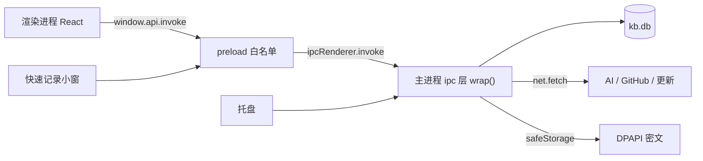
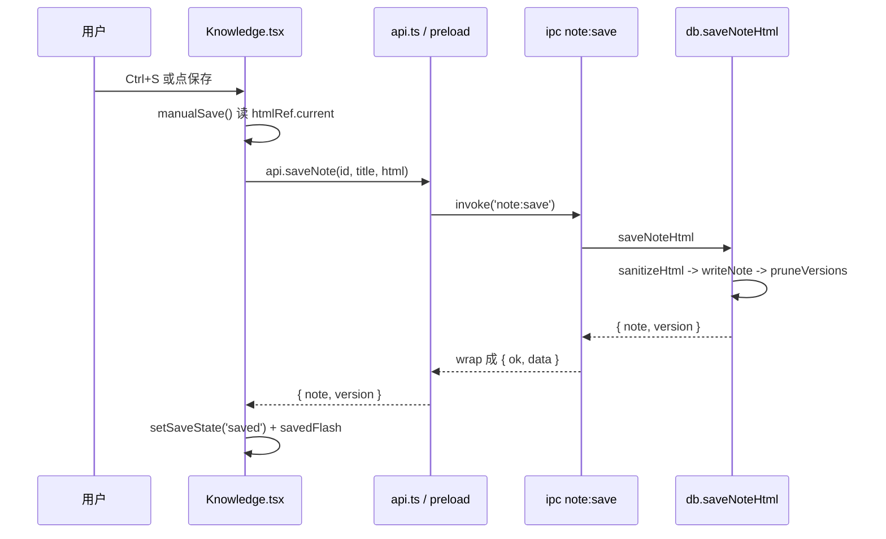

# 技术分析报告：Jw 知识库（v0.12.3）

> 写前基线实测：`npm run typecheck` **0 错**；`npm run test:unit` **534/534**（38 个文件）。最近一次全量 `npm run test:all`：e2e 344/344、强杀恢复 6/6、打包自检 23/23。宿主 Node v24.19.0，Electron 44.8.0。

## 模块 1：全景速览

**一句话定位：Jw 知识库是纯本地的 Windows「第二大脑」—— 笔记、任务、复习、目标、番茄钟、AI 对话、收集箱共用一个 SQLite 文件；断网可用，数据不出本机。**

它解决的痛点：云笔记要账号/订阅且数据不受控；笔记、待办、复习分散在几个工具里。本项目用「单 Electron 应用 + 单 `kb.db` + 无后端」换零服务依赖、整目录可备份迁移。

**选型克制（它不解决什么）**：不做多端同步、协作、Web 版；AI 需自备 API Key，不内置模型；安装包无代码签名，SmartScreen 首次运行会拦；数据默认只落在 `D:\Jw知识库`，跨机靠整目录复制或云端备份。

**界面拆解**：主窗 9 个导航页（由 `App.tsx` 的 `NAV` 数组定义，`useHashRoute` 手写路由）；快速记录小窗（无边框置顶，hash `#/quick`）；托盘常驻。全局快捷键：Ctrl+K 搜索、Ctrl+N 新建笔记、Ctrl+1…9 切页、Ctrl+Shift+P 命令面板。

| 目标 | 读哪节 | 最快动作 |
| --- | --- | --- |
| 1 分钟看懂全貌 | 模块 1–3 | 看两张 Mermaid 图 |
| 5 分钟跑通本地 | 模块 4 | `npm install` → `npm run dev` |
| 30 分钟完成首改 | 模块 5 | 按 First PR 的 Diff 改一行 |

### 技术栈矩阵

| 层 | 选型（版本以 `package.json` 为准） | 一句话原因 |
| --- | --- | --- |
| 桌面壳 | Electron **44.8.0** | 一套 TS 写主进程/渲染层/小窗/托盘；Windows NSIS 打包成熟 |
| 构建 | electron-vite **6** + electron-builder **26.15.3** | 开发热更新、生产 asar；`electronDist` 直接用本地 Electron，绕开国内下载 |
| 界面 | React **18.3.1** + 手写 CSS | 9 个主导航页 + 快速记录小窗；无路由库（`useHashRoute`）、无 Redux/Zustand，页面级 state 够用 |
| 语言 | TypeScript **7.0.2**（strict） | 跨进程接口全部落 `src/shared` 类型，改错在编译期暴露 |
| 数据 | `node:sqlite` 的 `DatabaseSync` | 零原生依赖、免编译；单文件 `kb.db` 可直接备份 |
| 测试 | Vitest **5.0.5** + 自研 CDP e2e | 主进程纯函数可直测；e2e 起真实 Electron 断言真实 DOM |

**硬性版本**：宿主 Node 必须支持 `node:sqlite`（本机 v24.19.0 实测通过）；Electron 44.8.0 升级前先跑全量测试。

### 0.12.1 增量：AI 提炼成重点文档

工具栏「✨ AI → 整理成重点文档」把当前笔记压成一份**新笔记**，原笔记一行不改。链路：`Knowledge.tsx` 的 `startAiFull('extract')` → `AiExtractDocModal` → `window.api.invoke('ai:run', { action: 'extract' })` → `src/main/ipc/ai.ts` 的 `ai:run`（模块级 `extractJobRequestId` 单任务锁）→ `src/main/ai.ts` 的 `buildMessages`（对 `extract` 提前返回 `EXTRACT_SYSTEM_PROMPT`）→ `ai:stream` 逐块回渲染层（rAF 合并）→ 保存 `note:extract-save` → `src/main/db.ts` 的 `createExtractedNote`（`BEGIN IMMEDIATE` 包住「标题查重 → `createNote` → `setNoteTags`」，失败 `ROLLBACK`）。纯函数契约都在 `src/shared/extract-doc.ts`：`truncateForExtraction`（8000 字、优先按换行）、`splitExtractionOutput`、`normalizeExtractTitle`、`uniqueExtractTitle`、`extractResultError`。改这里先守住两条：① 空 / 纯空白结果绝不落库（IPC 与 db 各拦一道）；② 生成中关闭弹窗必须走 `src/renderer/src/ui.tsx` 的 `Modal.beforeClose` 二次确认。

### 0.12.2 增量：AI 长时记忆与习惯适配

AI 主链路多了「静默提取偏好 → 下次请求注入」的旁路，**非核心链路全程可降级**。提取：`src/main/ipc/ai.ts` 的 `scheduleMemoryExtraction` 只在用户请求 `done` 之后排程（1.5 秒防抖；`jobs.size` / `chatJobs.size` 非 0 时 1.2 秒后重试，绝不并发），`runPendingMemoryExtraction` 用 `chatOnce`（300 tokens、15 秒总超时）拿回 JSON，交给 `src/shared/ai-memory.ts` 的 `parseMemoryJson`（`/\{[\s\S]*\}/` 剥围栏与废话）与 `shouldSkipMemoryExtraction`（<20 字或简单替换直接跳过），再经 `src/main/db.ts` 的 `addAiMemory` 落 `ai_memory`（同场景同名去重、累加 `hit_count`、每场景只留最近 20 条）。注入：`buildMessages(action, payload, preferences)` 的第 0 条 system 由 `buildSystemPrompt(preferences)` 生成 = `SYSTEM_PROMPT` + `buildPreferenceBlock`（`<user_preferences>` 包裹，声明优先级低于核心指令）；`loadPreferencesSafely` 只对文本类动作注入、80ms 预算 + try/catch，失败返回 `[]`。表结构在 `src/main/schema.ts` 的 `AI_MEMORY_SCHEMA`，`migrate()` 里用 `CREATE TABLE IF NOT EXISTS` 幂等补齐并 `try...catch` 兜底，**不改 `SCHEMA_VERSION`（保持 8）**——提升版本会打挂 `tests/unit/migrate.test.ts` 对老库 `user_version` 的既有断言。提取成功经 `ai:memory:updated` 事件推到设置页 `src/renderer/src/AiMemoryCard.tsx`（只显示一行「🧠 已记住您的格式偏好」，不弹确认框）。改这里先守住两条：① 查库/提取失败必须静默降级，不能让润色/摘要主流程报错；② 入库与拼 Prompt 前必须 `sanitizeMemoryText` 清掉 `<` / `>`，防止提示词注入。

### 0.12.3 增量：AI 搜索直达（精准跳转与高亮）

搜索弹窗的 `openNote(hit.note_id, q)` 把查询词随 id 交给 `App.tsx` 的 `locate` state；`Knowledge` 页等 `putIntoEditor → setEditorEpoch` 渲染完再定位。链路：`src/renderer/src/pages/Knowledge.tsx` 的 `useLocateHighlight` → `src/shared/locate.ts` 的 `findQuoteRanges`（`extractCoreChars` 先剥全/半角标点与空白并保留索引映射，精确失败后多词组合、再前 15 个核心字符）→ `src/renderer/src/dom-find.ts` 的 `buildTextMap`（TreeWalker 跳过脚本/隐藏节点、块级与 `<br>` 补换行）+ `highlightRanges`（CSS Custom Highlight 优先，`<mark>` 降级）+ `scrollRangeIntoView`（用 `range.getClientRects()` 手动居中，不用 `scrollIntoView`）；同时发 `ai:locate`（`src/main/ipc/ai.ts`，`chatOnce`、`maxTokens 160`、timeouts 4s/6s/8s），AI 只回一句引文，`parseLocateQuote` 用 `/\{[\s\S]*\}/` 剥围栏，回来后替换高亮。防串台：`AbortController` + 打开的 `openId` 比对；防脏写：`touchBody` / `scheduleDraft` / `manualSave` 前 `stripHighlights()`，高亮绝不进 `htmlRef`。改这里先守住两条：① AI 定位失败/超时必须静默保留本地高亮；② 任何保存路径前必须清理 DOM 高亮。

## 模块 2：工程结构与安全边界

### 目录树（★ = 生成目录，禁改）

```
src/
├─ main/          # 主进程：窗口、托盘、数据库、AI、云备份、GitHub
│  ├─ index.ts    # 入口：createMainWindow / createCaptureWindow / createTray
│  ├─ db.ts       # 唯一数据访问层（约 2400 行）
│  ├─ ipc/        # 按域注册：registerIpc → registerNotes / registerAi …
│  └─ paths.ts    # 数据目录解析 resolveDataRoot
├─ preload/       # 仅 50 行：contextBridge 暴露 window.api
├─ renderer/      # React 页面；无 Node、无网络
└─ shared/        # 双端共享：types.ts、html.ts、markdown.ts、ai.ts …
tests/
├─ unit/          # 520 条 Vitest
└─ e2e/           # cdp-check.mjs（6806 行）+ kill-test.mjs
out/          ★  # electron-vite 编译产物（main/preload/renderer）
release/      ★  # electron-builder 安装包输出
node_modules/ ★
.e2e-data/ .kill-data/ .pack-data/ .probe-data/ ★  # 测试专用数据目录
resources/       # 图标、installer.nsh
.tools/          # 打包、发布、文档自检脚本
```

### 主进程模块分工

| 文件 | 职责 |
| --- | --- |
| `src/main/index.ts` | 进程/窗口/托盘/生命周期 |
| `src/main/db.ts` + `src/main/schema.ts` | 数据访问层与建表迁移 |
| `src/main/ipc/*` | 按域注册通道（`registerIpc` 统一汇总） |
| `src/main/ai.ts` | AI 流式对话、取消、错误翻译 |
| `src/main/cloud.ts` + `src/main/snapshot.ts` | 云端灾备与本地快照/恢复 |
| `src/main/github.ts` + `src/main/github-auth.ts` | 仓库同步与 Device Flow 登录 |
| `src/main/focus.ts` | 番茄钟纯引擎（`endAt` + `setTimeout` + `restore`） |
| `src/main/update.ts` + `src/main/updater.ts` | 更新检查与安装 |
| `src/main/export.ts` / `src/main/html-to-md.ts` | 导出与 HTML→Markdown |

渲染层：`src/renderer/src/App.tsx` 管路由与全局快捷键，每个页面在 `src/renderer/src/pages/*` 一个文件，`src/renderer/src/api.ts` 是唯一 IPC 出口；可复用 UI 平铺在 `src/renderer/src/*.tsx`，没有 `components/` 子目录。

### 安全边界（红线）

| 项 | 现状（`src/main/index.ts` 两处 `webPreferences`） | 改了会怎样 |
| --- | --- | --- |
| `contextIsolation` | **true** | 改 false = 页面脚本可劫持 preload 暴露的 IPC |
| `nodeIntegration` | **false** | 改 true = 任意页面脚本拿到 `require('fs')` |
| `sandbox` | **false**（为让 preload 用 `webUtils.getPathForFile`，不是放权） | 不要再放宽其它窗口；渲染层只能看到 `window.api` |
| 渲染层网络 | `src/renderer` 0 处 `fetch`/`require`；网络全在主进程（`net.fetch` 17 处） | 渲染层新增外联会绕过 CSP 与主进程审查 |
| 事件通道 | `src/preload/index.ts` 的 `ALLOWED_EVENTS` 白名单（10 条） | 未登记的事件 `api.on` 直接抛错；新增事件必须双端登记 |
| CSP | `src/renderer/index.html`；构建时 `electron.vite.config.ts` 的 `tightenCspInBuild` 把 `connect-src` 收紧为 `'self'` | 绕过 CSP 等于把「本地离线」变成可外联应用 |

渲染层禁止：`import fs from 'node:fs'`、直接 `fetch()`、把 API Key 写 `localStorage`（Key 由主进程 `safeStorage` 加密后存 `meta` 表）。

进程 / 数据拓扑：



## 模块 3：全局耦合与全链路穿透

### 隐性耦合（改一处炸一片）

| 耦合点 | 位置 | 级联风险 |
| --- | --- | --- |
| 设计 token | `src/renderer/src/styles.css`：`:root`（亮色）+ `[data-theme='dark']`（暗色） | 改 `--brand`/`--bg`/`--text`/`--radius` 会影响所有按钮、选中态、焦点环；只改一套 → 暗色主题不可读 |
| 核心类型 | `src/shared/types.ts` 的 `Note` | 同时被渲染层 state、IPC payload、db 行映射消费；加字段必须同步 schema、迁移、默认值 |
| 预加载 API | `window.api` 仅 `invoke`/`on`/`pathForFile` | 新通道要同时改 `src/renderer/src/api.ts`、`src/main/ipc/*`、`ALLOWED_EVENTS` |
| 时间常量 | `src/renderer/src/timing.ts` 的 `TIMING` | `themeFade`/`dragSettle`/`menuLeave`/`modalLeave` 与 CSS 过渡时长对齐，改一处要连 `styles.css` 一起改 |
| 通道字符串 | `note:save` 等在 `src/renderer/src/api.ts` 与 `src/main/ipc/notes.ts` 硬编码 | 单边改名 → 运行时 `ok:false`（`wrap()` 把异常转成中文错误，不崩但功能失效） |

常见改动的穿透路径（照着链改，别漏半边）：

| 想改什么 | 要动的文件链 |
| --- | --- |
| 新增一个 IPC 能力 | `src/shared/types.ts` 加类型 → `src/main/ipc/*.ts` 加 `handle` → `src/renderer/src/api.ts` 加封装 → 页面调用；若走事件推送才需要改 `ALLOWED_EVENTS` |
| 新增设置项 | 设置页 UI → `setSetting` 写 `meta` 表 → 读取处（主进程/渲染层各读一次）；默认值要兼容老库 |
| 改全局快捷键 | `App.tsx` 的 keydown → `palette.ts` 的 `shouldIgnoreShortcut`（输入框保护）→ e2e 补断言 |

### 全链路穿透：保存一篇笔记

1. 触发：`src/renderer/src/pages/Knowledge.tsx` 的 `manualSave()`（Ctrl+S 也走它）；正文取自 `htmlRef.current`，不是 React state。
2. 输入：`touchBody()` 每次输入只把 `innerHTML` 抄进 `htmlRef`（不 setState，避免重渲染打断光标）。
3. 渲染层：`src/renderer/src/api.ts` 的 `api.saveNote(id, title, { html }, '手动保存')` → `call('note:save', …)` → `window.api.invoke`。
4. preload：`src/preload/index.ts` 的 `api.invoke` 解包 `{ ok, data } | { ok, error }`，失败抛 `Error`。
5. IPC：`registerIpc`（`src/main/ipc/index.ts`）→ `registerNotes`（`src/main/ipc/notes.ts`）→ `note:save` 处理器被 `wrap()`（`src/main/ipc/common.ts`）包住，异常只回 `ok:false`。
6. 数据：`db.saveNoteHtml`（`src/main/db.ts`）先 `sanitizeHtml`，再 `writeNote` 写 `note` 行、追加 `note_version`，`pruneVersions` 只留最近若干版。
7. 回程：`{ note, version }` 经 `wrap` 原路返回；`manualSave` 更新 `saveState`/`savedFlash`，`TIMING.savedFlash` 后自动消失。



### 库表分布（`src/main/schema.ts`，21 张表）

内容层：`note`、`note_version`、`tag`、`note_tag`、`category`、`attachment`、`inbox_item`；任务层：`task`、`goal`、`goal_key_result`、`goal_pool`；计划/复习层：`plan`、`plan_item`、`review_card`、`milestone`、`review_log`、`retrospective`；系统层：`meta`、`focus_sessions`、`github_sync_meta`。建表全在 `schema.ts`，`migrate()` 只做增量补列和索引；改结构不要去动已发布的 `CREATE TABLE`。

### DB 迁移

- 版本号：`src/main/db.ts` 的 `SCHEMA_VERSION`，当前 **8**；`migrate()` 读 `PRAGMA user_version`，按 `if (current < N)` 逐级补列/建表，最后写回版本号。
- 入口：`openDatabase()` 打开库后执行 `migrate()`，顺序幂等（重复打开不会重跑）。
- 加字段的正确姿势：升级 `SCHEMA_VERSION` + 在 `migrate()` 追加 `if (current < N+1)` 分支，用 `addColumnIfMissing` / `CREATE INDEX IF NOT EXISTS`；同步补 `tests/unit/migrate.test.ts`、`tests/unit/db.test.ts` 用例。
- 禁忌：只改建表 `SCHEMA` 不升版本——老库不会重建，运行时直接 `no such column`。

## 模块 4：接手 SOP 与排雷

### Day 1 启动

```bash
npm install        # Node 需支持 node:sqlite；.npmrc 配了镜像，npm warn 可忽略
npm run dev        # electron-vite 起 Vite dev server + 真实 Electron 窗口
npm run typecheck  # 改代码前先确认基线
```

- **没有 `.env`，也没有 dotenv**：配置由启动命令直接注入 `process.env.JWKB_*`。
- 生产差异：开发时主进程拿到 `ELECTRON_RENDERER_URL` 走 `loadURL`；打包版没有该变量，走 `loadFile(out/renderer/index.html)`，CSP 收紧为 `connect-src 'self'`。
- 生产可只设一个：`JWKB_DATA_DIR`（覆盖数据目录，见 `paths.resolveDataRoot`）。测试专用：`JWKB_FOCUS_MIN_SECONDS`（番茄钟最短秒数）、`JWKB_EXPORT_DIR`、`JWKB_GITHUB_*`、`JWKB_UPDATE_*`。

### 环境排雷（3 个必踩）

| 报错关键词 | 原因 | 处理 |
| --- | --- | --- |
| `NativeCommandError` + `npm warn Unknown project config "electron_mirror"` | PowerShell 把 npm 的 stderr 当错误 | 跑 npm 脚本**不要接管道/重定向**，直接裸跑 |
| `EADDRINUSE 9333` | 上一轮 e2e 的 Electron 未退出，CDP 端口被占 | `taskkill /F /IM electron.exe` 后重跑 |
| `!tempfile: Unable to create temporary file!` / `Error writing temporary file` | 项目路径含中文（`Jw的app`）+ 工作区 ACL，NSIS 在项目目录打不了包也装不了 | 用 `node .tools/build-installer.mjs`（英文暂存目录）；安装包从 `C:\JwKB\setup` 运行 |

### 数据隔离（绝不污染真实数据）

- 测试/自检一律用 `JWKB_DATA_DIR` 指向临时目录：e2e 用 `.e2e-data/`、强杀测试 `.kill-data/`、打包自检 `.pack-data/`。真实库在 `D:\Jw知识库`（`paths.DEFAULT_DATA_ROOT`，换过目录则记录在 `readLocator()` 的 `%APPDATA%\Jw知识库\locator.json`）。
- **禁止**把 `JWKB_DATA_DIR` 指到真实目录，或手删真实 `kb.db`；破坏性实验前先整目录复制。
- 数据目录长这样：`kb.db`（+ `kb.db-wal` / `kb.db-shm`）、`attachments/`（附件原文件）、`备份/`（快照）。换机迁移直接整目录复制，新位置由 `readLocator()` 记录的 locator 指向。
- 清空测试数据：关掉 Electron 后删对应隐藏目录，应用启动会重建。

### 测试与调试

- 单跑一条用例：`npx vitest run tests/unit/save.test.ts -t "关键词"`。
- 入门阅读顺序：`src/main/index.ts`（进程与窗口边界）→ `src/shared/types.ts` + `src/main/schema.ts`（数据模型）→ `src/renderer/src/App.tsx` + 任一 `pages/*`（页面与 IPC 调用），然后 `npm run dev` 对照真实界面。
- e2e 是单脚本顺序执行（`tests/e2e/cdp-check.mjs`），**没有 `--grep` 过滤**；调试时在脚本里临时 `return` 或注释段落，跑完必须还原。
- 全量顺序：`npm run test:all`（typecheck → unit → build → e2e → kill）；单独跑 e2e **必须先 `npm run build`**，否则测的是旧 `out/`。

## 模块 5：First PR 与暗黑逻辑

### First PR 演练：给 AI 对话「发送」按钮加 Tooltip

低风险理由：只加 DOM 属性，不碰 IPC/DB/状态；e2e 用类名 `.ai-chat-send` 定位，不受影响。

```diff
--- a/src/renderer/src/AiChatDrawer.tsx
+++ b/src/renderer/src/AiChatDrawer.tsx
@@
-            <button type="button" className="btn sm primary ai-chat-send" onClick={() => void send()} disabled={!draft.trim()}>
+            <button type="button" className="btn sm primary ai-chat-send" title="Enter 发送，Shift+Enter 换行" onClick={() => void send()} disabled={!draft.trim()}>
```

验证：`npm run dev` → 打开任意笔记 → 打开 AI 对话抽屉 → 悬停「发送」出现提示；再跑 `npm run typecheck` 和全量 `npm run test:all`（e2e 325 条必须全绿）。肉眼再确认：输入为空时按钮仍禁用、Enter 发送行为不变。

### 暗黑逻辑（看着奇怪，删了就坏）

| 代码 | 为什么不能删 |
| --- | --- |
| `TIMING.draftIdle = 1000`（`timing.ts`，`Knowledge.tsx` 的 `scheduleDraft`） | 每次输入都写库会触发 SQLITE_BUSY 并放大 WAL；停手 1 秒才 `saveDraft`（只写草稿，不建版本） |
| `touchBody()` 只写 `htmlRef`，不 `setState` | contentEditable 每次重渲染都会重置光标、打断中文输入法；正文真源是 `htmlRef`，只在换笔记时用 `putIntoEditor` + `editorEpoch` 写 DOM |
| `rich.ts` 用 `document.execCommand` | 保留浏览器原生撤销栈；改成 `innerHTML =` 会丢 Ctrl+Z |
| `savedFlash` 1.5 秒定时器 + 卸载清理 | 防卸载后 `setState`；所有手感时长集中在 `TIMING`，不要散落写死 |
| `src/main/focus.ts` 只存 `endAt` + `setTimeout`，`restore()` 启动补记 | 不每秒 tick 写库；进程被杀后能按 `endAt` 续上会话 |
| 保存时两次 `sanitizeHtml`（预览一次、主进程一次） | 主进程是最后防线，AI 生成与粘贴内容都不可信 |
| `palette.ts` 的 `shouldIgnoreShortcut` | 焦点在 input/textarea/contenteditable 且按裸键时放行，否则在笔记里打字会被 Ctrl+1…9 等全局快捷键抢走；带 Ctrl/Alt/Meta 的组合键仍走应用级（Ctrl+S/Ctrl+K） |

## 模块 6：构建与流水线（防打包白屏）

- `npm run build` = `electron-vite build`：主进程/预加载 → `out/main`、`out/preload`；渲染层 Vite 产物 → `out/renderer`。`out/` 是生成目录，禁改。
- `npm run dist` = build + `.tools/build-installer.mjs`：复制产物到纯英文暂存目录 → `node_modules` 用 junction → electron-builder 打 NSIS（`electronDist` 用本地 Electron）→ 输出 `release/`，并把安装包另拷到 `C:\JwKB\setup`；`.tools/check-packaged.mjs` 对产物做 23 项冒烟自检（启动、窗口、IPC、数据目录、9 个页面渲染、新建/保存/回读、搜索等），任一项失败即视为不可发布。
- `localhost` vs `file://`：开发时 `ELECTRON_RENDERER_URL` 是 http 地址，走 `loadURL`，CSP 放开 `ws:` / `http://localhost:*`；生产 `loadFile` 下资源必须是相对路径，hash 路由（`#/quick`）不经过服务端。**白屏第一嫌疑**：用了绝对 `/assets/...` 路径，或没 `npm run build` 就跑新安装包。
- 安装包不能从项目目录双击运行（工作区 ACL 拒绝临时文件），要从 `C:\JwKB\setup` 或桌面英文目录运行。
- 无 CI：发版手动 `node .tools/release.mjs --apply`（PowerShell 5.1 下 `npm run release -- --apply` 会静默变预演）。
- 发版 checklist：① `package.json` 版本号、`CHANGELOG.md`、README 徽章三处同步；② `npm run test:all` 全绿；③ `npm run dist` 出包后跑 `.tools/check-packaged.mjs`，必须 23/23；④ 真机安装，9 个页面各点一次、新建/搜索/导出各验一次；⑤ 打 tag、传安装包与 SHA256 到 GitHub Release。

## 模块 7：技术债与急救指南

### 客观盘点（只陈述事实）

| 事实 | 体量 | 影响 |
| --- | --- | --- |
| `src/renderer/src/pages/Knowledge.tsx` | 2265 行 | 编辑器、列表、附件、版本、搜索混在一个组件；改保存链路需通读全文件 |
| `src/main/db.ts` | 2379 行 | 所有表、迁移、行映射集中；改 schema 要连带看 `SCHEMA` / `migrate` / 查询 |
| `src/renderer/src/styles.css` | 5092 行、两套 `:root` token | 级联面大，暗色主题靠 `[data-theme='dark']` 覆盖 |
| `tests/e2e/cdp-check.mjs` | 6806 行、单脚本顺序执行 | 325 条断言共享应用状态，单条失败会带偏后续 |
| 无 CI、无 ErrorBoundary | 渲染层 `ErrorBoundary` / `window.onerror` 0 处 | 渲染层异常只剩白屏，无兜底上报 |
| CodeMirror 死依赖 | `package.json` 3 个包，`src/` 0 引用 | 增大体积、误导选型 |
| IPC 通道双端硬编码 | 147 个 `handle` + 3 个 `handleWindow` | 通道名在 `src/renderer/src/api.ts` 与 `src/main/ipc/*.ts` 各写一遍，改名要搜两处；漏改只会在运行时 `ok:false` |
| 无代码签名 | NSIS 产物未签名 | SmartScreen 首次运行会拦 |

### 急救指南

1. **本地库坏了 / 要重置**：先关应用；整目录复制备份 `D:\Jw知识库`；把 `kb.db`、`kb.db-wal`、`kb.db-shm` **一起**改名（只删主文件会留下脏 WAL）；重开应用会自动 `openDatabase` + `migrate` 建 v8 空库。
2. **恢复数据**：从 `D:\Jw知识库\备份\` 或云端备份取回；单篇回滚用笔记内的 `rollbackVersion`（会先自动存「回滚前快照」）。
3. **测试崩 / 残留进程**：`taskkill /F /IM electron.exe`、`/IM node.exe`；删除 `.e2e-data`、`.kill-data`、`.pack-data`、`tests/e2e/ud`、`out/` 后重跑。
4. **Git 冲突**：`git status` 后逐文件 `git checkout -- <file>`（放弃本地）或 `git stash`；解决后必须 `npm run typecheck && npm run test:unit` 再提交。
5. **依赖死锁 / `node_modules` 删不掉（EPERM/EBUSY）**：先杀 `node.exe`、`electron.exe`，关 IDE 和杀毒；用 `cmd /c rmdir /s /q node_modules`（PowerShell 的 `Remove-Item -Recurse -Force` 常遇长路径/占用报错）；删干净后 `npm ci`。仍失败就把仓库复制到英文短路径（如 `C:\jwkb`）再删。
