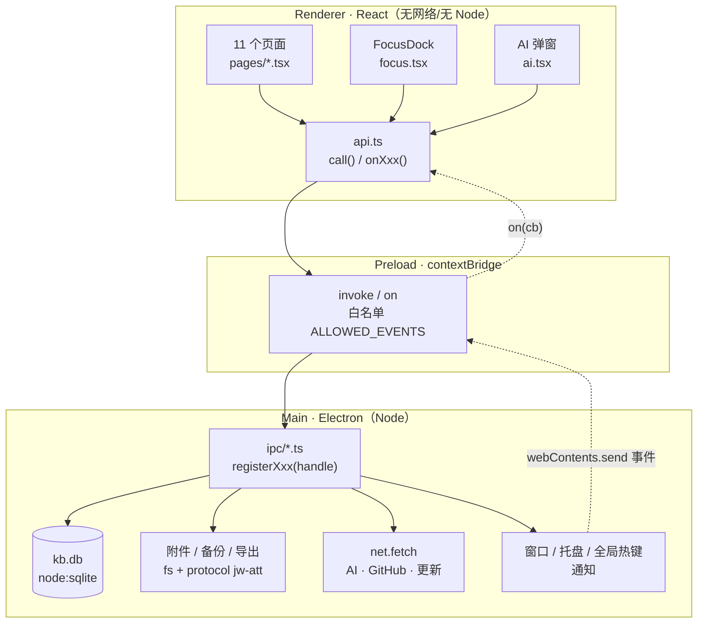
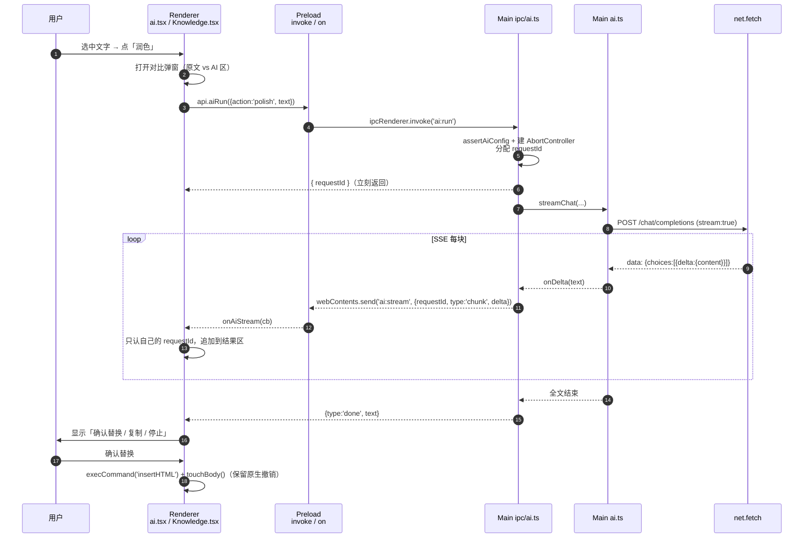
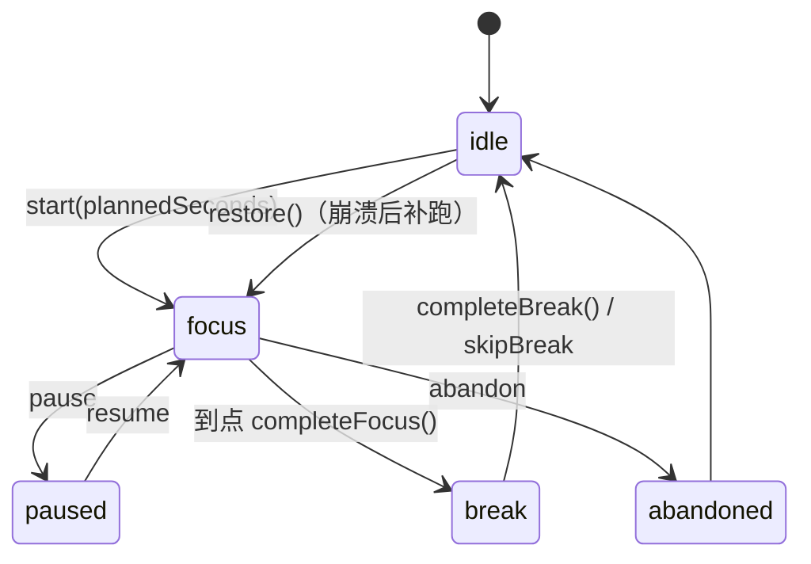

# 技术分析报告（TECH_REPORT）

> 基线：版本 **0.10.0**、schema **v7**、`src/` 63 个 TS/TSX 文件 17,289 行、单测 **381**（26 文件）、e2e **305**、强杀 **6**、打包自检 **23**。
> 这份报告里的每个 `path:line` 都可以用 `.tools/check-doc.cjs TECH_REPORT.md` 复核（会逐条检查文件存在 + 行号不越界 + Mermaid 图数量）。
> 想看更细的操作手册（Day-1 SOP、发版 10 步）去 [DEVELOPER_GUIDE.md](DEVELOPER_GUIDE.md)；这份只回答三个问题：**它是什么、底层怎么转、我第一刀往哪切**。

---

## 0. 三个目标对应的最短路径

| 目标 | 直接看 |
|---|---|
| 1 分钟看懂全貌 | §1.1 一句话定位 + §1.2 界面拆解 + §2.1 进程边界表 |
| 5 分钟跑通本地环境 | §3.1 命令表 + §3.2 数据隔离（**必读**，别污染真实库） |
| 30 分钟完成第一次改动 | §3.3 代码地图 → §3.4 First PR（照抄步骤，含验收） |

---

## 1. 全景速览

### 1.1 一句话定位

**一个本地优先（local-first）的 Windows 桌面「第二大脑」**：笔记 / 分类 / 标签、任务与计划、间隔复习、当前目标与里程碑、番茄钟、AI 润色与摘要、GitHub Issue 单向同步，全部数据落在本机一个 SQLite 文件里（`kb.db`），不登录、不上传、可整目录搬走。

它解决的痛点：把「记笔记 / 管任务 / 复习 / 专注」四件事拆成四个 App 的人，用同一个库把它们串起来（笔记 → 复习卡 → 任务 → 番茄钟 / 目标），并且**不牺牲数据主权**（`src/main/paths.ts:67` 的 `resolveDataRoot()` 允许把数据目录指到任意盘）。

### 1.2 界面与功能拆解

不是传统多窗口应用：**1 个主窗口 + 1 个全局快速记录小窗 + 1 个托盘**。

- 主窗口（`src/main/index.ts:121` `createMainWindow`，`frame:false` 自绘标题栏、Windows 11 用 acrylic 材质）
  - 左侧固定侧栏：品牌区 + 9 个导航（首页 / 收集箱 / 知识库 / 任务待办 / 学习计划 / 当前目标 / 下一阶段目标 / 复习与复盘 / 设置）+ 底部折叠按钮。
  - 顶部工具条：搜索（Ctrl+K）、快速记录（Ctrl+Alt+Space）。
  - 主区域：11 个页面组件（`src/renderer/src/pages/` 下 11 个文件），**没有路由库**，用 hash 路由手写：`src/renderer/src/App.tsx:36` 的 `useHashRoute()` + `NAV` 表。
  - 右下角悬浮层：番茄钟 `FocusDock`（`src/renderer/src/App.tsx:16` import），全局常驻、可拖动/吸边。
  - 全局轻提示：`ToastHost`（同文件 `App.tsx` 底部），带「撤销」动作。
- 快速记录小窗（`src/main/index.ts:188` `createCaptureWindow`，560×148、失焦自动隐藏）：不打断当前工作，先扔进收集箱。
- 托盘（`src/main/index.ts:246` `createTray`）：快速记录 / 显示主窗 / 退出；`Ctrl+Alt+Space` 全局热键在 `src/main/index.ts:331` 注册。

**联动关系**（不是并列功能，是有数据流的）：

```
收集箱 --convert--> 知识库笔记 --from-note--> 复习卡 --grade--> 复习日志
   └--convert--> 任务（可挂到 计划 / 里程碑 / 目标关键结果）
知识库笔记 --AI--> 摘要/标签/联想 --> 回写笔记或新建笔记
任务 --定时提醒--> 系统通知（src/main/index.ts:277 checkDue）
任务 --开始专注--> 番茄钟会话 focus_sessions --> 今日/本周统计
GitHub Issue --单向同步--> 本地任务（github_issue_id 去重）
```

### 1.3 核心技术栈（含「为什么」和「代价」）

| 层 | 选型（版本） | 为什么 | 代价 / 妥协 |
|---|---|---|---|
| 壳 | Electron 44.8.0 + electron-vite 6 | 需要托盘、全局热键、`safeStorage`(DPAPI)、自绘标题栏、原生窗口材质；Web 技术栈迭代快 | 安装包 ~112 MB；Electron 安全基线要自己守住 |
| UI | React 18.3.1（无 Router、无状态库） | 页面数固定 11 个，hash 路由 + `useState` 足够；少依赖少供应链风险（运行时依赖只有 5 个，见 `package.json:26`） | `useState` 在渲染层出现 90 处，跨页共享靠 prop drilling；`App.tsx` 撑到 433 行 |
| 编辑器 | 原生 `contentEditable` + `document.execCommand`（`src/renderer/src/rich.ts`） | 能在不引第三方编辑器的情况下做粗体/颜色/表格/插图，且**借用浏览器原生撤销栈**（AI 插入摘要必须能被 Ctrl+Z 一次撤掉） | 光标/选区/撤销栈全是隐式状态，任何「重设 innerHTML」都可能丢现场（见 §2.3） |
| 数据库 | Node 内置 `node:sqlite`（`DatabaseSync`，`src/main/db.ts:1`） | Electron 44 / Node 24 自带，**零原生编译、零额外依赖**；同步 API 写起来像本地文件 | 单连接同步调用，长事务会阻塞主进程；没有连接池概念 |
| IPC | 手写 `ipcMain.handle` + `preload` 白名单桥（`src/preload/index.ts:3`） | 通道数量大（129 个），需要统一的 `{ok,data}|{ok,error}` 语义和事件白名单 | 每个新通道都要手动加：主进程注册 + 白名单 + `api.ts` 封装（3 处） |
| 网络 | 全部在主进程，用 Electron `net.fetch`（AI / GitHub / 更新 / 附件协议） | 渲染层零网络是硬红线：Key/Token 不进渲染层，CSP 简单 | 流式响应要在主进程解析 SSE，再逐块 push 给渲染层（见 §2.4） |
| 打包 | electron-builder 26 + NSIS（`electron-builder.yml`） | 免安装体验 + 单文件安装包；支持「检查更新 → 下载 → 静默安装」 | 无代码签名 → 首次运行 SmartScreen 提示；更新清单靠 GitHub Release |
| 测试 | vitest 5（单测）+ CDP 驱动 Electron 的 e2e（`tests/e2e/cdp-check.mjs`） | 真跑应用、真截图、真点按钮，覆盖「软件渲染 + 真实 IPC + 真实 SQLite」 | 单脚本 6,017 行、顺序强耦合、跑一轮数分钟 |

> 两个「看着像在用、其实没用」的东西（别被骗）：
> - `package.json` 的 3 个 CodeMirror 依赖：`src/` 里 grep `codemirror|CodeMirror` **0 命中**（历史遗留，P2 技术债）。
> - 没有 Zustand / Redux / Context：grep `zustand|redux|createContext` 同样 **0 命中**。

---

## 2. 架构深潜与数据流向

### 2.1 进程边界与通信红线

```
┌─────────────────────────── Renderer（src/renderer，React）───────────────────────────┐
│ 页面 + 组件（无 Node、无网络、拿不到 fs）；只能通过 window.api.invoke / on 说话          │
└───────────────────────────────▲──────────────────────────────────────────────────────┘
                    contextBridge │（src/preload/index.ts:1 contextBridge）
┌───────────────────────────────┴──────────────────────────────────────────────────────┐
│ Preload（src/preload/index.ts:48 行）：invoke<T>() 解包 {ok,data,error}；on() 只放行白名单 │
└───────────────────────────────▲──────────────────────────────────────────────────────┘
                                │ ipcMain.handle（统一 wrap，src/main/ipc/common.ts:19）
┌───────────────────────────────┴──────────────────────────────────────────────────────┐
│ Main（src/main，Node）：SQLite / 文件 / 网络 / 通知 / 托盘 / 全局热键 / 窗口              │
└──────────────────────────────────────────────────────────────────────────────────────┘
```

| 职责 | 主进程 `src/main` | 预加载 `src/preload` | 渲染层 `src/renderer/src` |
|---|---|---|---|
| 数据库 | 全部（`db.ts` 2,519 行） | 不碰 | 不碰 |
| 网络 | 全部（`src/main/ai.ts` / `src/main/github.ts` / `src/main/update.ts`） | 不碰 | **0 处** `fetch/XHR/axios`（实测 grep = 0） |
| 密钥 | `safeStorage` 加密后进 `meta` | 不碰 | 只拿 `hasKey` / 打码尾巴 |
| 窗口/托盘/热键 | 全部 | 不碰 | 不碰 |
| 业务 UI 状态 | 无 | 无 | 全部（`useState`/`useRef`） |

**四条被 e2e 或代码结构强制的红线**：

1. 渲染层不允许直接联网：AI / GitHub / 更新全部走 `ipcMain.handle`，再由主进程 `fetch`。
2. IPC 返回值统一 `Result<T>`：`{ ok: true; data } | { ok: false; error }`（`src/main/ipc/common.ts:5`），`wrap()`（同文件 `:19`）负责把所有异常转成中文 error，渲染层只 `throw Error(error)`。
3. 事件（主→渲染）必须登记在 `ALLOWED_EVENTS`（`src/preload/index.ts:3`），否则 `on()` 直接忽略；当前包含 `nav:go / capture:focus / notice:due / update:progress / focus:state / ai:stream / export:progress / github:progress`。
4. 通道注册集中在一处：`src/main/ipc/index.ts:4` 起按域调 `registerCore / registerNotes / … / registerGithub`，加通道只改这里 + preload + `api.ts`。

### 2.2 架构拓扑（Mermaid）



### 2.3 核心难点 A：`contentEditable` 富文本的「持久化不炸」

问题不在「怎么存 HTML」，而在**怎么在高频输入下既不丢光标、不丢撤销栈，又能自动保存、版本回滚、AI 改写**。项目里三套状态彼此牵制：

1. **正文只有一个真源**：`htmlRef`（`src/renderer/src/pages/Knowledge.tsx:46` 附近）。输入时 `onInput → touchBody()`（`Knowledge.tsx:153`）只做三件事：把 `el.innerHTML` 抄进 ref、标 `dirty`、触发草稿；**不 setState 正文**——否则每敲一个字 React 就重渲染，光标会跳。
2. **只有「换文档」才允许把 HTML 推回 DOM**：`putIntoEditor()`（`Knowledge.tsx:144`）会 sanitize + setPreviewHtml + setWordCount + `setEditorEpoch(n+1)`，而真正写 `el.innerHTML` 的 effect 依赖 `[editorEpoch, openId]`——换笔记 / 恢复草稿 / 回滚版本 / 应用模板才触发。这是全项目最容易被新人破坏的约定：**随手改 effect 依赖 = 光标乱跳 + 撤销栈清空**。
3. **保存分三档，节奏写在 `src/renderer/src/timing.ts`**：`TIMING.draftIdle = 1000`（停手 1 秒写草稿 `note:draft`，`Knowledge.tsx:136` 的 `scheduleDraft`）、`wordCountIdle = 300`（字数统计）、`manualSave`（`Knowledge.tsx:347`，Ctrl+S / 点保存，写正式版本 `note:save`）。
4. **服务端兜底**：主进程 `saveNoteHtml()`（`src/main/db.ts:685`）入口再 `sanitizeHtml(html)` 一次，然后写纯文本 `content` + 清洗后的 `content_html` + 一条 `note_version`（版本回滚数据源）。所以「前端不清洗」也不会把 XSS 存进去——但**别删这一层**，它是最后一道闸。
5. **AI 改写为何能用 Ctrl+Z 撤销**：`insertAiSummary()` / `replaceSelectionWithAi()` 走 `document.execCommand('insertHTML')` 而不是重设 `innerHTML`，一次插入一个 `<blockquote class="ai-summary">`，浏览器把它记成一条 undo 记录。

### 2.4 核心难点 B：主进程计时、流式与 SQLite 一致性

番茄钟和 AI 是两个「看起来是 UI、其实是并发/状态机」的模块，共同结论：**状态的真源在主进程，渲染层只是投影**。

- **番茄钟**：`createFocus()`（`src/main/focus.ts:83`）是纯引擎（不 import electron），只存 `endAt`、全程一个 `setTimeout`、状态机 `idle / focus / paused / break`；副作用通过 `FocusDeps` 注入（`now / setTimer / clearTimer / notify / emit / persist / progress / flash`）。渲染层每秒只是拿 `endAt - now` 重算显示，**关面板、切页、最小化都不影响倒计时**；崩溃后 `restore()` 会用 `focus:state` 的持久化记录补记（残留的收 abandoned）。任务栏进度条 / 到点闪窗也在 ipc 层通过可选钩子注入（`src/main/ipc/focus.ts`），引擎本身保持可单测。
- **AI 流式**：请求在主进程 `streamChat()`（`src/main/ai.ts:517`），三层超时 `AI_TIMEOUTS`（`src/main/ai.ts:22`）：等响应头 10s / 空闲 60s / 总 180s；用 `AbortController` + `requestId` 隔离并发；解析 SSE 逐块 `webContents.send('ai:stream', …)`，渲染层 `useAiRun()` 按 `requestId` 过滤后把增量拼进弹窗文本。取消走 `ai:cancel`；网络错误统一翻中文。
- **SQLite 一致性**：`SCHEMA_VERSION`（`src/main/db.ts:158`）与 `migrate()`（`db.ts:220`）用 `PRAGMA user_version` 做**幂等顺序迁移**，每一步都 `addColumnIfMissing` 只加不删；批量写用 `runInTransaction()`（`db.ts:2422`，BEGIN/COMMIT/ROLLBACK），例如笔记排序、标签改名、GitHub 单仓库一轮 upsert；启动时 `integrityCheck()`（`db.ts:342`）跑 `PRAGMA integrity_check`，配合每日备份（`src/main/backup.ts`）与「强杀测试」（`tests/e2e/kill-test.mjs`）兜底。

### 2.5 核心交互时序：AI 润色流式（Mermaid）



番茄钟状态机（精简版，完整实现见 `src/main/focus.ts`）：



---

## 3. 接手实操 SOP

### 3.1 命令表

| 目的 | 命令 | 备注 |
|---|---|---|
| 装依赖 | `npm ci`（首次可 `npm install`） | 需要 Node ≥ 22（本机实测 v24.19.0） |
| 起开发 | `npm run dev` | electron-vite 热更新（渲染层 HMR） |
| 类型检查 | `npm run typecheck` | `tsc --noEmit`，要求 0 错 |
| 单测 | `npm run test:unit` | vitest，当前 **381** 项 / 26 文件，约 7 秒 |
| 构建 + e2e | `npm run build` **然后** `npm run test:e2e` | **`test:e2e` 不会自动 build**，不 build 就跑旧 `out/`（经典坑） |
| 强杀（断电）测试 | `npm run test:kill` | 6 项，验证 WAL + 草稿恢复 |
| 全量门槛 | `npm run test:all` | typecheck → unit → build → e2e → kill |
| 打包 | `npm run dist` | 产物 `C:\JwKB\setup\Jw知识库-安装包-<版本>.exe`，再 `node .tools/check-packaged.mjs` 自检 23 项 |

### 3.2 数据隔离（红线，先做这个）

**绝不要用真实库跑开发/测试**。数据目录解析顺序（`src/main/paths.ts:62`）：

1. 环境变量 `JWKB_DATA_DIR`（最高优先级，`paths.ts:68`）
2. 之前保存的定位文件 `%APPDATA%\Jw知识库\locator.json`（`paths.ts:17`）
3. 兜底目录（且只有**没设环境变量**时才写定位文件，`src/main/index.ts:313`）

标准姿势（PowerShell）：

```powershell
$env:JWKB_DATA_DIR = "$PWD\dev-data"    # 任意空目录；第一次会自动建库
npm run dev
```

e2e 自带隔离：脚本会创建 `.e2e-data/` 并通过 `JWKB_DATA_DIR` 传给被启动的 Electron，断言里还会检查 `dataRoot` 指向它。

**弄坏了怎么重置**：直接删掉隔离目录即可（`Remove-Item -Recurse -Force dev-data`），下次启动重建 schema。**真实库的备份/恢复**走设置页「备份与恢复」（每日自动备份 + 手动备份 + 数据库自检），不要手删 `kb.db`。

### 3.3 代码地图（「我想改 X → 去 Y」）

| 我想改… | 去哪 | 关键位置 |
|---|---|---|
| 主题 / 颜色 / 圆角 | `src/renderer/src/styles.css` | `:root` 变量（`styles.css:6`）、暗色覆盖（`styles.css:100`）、玻璃拟态 `.glass`（`styles.css:2730`） |
| 加一个页面 | `src/renderer/src/pages/` + `App.tsx` + 侧栏配置 | 新 `pages/<你的页面>.tsx` → `App.tsx:36` 的 `useHashRoute` 与 `NAV` 表 → 渲染分支（`App.tsx` 中 `switch/page` 处） |
| 全局快捷键 | `src/main/index.ts` | `globalShortcut.register`（`src/main/index.ts:331`）；再改设置页说明 |
| 本地热键（Ctrl+K 等） | `src/renderer/src/App.tsx` | 全局 keydown effect（`App.tsx` 中 `keydown` 监听） |
| 笔记编辑器工具栏按钮 | `src/renderer/src/pages/Knowledge.tsx` | 工具栏 JSX（`Knowledge.tsx` 中 `.rt-toolbar`）；命令封装在 `rich.ts` |
| AI 提示词 / 模型参数 | `src/main/ai.ts` | `SYSTEM_PROMPT`、`buildMessages`、`AI_TIMEOUTS`（`src/main/ai.ts:22`） |
| AI 设置卡片 / 错误文案 | `src/renderer/src/pages/Settings.tsx` + `src/shared/ai.ts` | `classifyAiConfigError`（`src/shared/ai.ts`） |
| GitHub 同步映射 | `src/main/github.ts` | `mapIssueToTask`、`fetchRepoIssues`（`src/main/github.ts:548`） |
| GitHub 同步流程 | `src/main/github-sync.ts` + `src/main/ipc/github.ts` | `syncGithubIssues`（`github-sync.ts:40`）、`registerGithub`（`src/main/ipc/github.ts:245`） |
| 番茄钟逻辑 | `src/main/focus.ts` + `src/renderer/src/focus.tsx` | `createFocus`（`src/main/focus.ts:83`）、悬浮球定位纯函数 `src/renderer/src/fabPos.ts:77` |
| 加 IPC 通道 | 三处同名 | `src/main/ipc/<域>.ts` 注册 → `src/preload/index.ts:3` 白名单（仅事件）→ `src/renderer/src/api.ts` 封装 |
| 加数据表 / 迁移 | `src/main/schema.ts` + `src/main/db.ts` | 表定义走 `SCHEMA`；版本与迁移见 `db.ts:158` / `db.ts:220` |
| 安装包图标 / 名称 | `resources/` + `electron-builder.yml` | `icon.ico`/`icon.png`/`tray.png`；`productName` 与 `nsis` 配置在 yml |
| e2e 断言 | `tests/e2e/cdp-check.mjs` | `CHECK_SCRIPT`（`cdp-check.mjs:421`）、`rec()`（`cdp-check.mjs:423`）、截图 `cdp.shot()` |

### 3.4 First PR（低风险、可验证、30 分钟内完成）

**任务**：在设置页「软件更新」卡片里加一个 **「复制版本信息」** 按钮，一键复制 `Jw知识库 0.10.0 · Electron 44.8.0 · Node 24.22.0`（报 bug 时给维护者用）。

为什么安全：不碰数据库 / 不碰网络 / 不碰 IPC 契约（`system:copy-text` 已存在，`api.copyText` 在 `src/renderer/src/api.ts:323`），版本信息在页面挂载时已经通过 `api.appInfo()` 拿好了（`src/renderer/src/pages/Settings.tsx:64`），只是多一个按钮和一次剪贴板写入。

**动 2 个文件**：

1. `src/renderer/src/pages/Settings.tsx`——在「软件更新」卡片头部（`<div className="card-head">` 那一块，靠近「检查更新」按钮）加：

```tsx
<button
  className="btn sm"
  onClick={() =>
    void api
      .copyText(`Jw知识库 ${info?.version ?? ''} · Electron ${info?.electron ?? ''} · Node ${info?.node ?? ''}`)
      .then(() => toast('版本信息已复制'))
  }
>
  复制版本信息
</button>
```

2. `src/renderer/src/styles.css`——一般不需要改（`.btn.sm` 已存在）；只有在卡片头部挤不下时才加一条：

```css
.card-head .btn + .btn { margin-left: 6px; }
```

**验收（照做即可）**：

```powershell
npm run typecheck        # 0 错
npm run build            # e2e 前必须 build
npm run test:e2e         # 期望仍是 305/305（这条改动不新增断言）
```

再手动看三件事：① 设置页「软件更新」卡片里出现按钮；② 点它弹 Toast「版本信息已复制」；③ 随便粘到记事本里，版本号与设置页「数据位置」卡片底部那行一致（`0.10.0 · Electron 44.8.0 · Node 24.22.0`）。

可选加分（第二个 PR）：给按钮加 `title="复制版本号与运行环境，报 bug 时贴给维护者"`，并在 `tests/e2e/cdp-check.mjs` 里补一条断言（用 `cdp.eval` 读剪贴板不可靠，改成断言按钮存在 + `.click()` 后出现 toast 文案）。

---

## 4. 工程红线与排错

### 4.1 防崩溃机制（现状盘点，别以为很全）

| 机制 | 位置 | 覆盖什么 | 缺口 |
|---|---|---|---|
| IPC 统一 try/catch | `src/main/ipc/common.ts:19` `wrap()` | 任何 handler 抛错都变 `{ok:false,error}`，不会把主进程炸掉 | 只覆盖 IPC 边界 |
| 启动失败兜底 | `src/main/index.ts:350` `dialog.showErrorBox` | 建库/迁移/路径失败时提示后退出 | 无重启/回滚建议 |
| 数据库完整性检查 | `src/main/db.ts:342` `integrityCheck()` | 设置页「数据库自检」、启动时 | 只报错不自修 |
| 每日/手动备份 + 恢复 | `src/main/backup.ts`、设置页「备份与恢复」 | 数据库文件级快照 | 恢复需要重启应用 |
| 草稿自动保存 | `note:draft`（`Knowledge.tsx:136` 触发） | 断电/强杀后能找回未保存正文 | 只覆盖笔记正文 |
| 事务回滚 | `src/main/db.ts:2422` `runInTransaction()` | 批量写要么全成要么全退 | 只在显式使用的事务里 |
| 强杀测试 | `tests/e2e/kill-test.mjs:5` | 回归「写一半断电」 | 只覆盖极少数路径 |
| **渲染层全局兜底** | **不存在** | — | 没有 ErrorBoundary、没有 `window.onerror`、没有 `unhandledrejection`（grep 0 命中）：某个组件渲染抛错 = 白屏且无处上报（P2 技术债） |
| **主进程未捕获异常** | **不存在** `process.on('uncaughtException')` | — | 未捕获异常默认让 Electron 弹错误对话框并退出 |

### 4.2 调试指南

| 场景 | 怎么做 |
|---|---|
| 主进程日志 | `npm run dev` 的终端 stdout/stderr 全在主进程侧；打包版没有控制台，**优先在 dev 复现**；AI/GitHub 原始响应会 `console.warn('[AI] …')`（已打码，见 `src/main/ai.ts` 的 `logRawAiResponse`） |
| 渲染层断点 | 开发时 `Ctrl+Shift+I` 开 DevTools；或 `--remote-debugging-port=9222` 后用 CDP 连（e2e 就是这么干的） |
| 数据库里到底有什么 | 数据目录见设置页「数据位置」；用任意 SQLite 工具打开 `kb.db`；`PRAGMA user_version` 看 schema 版本，`SELECT * FROM meta` 看设置/密钥状态（密钥是密文） |
| e2e 失败现场 | 每步截图在 `tests/e2e/shots/*.png`；结果明细在 `tests/e2e/last-result.txt`；日志尾行会打印「合计 N 项，通过 M，失败 K」 |
| e2e 连不上 Electron | CDP 端口被占用（默认 9222 / 探针 9357）：先 `Get-Process electron` 清残留，或改脚本里的端口 |
| 打包/安装报错 | `electron-builder.yml` 的 `electronDist` 指向 `node_modules/electron/dist`（本机 github 不可达时走本地已下载的 Electron）；NSIS 需要写注册表 → 被杀软拦时加白 |
| AI 报「连不上」 | 先看设置页「测试连接」的具体中文错误（401/404/429 已分类）；代理环境要在系统层配，代码不读代理设置 |

### 4.3 高频排错表

| 现象 | 最可能的原因 | 处理 |
|---|---|---|
| 页面白屏、控制台无报错 | 渲染层异常（无 ErrorBoundary，React 18 会卸载整棵树） | 开 DevTools 看 Console；临时在 `src/renderer/src/main.tsx` 外层套 try/catch 或加 ErrorBoundary（属于 P2 改进） |
| `npm run test:e2e` 全挂「没有 tab」 | 忘了 `npm run build`，e2e 驱动的是旧 `out/` | 先 build 再跑 |
| 新功能本地好、打包版坏 | 用了只有 dev 才有的路径/环境变量（如 `out/` 相对路径、未进 `extraResources` 的资源） | 跑 `npm run dist` + `node .tools/check-packaged.mjs`；资源走 `resourcePath()` |
| 数据库突然报 `no such column` | 迁移没执行（`PRAGMA user_version` 没跟上 `SCHEMA_VERSION`） | 看 `src/main/db.ts:220` 的 migrate 顺序；**不要手改真实库**，用备份恢复 |
| 拖拽/悬浮层点不动 | 落在 `-webkit-app-region: drag` 的自绘标题栏区（`styles.css:1204`） | 给该元素加 `-webkit-app-region: no-drag`（参考 `.focus-dock` 的做法） |

---

## 5. 技术债与重构优先级（现状真相）

### 5.1 核心遗留问题

| 优先级 | 问题 | 证据 | 建议 |
|---|---|---|---|
| **P0** | `Knowledge.tsx` 2,330 行单组件：编辑器 + AI + 标签 + 分类树 + 版本抽屉 + 拖拽全在一个文件 | `src/renderer/src/pages/Knowledge.tsx:42` 起 | 先抽 hooks（`useNoteEditor` / `useAiActions` / `useTagActions`）再抽子组件，**保持 DOM/类名不变**，每步用 e2e 305 条兜底 |
| **P0** | e2e 是 6,017 行单脚本、顺序强耦合、跑一轮数分钟 | `tests/e2e/cdp-check.mjs:421` | 拆成 specs/*.mjs + 共享的 e2e harness 模块（Cdp/stub/rec/shot），断言之间禁止共享状态 |
| **P1** | `db.ts` 2,519 行巨型仓储（122 个 export，所有域混在一起） | `src/main/db.ts` 全文件 | 按域拆 db/{notes,tasks,goals,review,focus,github}.ts + 各域 index.ts 重导出；现有单测可当护栏 |
| **P1** | `styles.css` 5,148 行，同一选择器多段重复、靠特异性互相覆盖，且有**两个** `:root` | `styles.css:6` 与 `styles.css:4259` | 按域拆文件 + `@layer`；拆前先把最终生效值写成快照测试 |
| **P1** | 没有 CI：typecheck/单测/e2e 全靠本地自觉 | 无 `.github/workflows/` | 加 Windows runner：`typecheck + test:unit + build`；e2e 依赖图形环境，可先只跑单测 |
| **P2** | 渲染层无 ErrorBoundary / 全局异常兜底 | grep `ErrorBoundary|window.onerror|unhandledrejection` = 0 | 加 ErrorBoundary + 上报 toast + 写日志；主进程补 `uncaughtException` |
| **P2** | 3 个 CodeMirror 依赖声明但零使用 | `package.json` deps；`src/` grep 0 命中 | 移除依赖 + 修正 README 技术栈描述 |
| **P2** | 跨页状态靠 prop drilling（`navigate` / `refreshCount` 传到 9 个页面） | `App.tsx` 渲染分支 | 页面数不再增长就先不动；要加「跨页编辑态」时引轻 Context |
| **P2** | GitHub Device Flow 要用户自备 OAuth App Client ID（默认空串） | `src/shared/github.ts:19`；`src/main/ipc/github.ts:59` | 发行方注册一个公开 OAuth App 内置 client id |
| **P3** | 时间比较用「带本地时区偏移的 ISO 字符串」做字符串比较 | `src/main/db.ts` 中 focus 统计、`src/main/ipc/focus.ts` | 统一 epoch ms 或 UTC |
| **P3** | e2e 多处靠 sleep/重试抗抖动（软件渲染下偶发丢点击） | `cdp-check.mjs` 中 `sleep(` 大量出现 | 换成「等条件成立」的轮询 helper |
| **P3** | 安装包无代码签名 | `electron-builder.yml` 无 `sign` 配置 | 有证书后加；否则保持「SmartScreen 提示」的用户说明 |

### 5.2 明确禁区（脆弱但核心，不要随手重构）

1. **`src/main/db.ts` 的 `SCHEMA_VERSION` 与 `migrate()` 段**（`db.ts:158` / `db.ts:220`）：顺序、幂等、`user_version` 三者错一个，老用户升级就炸库。加列只走 `addColumnIfMissing`，绝不改历史步骤的语义。
2. **`saveNoteHtml()` 的清洗链**（`db.ts:685`）：`sanitizeHtml`（白名单）→ 纯文本 → 版本快照。删一层就是 XSS 或正文丢失。
3. **`src/preload/index.ts` 的 `ALLOWED_EVENTS` 与 invoke 解包语义**（`src/preload/index.ts:3`）：事件名漏登记 = 功能静默失效（不报错，最难查）。
4. **`src/main/focus.ts` 的定时器/`restore()` 语义**（`src/main/focus.ts:83` / `src/main/focus.ts:137`）：改完必须跑 `focus-engine` 单测 + 强杀测试，否则「关面板就丢计时 / 重启后幽灵会话」。
5. **`src/renderer/src/pages/Knowledge.tsx` 的 `htmlRef` + `editorEpoch` 约定**（`Knowledge.tsx:144` / `:153`）：动 effect 依赖 = 光标跳、撤销栈清空、草稿覆盖正式内容。
6. **`styles.css` 的响应式与折叠态覆盖**：`.sidebar` / `.brand` / `.focus-dock` 有多段级联，删任意一段都可能让 60px 折叠态错位（e2e 里已有专门断言）。
7. **e2e 既有 305 条断言**：它们不是「测试」，是**产品行为契约**（键盘、快捷键、空态文案、主题、拖拽区）。改 UI 时优先改实现去满足断言，而不是改断言。

### 5.3 建议的重构顺序（低风险 → 高风险）

1. 加 CI（只跑 typecheck + unit + build）——零业务风险，收益立刻有。
2. 拆 `Knowledge.tsx` 的 hooks——e2e 305 条是安全网，先抽逻辑再抽视图。
3. 拆 db.ts 按域 + 各域 index.ts 重导出——单测 381 条兜底。
4. 拆 `styles.css`（先快照最终生效值，再按层拆）。
5. 拆 e2e 成 specs（最后做，因为它是前面所有步骤的裁判）。

---

## 附录 A：文件规模 Top 10（`Get-Content | Measure-Object -Line` 实测）

| 文件 | 行数 |
|---|---|
| `tests/e2e/cdp-check.mjs` | 6,017 |
| `src/renderer/src/styles.css` | 5,148 |
| `src/main/db.ts` | 2,519 |
| `src/renderer/src/pages/Knowledge.tsx` | 2,331 |
| `src/renderer/src/pages/Settings.tsx` | 788 |
| `src/renderer/src/ai.tsx` | 789 |
| `src/renderer/src/pages/Tasks.tsx` | 746 |
| `src/main/ai.ts` | 741 |
| `src/main/github.ts` | 653 |
| `src/shared/types.ts` | 537 |

## 附录 B：自检方式

```powershell
node .tools/check-doc.cjs TECH_REPORT.md   # 路径存在 + 行号不越界 + Mermaid ≥ 2 张
```
