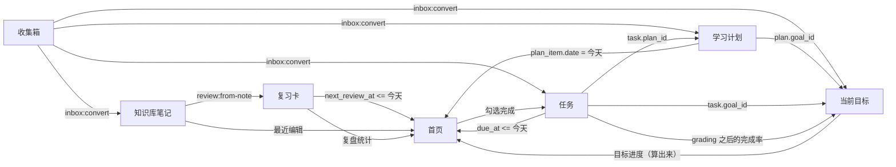

# Jw 知识库 · 功能分析文档

| | |
|---|---|
| 对应版本 | 0.7.0（第五版 + 更新模块 + 标签全局管理 + 番茄钟 + AI 辅助） |
| 对应代码 | `main` 分支（0.7.0） |
| 日期 | 2026-10-19（0.7.0）；初版 2026-10-16 |
| 配套文档 | [PRD.md](PRD.md)（需求原文）、[开发计划.md](开发计划.md)（实施记录）、[验收清单.md](验收清单.md)（可动手检查的验收项）、[README.md](README.md)（怎么装、怎么用）、[CHANGELOG.md](CHANGELOG.md)（版本变更） |
| 本文档回答 | 每个模块为什么存在、边界在哪；每个功能背后有哪些数据对象和操作；功能之间怎么耦合、哪里最容易断；现在做到了什么程度 |

---

## 1. 产品定位

### 1.1 一句话

把「想法进来 → 整理成知识 → 排成任务 → 按目标推进 → 定期复习」这一条链条，收进一个只跑在自己电脑上的软件里：不联网、不登录、不丢数据。

### 1.2 三个现实问题，以及功能上给出的答案

| 现实问题 | 功能上的答案 | 落在哪 |
|---|---|---|
| **记了不用**：记的地方和整理的地方是两个工具，收集箱里堆着没人看 | 收集箱是**临时中转站**而不是仓库：每条只有「转走」和「丢弃」两个出路；首页常驻显示未处理条数 | 收集箱、首页 |
| **各自为政**：笔记、任务、目标散在多个软件里 | 用**单向引用**把对象串起来（任务 → 目标/计划，计划 → 目标，复习卡 → 笔记）；目标进度不是填的，是**算出来的**，勾一个任务，目标进度条和首页一起变 | 任务、学习计划、当前目标 |
| **学过就忘**：写过的笔记再也没打开第二次 | 间隔重复：卡片按 `1 / 2 / 4 / 7 / 15 / 30 / 60 / 120` 天的阶梯复现，每天首页显示「今天该复习几张」 | 复习与复盘 |

### 1.3 四个真实使用场景

| 场景 | 时长 | 触发时机 | 走到的模块 |
|---|---|---|---|
| A 随手收集 | 30 秒 | 干活干到一半突然想起一件事 | 快速记录小窗（`Ctrl+Alt+Space`）→ 收集箱 |
| B 晚间整理 | 10–20 分钟 | 一天结束，清空收集箱 | 收集箱逐条清理 → 知识库 / 任务 / 当前目标 / 学习计划 |
| C 专注写作 | 30–60 分钟 | 想认真写一篇笔记 | 知识库三栏 + 手动保存 + 版本点 |
| D 晨间俯视 | 2 分钟 | 早上开机第一眼 | 首页（今日待办 / 目标进度 / 今日计划 / 复习提醒） |

### 1.4 边界（明确不做成什么）

- 不是多人协作工具：没有分享、评论、权限。
- 不是云端服务：没有账号、没有服务器、不联网。
- 不是内容采集器：不抓网页、不做 AI 生成内容。
- 不是通用笔记软件：它的价值在「收集 → 整理 → 执行 → 复习」这条闭环，而不是编辑器功能多。
- 相应地，登录/云同步/手机端/数据加密/多窗口/自定义配色都在「不做」清单里（见 PRD §9）。

---

## 2. 功能全景

### 2.1 九个模块

| # | 模块 | 一句话用途 | 它明确不干什么 | 页面骨架 | 状态 |
|---|---|---|---|---|---|
| 1 | 首页总览 | 早上 2 分钟看清「今天做什么、目标推进到哪、该复习多少」 | 不产生数据；不在首页做复杂编辑 | 单栏卡片网格 | 可用（部分细节未做） |
| 2 | 快速收集箱 | 想法冒出来时 30 秒接住，不要求当场分类 | 不是长期仓库；不允许堆积超过一周不处理 | 单栏列表 | 可用 |
| 3 | 知识库 | 想清楚的东西长期存下来、分好类、搜得到、带附件 | 不负责待办；笔记没有完成状态 | 三栏 | 可用 |
| 4 | 学习计划 | 定「这段时间学什么、每周投入多少」，铺到日历上 | 不是任务清单的别名：计划是周期安排，任务是具体动作 | 两栏 | 可用 |
| 5 | 任务待办与提醒 | 具体到某天某时要做完的事，带优先级、截止、重复、提醒 | 不做长期方向规划；任务一定能被「完成」 | 两栏 | 可用 |
| 6 | 当前目标 | 正在推的 1–3 个目标，拆成关键结果 / 里程碑 / 任务 | 最多 3 个，不归档就不换新的 | 两栏 | 可用 |
| 7 | 下一阶段目标 | 还没启动的方向池：想做什么、为什么、什么条件才启动 | 不是当前目标的草稿本；进池的目标不安排任何任务和提醒 | 两栏 | 可用 |
| 8 | 复习与复盘 | 让写过的东西被重新打开，让做过的事被回头看 | 不做知识管理本身，只做「再读一遍」和「回看一遍」 | 单栏 + 专注模式 | 可用 |
| 9 | 数据与设置 | 数据在哪、怎么备份、怎么恢复、界面偏好 | 不做账号、不做同步 | 单栏 | 可用（迁移向导未做） |

### 2.2 数据流向



### 2.3 三种角色的模块

- **产生数据**：收集箱、知识库、任务、学习计划、当前目标、下一阶段目标、复习与复盘。
- **只读聚合**：首页。它是所有模块的投影，唯一的写操作是勾选任务完成状态。
- **管数据**：设置（备份、恢复、数据目录、主题、托盘）。

---

## 3. 模块逐个分析

每个模块按「用途与边界 / 核心对象 / 关键操作 / 业务规则 / 依赖 / 缺口」六项拆开。

### 3.1 首页总览

- **用途**：驾驶舱。不产生数据，只展示和跳转。
- **核心对象**：没有自己的表。聚合 `task`、`plan_item`、`review_card`、`note`、`goal`、`inbox_item`。
- **关键操作**：勾选任务完成（`task:toggle`）、勾选计划条目（`plan-item:toggle`）、点卡片跳转。
- **业务规则**：
  - 「今日计划」不是一张表，是实时算出来的集合：**今天到期或逾期的未完成任务 + 今天排的学习内容 + 今天到期的复习卡**。
  - 数据为空时不隐藏卡片，显示一句空状态文案 + 一个下一步动作。
  - 导航栏计数每 20 秒刷新一次（`App.tsx` 的 `setInterval`），首页数据在进入页面时重新拉取。
- **数据来源**：`dash:overview` → `db.dashboard()`（`src/main/db.ts:1307` 起，`todayPlan = calendarEntries(today, today)`、`reviewDueCount`）。
- **缺口**：
  1. PRD §3.1 要求的**顶部通栏今日条**（`今天是 X 月 X 日 · 今天 N 件事 · 待复习 M 张`）没有实现，数字散在各卡片里。
  2. 右下角悬浮加号没有，用「快捷创建」卡片代替。
  3. 卡片拖动排序、顺序记忆没有。
  4. 0 点跨天**主动**重算没有：目前靠 20 秒定时器刷新计数 + 进入页面重载，程序挂在后台过夜时首页数字不会自己变。

### 3.2 快速收集箱

- **用途**：接住还没想清楚的东西。
- **核心对象**：`inbox_item(id, content, kind, status, ref, created_at, updated_at)`；`status ∈ {open, processed, dropped}`。
- **关键操作**：`inbox:add / update / discard / restore / delete`，以及**唯一的转出通道** `inbox:convert`，`target ∈ {note, task, goal, plan}`。
- **业务规则**：
  - 转出成功后写 `status='processed'` 并记 `ref`（形如 `note:12`、`task:7`、`goal:2`、`plan:3`），保证「这条从哪来」可追溯。
  - 转任务时可以带 `due_at / priority / repeat_rule`，转笔记可以带 `categoryId`。
  - 丢弃与恢复是软的，可以后悔；彻底删除是 `inbox:delete`。
- **依赖**：转出时调用各模块的创建函数（`createNote` / `createTask` / `createGoal` / `createPlan`），是**唯一**一个横跨四个模块的写入口。
- **缺口**：「不允许堆积超过一周」目前只是一句约定 + 首页未处理计数，没有强制手段（例如 7 天后标红）。

### 3.3 知识库

- **用途**：想清楚的东西长期留下来。
- **核心对象**：`category`（树）、`note`、`tag` + `note_tag`、`attachment`、`note_version`。
- **关键操作**：
  - 笔记：`note:list / get / create / draft / save / move / pin / trash / restore / purge / empty-trash`、`note:reorder`（拖动排序写位次）
  - 版本：`version:list / rollback`（保存时写版本点，可回滚，编辑器里有行级 diff）
  - 标签：`tag:list / set`；搜索：`search:query / reindex`
  - 分类：`category:tree / create / rename / move / delete`
  - 附件：`attach:add`（对话框选文件）、`attach:add-path`（拖拽进编辑器，走 preload 的 `webUtils.getPathForFile` 拿真实路径）、`attach:open / delete`
- **业务规则**：
  - **第三版起编辑器是所见即所得（`contenteditable`）**：加粗 / 斜体 / 下划线 / 字色 / 背景高亮 / 撤销 / 重做；表格可插入并增删行列。存盘时正文以 `content_html` 存 HTML，`content` 存同一篇的纯文字（全文搜索、字数、版本对比都用它）。
  - **HTML 全链路清洗**（`src/shared/html.ts` 的 `sanitizeHtml`）：白名单标签 + 白名单属性；`<script>`、`on*`、`javascript:`、`iframe` 一律拿掉；`<font color>`（Chromium、Word 粘贴的产物）翻成 `<span style>` 后保留。
  - **图片复制进数据目录** `attachments/YYYY-MM/`，正文里只存 `jw-att://attachments/…` 相对地址，渲染由主进程注册的 `jw-att://` 协议负责（越界 403、缺文件 404）；**删除笔记不会连带删图**，避免误删。
  - **拖动排序**：同一分类内拖动换位，松手先本地重排再 `note:reorder` 写库；只在「当前分类、没有搜索关键字、没有标签筛选」时允许拖（此时列表顺序本来就经过筛选，写库会误伤）。
  - **分类**：支持多层（`parent_id`）；每个分类行可「↑ / ↓」同层换位；**分类下还有笔记就删不掉**（递归连子分类的笔记一起数，回收站里的不算），提示「该分类下还有笔记，请先移动或删除笔记」；删空分类时子分类上提一级并排到新一层末尾。
  - **建子分类有两个入口**：① 分类行的工具栏里「＋子分类」——先选中一个分类，按钮就带上这个分类的名字（`title` 写成「在「X」下新建子分类」），没选具体分类时按钮是禁用的；② 鼠标悬停在某个分类行上时行内浮现的「＋」也一样。两个入口都走 `category:create` 带 `parent_id`，建完立刻出现在树上。
  - **手动保存**：编辑器头部的「保存」（同 `Ctrl+S`）立即写盘并提示「已保存 HH:MM:SS」，失败按原因分诊（占用 / 权限 / 磁盘满 / 库损坏）。草稿仍然自动留、失焦即存，两者不冲突。
  - 删除是软的，进回收站；清空回收站是少数需要确认框的操作之一。
- **依赖**：被复习引用（`review:from-note`），被首页「最近笔记」引用。
- **缺口**：附件只能调用系统默认程序打开，没有内嵌预览（PDF 等）；搜索只有关键词，没有正则/字段限定；「清理未被引用的图片」还没做（清单里列为后续可选）。

### 3.4 学习计划

- **用途**：回答「这段时间学什么、每天投入多少」，并把内容铺到日历上。
- **核心对象**：`plan(id, title, goal_id, start_date, end_date, rhythm, status, created_at, deleted_at)`、`plan_item(id, plan_id, date, content, minutes, done, done_at)`。
- **关键操作**：`plan:list / get / create / update / delete`、`plan-item:list / create / update / toggle / delete`、`plan:calendar`。
- **业务规则**：
  - 计划是周期，条目是「某一天的一条内容」；条目勾选写 `done_at`，取消勾选置空。
  - 日历视图按月取数（`plan:calendar({from,to})`），按 `date` 前缀分组成 6×7 网格。
  - 计划可以挂到一个当前目标上（`plan.goal_id`），但**不会**自动给目标算进度（目标进度只看 KR 和任务）。
- **依赖**：首页「今日计划」= `plan_item.date = 今天`；任务可以归属到计划（`task.plan_id`）。
- **缺口**：没有「计划整体进度条之外的节奏提醒」（例如「本周该投入 6 小时，实际排了 2 小时」这类统计）。

### 3.5 任务待办与提醒

- **用途**：具体到某天某时要完成的事。
- **核心对象**：`task(id, title, note, status, priority, due_at, remind_at, repeat_rule, goal_id, plan_id, created_at, done_at)`。
- **关键操作**：`task:list / counts / create / update / toggle / delete / delete-many`。
- **业务规则**：
  - **优先级三档（第三版起）**：`urgent 紧急（红）/ important 重要（橙）/ normal 一般（蓝）`；列表按 `case priority when 'urgent' then 0 when 'important' then 1 else 2 end` 再按时间排序；左栏可按某一档筛选。老库里的数字（3/2/1/0）由 v4 迁移一次性转成文字，后端 `toPriority()` 也会把传进来的数字归一。
  - **勾完不消失**：今天 / 逾期 / 即将三个视图**不过滤已完成**，完成的任务显示为灰色 + 删除线并排在最后；另有独立的「全部 / 未完成 / 已完成」三档状态筛选（`taskCounts()` 提供条数）。
  - **多选与批量删除**：左栏「多选」进入多选模式（每行复选框、全选 / 取消全选），「批量删除」先弹确认框，后端 `task:delete-many` → `db.deleteTasks(ids)` 软删并返回真删条数。
  - `remind_at` 存本地时间 `YYYY-MM-DD HH:MM`，到点由主进程弹 Windows 通知；没有 `remind_at` 时按 `due_at` 当天提醒，已逾期的改成「已逾期」文案。
  - **重复任务真的会生成下一条**：`repeat_rule ∈ {daily 每天, weekdays 工作日, weekly 每周, monthly 每月}`，勾成完成时按 `due_at` 推算出下一次日期并新建一条，保留标题、备注、优先级、重复规则和关联的目标/计划（`src/main/db.ts:1153-1163`）。
  - 删除给 5 秒撤销提示，不拦截（批量删除则确认后直接删，不再给撤销）。
  - 详情抽屉里可以挂到「当前目标」和「学习计划」上，抽屉里有独立的「保存」按钮（优化项 8）。
- **依赖**：任务完成率喂给「当前目标」进度；任务到期喂给首页「今日待办」。
- **缺口**：重复任务生成的下一条**不继承 `remind_at`**——设了提醒时间的重复任务，从第二条开始提醒就没了。

### 3.6 当前目标

- **用途**：正在推的 1–3 个目标，拆解并自动汇总进度。
- **核心对象**：`goal(id, title, description, start_date, target_date, status, is_current, sort)`、`goal_key_result(id, goal_id, description, target_value, current_value, unit)`、`milestone(id, goal_id, title, target_date, done, done_at)`。
- **关键操作**：`goal:list / get / create / update / delete / active-count`、`kr:*`、`milestone:*`。
- **业务规则**：
  - **最多 3 个进行中的目标**（`MAX_ACTIVE_GOALS`），第 4 个直接报错：`当前目标最多 3 个，先完成或归档一个再新建`。
  - **进度是算出来的**：`进度 = 平均(关键结果的 sum(current)/sum(target), 关联任务完成率)`；两个维度都没有时才退回到里程碑完成率。
  - 删除目标时 KR 和里程碑一起清掉，**关联任务保留**（只解除关联）。
- **依赖**：目标池「启动」会生成一个当前目标；任务、学习计划通过 `goal_id` 引用它；首页显示进行中的目标进度条。
- **缺口**：归档写复盘目前是**手工**动作（复盘页面自己写），没有「归档时自动带出这个目标的回顾」。

### 3.7 下一阶段目标（目标池）

- **用途**：还没启动的方向，记下「想做什么、为什么、什么条件才启动」。
- **核心对象**：`goal_pool(id, title, why, start_condition, priority, horizon, status, est_start, goal_id)`；`horizon ∈ {this, next, later}`，`status ∈ {pool, ready, started, dropped}`。
- **关键操作**：`pool:list / create / update / delete / start`。
- **业务规则**：
  - 启动条件非空且已填 → 状态显示为「就绪」（`ready`），只是提示，不阻塞。
  - **启动**（`pool:start`）会真的创建一个当前目标，回写 `goal_id` 并把状态改成 `started`；同一条**不能启动两次**（第二次报错）。
  - 进池的目标不占时间：不给它排任务、不提醒（PRD 硬约束）。
- **依赖**：与当前目标是一对孪生模块（池 → 当前），靠 `goal_pool.goal_id` 单向指回去。

### 3.8 复习与复盘

- **用途**：让写过的东西被重新打开，让做过的事被回头看。
- **核心对象**：`review_card(id, note_id, front, back, source, next_review_at, interval_days, ease_level, lapses, review_count, created_at, deleted_at)`、`review_log(id, card_id, reviewed_at, result)`、`retrospective(id, type, date, content)`。
- **关键操作**：
  - 复习：`review:list / due / stats / create / from-note / update / delete / grade / logs`
  - 复盘：`retro:list / get / save / delete / period / stats`
- **业务规则**：
  - `source ∈ {note 笔记, wrong 错题, hard 难点}`，错题/难点本是同一张表按来源筛出来的视图，不额外建表。
  - **间隔阶梯** `[1, 2, 4, 7, 15, 30, 60, 120]` 天，`ease_level` 记「已经答对过几次」：
    - 记得 → 进一档，间隔取该档天数；
    - 模糊 → 退一档，间隔 = 上一次间隔 × 0.6（至少 1 天）；
    - 忘了 → 归零，今天再来，`lapses + 1`。
  - 每次打分写一条 `review_log`；同日「从同一篇笔记生成卡片」会**去重**返回已有卡片 id。
  - 复盘按「类型 + 日期」唯一（日=当天，周=周一，月=当月 1 号），重复保存是覆盖同一条，不会堆重复。
  - 复盘页自带周期统计：完成的任务数、动过的笔记数、复习次数、计划条目完成数（`retro:stats`）。
- **依赖**：卡片引用笔记；到期的卡片喂给首页「复习提醒」。
- **缺口**：
  1. **复习到期没有系统通知**——`checkDue()` 只处理任务（`dueTasksForNotice()`），PRD §2.4 承诺的是「任务到期和复习到期都弹通知」。
  2. 同一篇笔记只能有一张卡（去重按 `note_id`），想对一篇长笔记出多张卡做不到。

### 3.9 数据与设置

- **用途**：数据在哪、怎么备份恢复、界面偏好。
- **核心对象**：`meta`（设置键值）、数据目录文件（`kb.db`、`kb.db-wal`、附件目录、备份目录）。
- **关键操作**：`settings:get / set`、`backup:list / run / restore / delete / reveal`、`data:reveal / integrity`、`app:info`。
- **业务规则**：
  - 备份用 `VACUUM INTO '<备份目录>/kb.db'` 打一个**一致性快照**（`src/main/backup.ts:69`），三种来源：`daily`（每天第一次启动自动备一次，靠 `lastBackupDate` 去重）、`manual`（手动点）、`pre-restore`（**恢复之前先把当前数据另存一份**，避免误点恢复把现有内容弄丢）。自动备份按 `KEEP_DAILY` 保留最近几份，超出的自动清理。
  - 恢复属于需要确认框的危险操作。
  - 恢复/迁移的七条保障见 PRD §7.2（写前备份、完整性检查、WAL 处理等）。
  - 主题浅色/深色两套，跟随设置而不是跟随系统。
- **缺口**：
  1. **备份里只有数据库**：附件目录不在快照里——本机恢复不会丢附件（附件一直在数据目录里没被动过），但把备份拷到另一台机器时附件不会跟着走。
  2. 换磁盘/换数据目录仍要手工改配置，PRD 的「图形化迁移向导」属于第二版项，尚未做。
  3. JSON / Markdown 导入导出也没有。

---

## 4. 数据模型分析

### 4.1 18 张表

| 分组 | 表 | 说明 |
|---|---|---|
| 基础 | `meta` | 设置键值、计数等元信息 |
| 知识库 | `category`、`note`、`tag`、`note_tag`、`attachment`、`note_version` | 分类树（多层 + `sort_order` 同层顺序）+ 笔记（`content` 纯文字 / `content_html` 富文本 / `sort_order` 分类内顺序）+ 标签多对多 + 附件 + 版本点 |
| 收集箱 | `inbox_item` | 中转站，`status` 三态 + `ref` 追溯 |
| 任务 | `task` | 优先级三档（文字）、`due_at`、`remind_at`、`repeat_rule`、两个外键 |
| 目标 | `goal`、`goal_key_result`、`milestone` | `is_current` + 3 个上限由代码保证 |
| 目标池 | `goal_pool` | 方向池，`goal_id` 指回启动后生成的目标 |
| 学习计划 | `plan`、`plan_item` | 周期 + 某天的一条内容 |
| 复习复盘 | `review_card`、`review_log`、`retrospective` | 卡片 + 每次打分流水 + 日/周/月复盘 |

### 4.2 版本与迁移

- 当前 `SCHEMA_VERSION = 4`（`src/main/db.ts`）。打开数据库时按 `PRAGMA user_version` 逐级补齐，最后写回最新版本号。
- **v2**：`addColumnIfMissing()` 补列 `task.remind_at`、`goal_pool.priority / horizon / est_start / goal_id`、`plan.rhythm`、`plan_item.done_at`、`review_card.lapses`，再建 `milestone`、`review_log`、`retrospective` 三张表。
- **v3**：补 `note.content_html`、`note.sort_order`、`note_version.content_html`，建索引 `idx_note_sort(category_id, sort_order)`，然后在事务里跑 `backfillNoteHtml()`（把老笔记的 Markdown 转成 HTML，草稿也转）与 `backfillNoteSort()`（按 `updated_at desc` 在分类内铺 1..n，保证升级后顺序不变）。
  - 坑：这个索引**不能**放在 `SCHEMA` 常量里——老库的 `note` 表还没有 `sort_order`，索引会先于补列执行并报 `no such column: sort_order`。
- **v4**：`update task set priority = case when cast(priority as integer) >= 3 then 'urgent' when cast(priority as integer) = 2 then 'important' else 'normal' end where typeof(priority) <> 'text'`，把数字优先级转成文字三档；靠 `typeof` 判断保证重复打开不会把已转好的又降回 `normal`。后端另有 `toPriority()` 把传进来的数字也归一。
- 迁移是**幂等**的（重复打开不会出错），并且已经拿真实的第一版数据库（`user_version = 1`，6 条任务、1 条收集箱、1 个标签）实测过：升级后新表新列都在、老数据条数不变、`integrity_check = ok`；第三版的库升第四版也实测过。
- `tests/unit/migrate.test.ts` 用手写的 v1/v2/v3 老 schema 把这三步都固化成了回归测试。

### 4.3 关系设计的三条原则

1. **单向引用**：只有「下游」存「上游」的 id（任务存 goal_id / plan_id，计划存 goal_id，卡片存 note_id，池存 goal_id）。反向不存字段，避免两边打架。
2. **能算的就不存**：目标进度、今日计划、各视图条数、周期统计都是查询时算出来的，没有冗余字段需要同步。
3. **删除是软的 + 有传播规则**：笔记进回收站，卡片保留；目标删除时清 KR/里程碑但保留任务。

---

## 5. 关键计算规则（实现依据）

| 概念 | 规则 | 代码位置 |
|---|---|---|
| 今日计划 | `task.due_at <= 今天 且未完成` ∪ `plan_item.date = 今天` ∪ `review_card.next_review_at <= 今天` | `src/main/db.ts:1307` |
| 首页待办 | 今天的 + 已逾期的未完成任务，逾期的标红 | `src/main/db.ts` 的 `dashboard()` |
| 目标进度 | `平均(KR 汇总比, 关联任务完成率)`，两者皆无时用里程碑完成率，最后 `round(×100)` | `src/main/db.ts:1230` |
| 当前目标上限 | 3 个，超出抛错 | `src/main/db.ts:1335` |
| 池项启动 | 建当前目标 + 回写 `goal_id` + `status='started'`，不可重复 | `src/main/db.ts:1656` |
| 复习间隔 | 阶梯 `[1,2,4,7,15,30,60,120]`，记得进档 / 模糊 ×0.6 / 忘了归零 | `src/main/db.ts:1843` |
| 任务排序 | 未完成在前（`case when status='done' then 1 else 0 end`），再 `case priority when 'urgent' then 0 …`，再按截止日 | `src/main/db.ts` 的 `listTasks` |
| 笔记排序 | 置顶优先，再 `sort_order asc`（拖动排序写的位次），再 `updated_at desc` | `src/main/db.ts` 的 `listNotes` |
| 任务提醒判定 | `status='todo'` 且（`remind_at <= now` 或 `due_at` 的日期 <= 今天） | `src/main/db.ts:1180` |
| 分类能不能删 | 递归数「本分类 + 子分类」里未删除的笔记，> 0 就拒绝 | `src/main/db.ts` 的 `deleteCategory` |
| 复盘主键 | `(type, date)`，周取其所在周的周一，月取当月 1 号 | `src/main/db.ts:2050/2078` |

---

## 6. 耦合与风险分析

这一节是「哪里容易出问题」的清单，按影响面排序。

1. **首页是唯一的聚合点，也是最脆的一环。** 三个数据源全靠**字符串日期比较**（`due_at`、`plan_item.date`、`next_review_at`）。只要哪个入口写进去的日期格式不是 `YYYY-MM-DD` 前缀，首页就会**静默**漏掉这条数据——不报错，只是不显示。凡是新增写日期的代码，都必须走 `todayLocal()` 这类统一格式的函数。
2. **目标进度依赖关键结果的分母。** `target_value <= 0` 的关键结果会让该维度失效（现按 0 处理）。新增 KR 时应该校验 `target_value > 0`。
3. **进度是算出来的，所以「延迟」是设计特性。** 勾任务后目标进度变化依赖重新查询，不是实时推送；页面切换/20 秒计数刷新时才更新。如果哪天要做「勾一下进度条立刻动」，需要加事件广播，而不是改成存字段。
4. **删除的传播规则只在代码里。** 删笔记保留卡片、删目标保留任务，这些规则没有数据库外键兜底（`integrityCheck` 只查 SQLite 层面的一致性）。手工改库或者以后加批量删除时，需要一并走这些函数。
5. **提醒的覆盖面有缺口。** 主进程 `checkDue()` 只处理任务，复习到期没有通知（见 3.8）。
6. **通知依赖程序常驻。** `closeToTray = 1` 时关窗口只是收进托盘；真退出程序就不会提醒。README 和验收清单里已如实说明。
7. **收集箱的「必须处理掉」是约定不是机制。** 目前没有超期标红/自动降级，靠首页计数提醒人。
8. **当前目标上限只在创建时检查。** 如果以后支持「从备份还原」「批量导入」，要重新走一遍上限校验，否则可能出现 4 个 current。

---

## 7. 实现现状盘点

### 7.1 已完成且验证过

| 范围 | 内容 | 验证方式 |
|---|---|---|
| 应用外壳 | 单窗口、左侧导航 9 项、顶栏搜索、快捷键（`Ctrl+K` / `Ctrl+N` / `Ctrl+S` / `Ctrl+1..9` / `Ctrl+Alt+Space`）、托盘菜单、关闭到托盘、单实例 | 打包版自检、e2e |
| 数据层 | 19 张表、schema v6、幂等迁移（v2 补表补列 / v3 富文本与非空分类顺序回填 / v4 优先级文字化 / v5 标签索引 / v6 `focus_sessions`）、完整性检查、WAL 处理 | 单测 + 真实老库迁移实测 |
| 收集箱 | 增删改、丢弃/恢复、四路转出（笔记/任务/目标/计划） | e2e |
| 知识库 | 三栏、分类树（↑↓ 同层排序、非空禁删）、富文本编辑（加粗/字色/高亮/插图/表格/撤销重做）、版本点与回滚、标签、全文搜索、拖动排序、回收站、附件（对话框 + 拖拽 + `jw-att://` 显示） | 单测（`richtext`/`reorder`/`category`）+ e2e（含真实 DragEvent 与 1×1 图片渲染） |
| 任务 | 四视图 + 状态三档筛选、优先级三档（紧急/重要/一般）、勾选不消失、多选批量删除、截止/提醒、重复任务（每天/工作日/每周/每月，完成自动生成下一条）、关联目标与计划、撤销删除 | 单测 + e2e |
| 学习计划 | 计划 + 条目 + 日历视图 + 挂目标 | 单测 + e2e |
| 当前目标 | KR / 里程碑 / 关联任务 / 自动进度 / 3 个上限 / 归档 / 手动保存 | 单测 + e2e |
| 目标池 | 地平线筛选、启动条件、启动转当前目标 | 单测 + e2e |
| 复习 | 卡片、一键从笔记生成、三档打分、间隔阶梯、错题/难点来源、日志 | 单测 + e2e |
| 复盘 | 日/周/月、周期区间、周期统计、历史 | 单测 + e2e |
| 设置 | 数据目录、每日自动备份 + 手动备份/恢复/删除/打开、主题、托盘开关、手动保存与失败分诊 | e2e |
| 交付 | 安装包 + 绿色版，交付到 `C:\JwKB\`；打包后自检 15 项 | 打包自检 |

测试规模（当前）：单测 **261 项 / 19 个文件**、端到端 **261 项**、强杀恢复 **6 项**、打包产物自检 **23 项**，`typecheck` 0 错误、`npm run test:all` 整体 exit 0。

### 7.2 部分完成

| 功能 | 差在哪 |
|---|---|
| 首页 | 缺顶部今日条、缺悬浮加号、卡片不能拖动排序、0 点不主动重算 |
| 到期通知 | 只有任务，没有复习 |
| 重复任务 | 能生成下一条，但不继承 `remind_at` |
| 复盘 | 归档目标时不会自动带出回顾，要手工写 |

### 7.3 未做（PRD 里明确暂缓或列为后续）

登录/账号、云同步、手机端、数据加密、导入导出（JSON/Markdown）、附件内嵌预览（PDF）、搜索高级语法、统计图表、自定义配色、多窗口/标签页、图形化数据路径迁移向导、清理未被引用的图片。

---

## 8. 建议的下一步（按性价比排序）

| 优先级 | 建议 | 为什么先做它 | 涉及范围 |
|---|---|---|---|
| P0 | 补复习到期通知 | PRD 已承诺，改动只在主进程 `checkDue()` 加一个条件 | `src/main/index.ts` |
| P0 | 首页顶部今日条 | 数据 `dashboard()` 里已经有，纯粹是展示；晨间俯视场景的直接入口 | `Dashboard.tsx` |
| P1 | 0 点跨天重算 + 广播 | 常驻场景下首页数字不对，属于「看起来坏了」的问题 | 主进程定时器 + 渲染层事件 |
| P1 | 重复任务继承提醒时间 | 现在下一条会丢 `remind_at`，重复几次以后提醒就静默消失了 | `toggleTask` |
| P1 | 归档目标时带出复盘草稿 | 把「目标 → 复盘」这条闭环补上 | `updateGoal` + Review 页 |
| P2 | 附件内嵌预览（图片/PDF） | 知识库体验的明显短板 | Knowledge 页 |
| P2 | 导入导出 | 数据安全感的来源，替代方案只有整库备份 | 设置页 |
| P2 | 统计图表（复用 `periodStats`） | 数据已经算好，只差画出来 | Review/设置页 |
| P3 | 图形化数据路径迁移向导 | 换电脑/换磁盘的高级需求 | 设置页 |

---

## 9. 附：接口与验证现状

- **IPC 通道**：`src/main/ipc.ts` 里注册了 **95 个**通道，分布在 21 个命名空间（`app / settings / category / note / version / tag / search / attach / inbox / task / dash / goal / kr / milestone / pool / plan / plan-item / review / retro / backup / data`）。渲染层不直接碰数据库，全部通过 `preload` 暴露的 `window.api`（`src/shared/types.ts` 的 `KbApi`）走 IPC。
- **数据文件**：`kb.db`（SQLite，WAL 模式）+ 附件目录 + 备份目录，都放在数据根目录下；路径由配置决定，设置页可以打开目录。
- **测试**（0.7.0 当前值）：`npm run test:unit`（**261** 项 / 19 个文件）、`npm run typecheck`（必须 0 错）、`node tests/e2e/cdp-check.mjs`（**261** 项）、`node tests/e2e/kill-test.mjs`（6 项）、`node .tools/check-packaged.mjs`（打包产物 **23** 项）；`npm run test:all` 一次跑完前四项。
- **提交历史**：`c7a968d` 第一版 → `6ea081f` 第二版（补齐四个模块）→ `5ec31c4` 交付路径修正 → `377227a` 富文本+表格 → `31fa599` 勾选不消失/多选 → `2ad6651` 优先级三档 → `016f108` 拖动排序 → `949354d` 分类 → `5a7468d` 手动保存。


## 10. 更新模块（0.4.0 / 0.5.0，2026-10-18）

### 10.1 为什么存在

应用只有一个人用、装在自己电脑上，但装好之后总要能升级：0.4.0 之前只能自己去 GitHub 找安装包。这一模块解决「知道有没有新版」和「一键换到新版」两件事，同时守住一条底线：**除用户主动点按钮外，应用不联网**。

### 10.2 涉及的文件与职责

| 文件 | 职责 |
|---|---|
| `src/main/update.ts` | 纯逻辑：版本号比较、解析 GitHub Release JSON（取 tag / 下载页 / 说明 / 附件）、错误映射成中文（超时 / 断网 / 403 限流 / 404 无 Release / 非 JSON） |
| `src/main/updater.ts` | 纯逻辑：流式下载写盘（进度回调）、文件名清洗、便携版识别、SHA256 计算、大小与摘要校验、取消（abort） |
| `src/main/ipc/update.ts` | IPC 层：`update:check` / `update:download` / `update:cancel` / `update:install` / `update:reveal` / `update:quit`；下载地址白名单（只允许 `github.com` / `api.github.com`）、更新目录、`JWKB_UPDATE_URL` 与 `JWKB_UPDATE_DRYRUN` 两个仅测试用的环境变量 |
| `src/preload/index.ts` | 事件白名单加 `update:progress`，进度事件只放行这一种 |
| `src/renderer/src/api.ts` | `checkUpdate / downloadUpdate / cancelUpdate / installUpdate / revealUpdate / quitForUpdate / onUpdateProgress` |
| `src/renderer/src/pages/Settings.tsx` | 「软件更新」卡片 + 「发现新版本」弹窗（三态按钮：下载中 / 已下载 / 平时） |

### 10.3 数据流

1. 渲染层点「检查更新」→ `api.checkUpdate()` → `update:check`。
2. 主进程 `checkUpdate(app.getVersion())` 用 `net.fetch` 请求 `releases/latest`（5 秒 `AbortSignal.timeout`），返回 `{ status: 'newer' | 'latest' | 'no-release', current, latest, checkedAt }`。
3. 有新版本 → 渲染层弹窗；点「下载并安装」→ `update:download` → 主进程 `downloadFile()` 流式写盘，每 100ms 通过 `update:progress` 推 `{ phase, received, total, percent }`。
4. 下完进入 `verifying`：算 SHA256、比对大小与 digest；不符 → 删文件 + 抛中文错。
5. 成功后返回 `{ path, version, size, sha256 }`；点「立即安装」→ `update:install`：校验路径在更新目录内 → `spawn(安装程序, ['/S'], { detached })` → 200ms 后 `app.quit()`；NSIS 装完自动启动新版。

### 10.4 边界与失败处理

- 断网 / 超时 / 限流 / 无 Release / 返回非 JSON：各有一条明确中文提示，界面不卡、不崩、不写库。
- 取消下载：主进程 abort → 半成品删除 → 渲染层提示「已取消下载」，回到可重试状态。
- 便携版（`PORTABLE_EXECUTABLE_FILE` 存在）：不静默安装，改为打开文件位置让用户手动替换。
- 测试模式：`JWKB_UPDATE_DRYRUN=1` 只走到「将启动安装程序」就返回，不真执行。
- 这一模块不碰任何业务表，也不影响本地读写；它只新增 2 个 CSS 类，其他页面零改动。

### 10.5 已知限制

- 只支持「覆盖安装」这一种升级形态；不做增量更新、不做后台自动更新。
- 安装包没买代码签名证书，Windows SmartScreen 会提示「发布者未知」。
- 校验依赖 Release 附件提供 digest；没有 digest 的版本只能比大小。

---

## 11. 标签全局管理（0.6.0，2026-10-18）

### 11.1 为什么存在
标签原来只能挂在笔记底部（逗号分隔的输入框），没有「全部标签 + 引用数 + 全局改名/删除」的入口。数据层其实第一版就有 `tag` / `note_tag` 关系表，所以这一版是**纯界面 + 几个查询**，不动表结构（只补索引）。

### 11.2 相关对象
| 对象 | 位置 | 说明 |
|---|---|---|
| `tag` / `note_tag` | `src/main/schema.ts` | 第一版就存在；`note_tag` 带 `ON DELETE CASCADE`；新增 `idx_note_tag_tag` 索引 |
| `listTags / tagById / renameTag / deleteTagById / countTagNotes / cleanTagName` | `src/main/db.ts` | 引用数只算 `deleted_at is null` 的笔记；改名与删除都在事务里，失败 ROLLBACK；改名撞名自动合并 |
| `tag:rename / tag:delete` | `src/main/ipc/notes.ts` | IPC 入口 |
| 左栏「标签管理」+ 两个弹框 | `src/renderer/src/pages/Knowledge.tsx` | 展开式列表（复用 `.tree-item`）、右键菜单、改名 Modal、删除 ConfirmDialog |

### 11.3 边界与失败处理
- 标签名：去首尾空白、不能为空、最多 40 字、不能含逗号（逗号是笔记里分隔多个标签的符号）。
- 改成一个已存在的名字 → 把关联并到目标标签、删除旧标签，返回 `merged: true` 与实际影响篇数。
- 删除标签 → 只删 `note_tag` 关联和 `tag` 行，笔记一行不动；回收站里笔记的关联也一起解除。
- 两个操作都包在 `BEGIN ... COMMIT` 里，任何一步抛错就 ROLLBACK（单测用触发器制造失败验证过）。

### 11.4 已知限制
- 没有「新建标签」入口：标签仍由笔记底部的输入框产生（避免出现一堆没人用的空标签）。
- 标签没有颜色 / 排序 / 层级，就是按名字排序的一列。

## 12. 番茄钟（0.6.0，2026-10-18）

### 12.1 为什么这么做
「专注 25 分钟」这类计时最怕两件事：切页 / 最小化后不准，以及用 `setInterval` 每秒减一累积误差。所以**主进程是唯一计时真相**：只存结束时刻 `endAt`，剩余时间永远用 `endAt - now` 现算；全程只有一个 `setTimeout` 到 `endAt`，任何状态切换都先清掉它。

### 12.2 相关对象
| 对象 | 位置 | 说明 |
|---|---|---|
| `focus_sessions` | `src/main/schema.ts` | id / kind(focus\|break) / task_id / started_at / ended_at / planned_seconds / actual_seconds / status(running\|paused\|done\|abandoned) / created_at；`idx_focus_started` 索引；`user_version` 5→6 |
| 会话与状态读写 | `src/main/db.ts` | `createFocusSession / setFocusSessionStatus / finishFocusSession / focusSessionById / focusSummary / saveFocusState / loadFocusState / clearFocusState / closeDanglingFocusSessions`；进行中的状态存 `meta` 表 key `focus:current` |
| 引擎 | `src/main/focus.ts` | `createFocus(deps)` 注入 `now / setTimer / clearTimer / notify / emit / persist`；`start / pause / resume / abandon / skipBreak / summary / restore` |
| 共用纯函数 | `src/shared/focus.ts` | `FOCUS_PRESET_MINUTES = [15,25,45,60]`、`DEFAULT_FOCUS_MINUTES = 25`、`BREAK_SECONDS = 300`、`formatClock`、`formatSpan` |
| IPC | `src/main/ipc/focus.ts` | `focus:state / start / pause / resume / abandon / skip-break / summary`，状态变化用 `focus:state` 事件推给渲染层 |
| 界面 | `src/renderer/src/focus.tsx` | 右下角 `.focus-fab` + `.focus-panel` 毛玻璃面板；`App.tsx` 挂载；任务详情「开始专注」在 `pages/Tasks.tsx` |

### 12.3 状态机
空闲 →（开始）→ 专注 running →（暂停）⇄ paused →（到点 / 手动结束）→ done → 休息 running（5 分钟，可跳过）→ 空闲；running / paused 时「放弃」→ abandoned（保留记录、不计时长）。

### 12.4 边界
- 计划时长限制 1 分钟 ~ 4 小时（`JWKB_FOCUS_MIN_SECONDS` 仅 e2e 用来降到 2 秒走真实完成路径）。
- 重启：`restore()` 按 `endAt - now` 接上；已超时的补记一条 done、不弹通知；残留 running/paused 收成 abandoned。
- 统计只认 `kind='focus' and status='done'`，今日 / 本周按本地时区算。
- 通知失败不影响计时（`Notification.isSupported()` 判断）。

### 12.5 已知限制
- 没有「专注白噪音 / 屏蔽」之类的功能，也没有跨设备同步（本来就没有云端）。
- 休息时长固定 5 分钟，不可配置。
- 番茄钟不做系统托盘计时显示（托盘只有菜单与单实例逻辑）。

## 13. AI 辅助（0.7.0，2026-10-19）

知识库笔记的 AI 辅助：划词改（润色 / 扩写 / 缩写 / 翻译）与全文整（摘要 / 分类整理 / 知识联想）。**AI 只产文字稿，写不写进笔记永远要人点「确认」**。

### 13.1 配置与安全

- 设置页「AI 模型」卡片：接口地址（OpenAI 兼容，`https://…/v1`）、模型名、API Key、测试连接。
- 配置存在现有 `meta` 表（不建表、`user_version` 仍为 6）：
  - `ai.baseUrl`、`ai.model`、`ai.privacyAck`；
  - Key 有 `safeStorage`（Windows = DPAPI）时加密后存 `ai.apiKeyEnc`（base64），否则退回明文 `ai.apiKey`（`publicConfig.encrypted=false` 如实标出）。
- 渲染层永远拿不到明文 Key：`ai:config:get` 只回 `keyHint`（如 `sk-…3456`）。
- **联网只在主进程**：`src/main/ai.ts` 用注入的 `AiFetcher`（真实实现是 Electron `net.fetch`），渲染层没有任何网络权限；IPC 通道只有 5 个：`ai:config:get/set/test`、`ai:run`、`ai:cancel`，外加主进程 → 渲染层的事件 `ai:stream`。
- 第一次使用先弹隐私说明，明确「选中的文字 / 整篇正文会发给第三方模型」，同意后 `ai.privacyAck=true` 不再重复弹。

### 13.2 划词（polish / expand / shorten / translate）

- 选中正文 → `selectionchange` 算出选区 `Range` 的矩形，在附近浮出气泡（`.ai-bubble`，四个动作 + 翻译的语言下拉）；点空白 / 滚动 / 缩放自动收起。
- 点动作 → `ai:run` 起作业（`requestId`），主进程流式请求，`ai:stream` 逐块回增量；弹窗左「原文」右「AI 结果」，结果打字机式增长。
- **确认前不改正文**。点「确认替换」才在前端把结果 `escapeHtml` 后 `execCommand('insertHTML')` 写回选区（进原生撤销栈，Ctrl+Z 整体撤回）；点「取消」直接丢弃。
- 翻译的目标语言：`auto`（自动识别）、`zh-CN`、`en`、`ja`、`ko`、`fr`、`de`、`es`，作为 `targetLang` 随 `ai:run` 传给主进程拼 prompt。

### 13.3 全文（summary / tags / related）

- **摘要**：笔记纯文本发主进程（最长 8000 字），流式生成完由前端在编辑器开头插入 `<blockquote class="ai-summary">…</blockquote>`（`Range.setStart(editor, 0)` + `execCommand('insertHTML')`，一次原生编辑 → Ctrl+Z 一步撤掉整块）；弹窗里也给「撤销插入」按钮（同样是原生撤销）。
- **分类整理**：非流式 `chatOnce`，要求模型回 `{"tags":[…],"category":…,"reason":…}`；前端用 `extractAiJson` 容错解析（剥 ```json 代码块 / 取首尾花括号），标签去 `#`、去重、最多 6 个。点标签胶囊 → 调现有 `note:set-tags`（`applyTags`）立刻加进当前笔记；分类建议只展示，不自动改分类。
- **知识联想**：非流式，要求回 `{"items":[{title,detail}]}`，最多 5 条；点「新建笔记」→ `api.createNote({ categoryId: 当前笔记.category_id ?? null, title, html: textToHtml(detail) })` → 刷新列表并 `setOpenId(新 id)` 直接打开。

### 13.4 请求、超时与错误

- 两种模式：`streamChat`（流式，润色类 + 摘要）、`chatOnce`（非流式，标签 / 联想 / 测试连接）。
- 三道超时闸（`AI_TIMEOUTS`）：等响应头 **10s**、中途空闲 **60s**、整轮 **180s**；超时文案区分三种。
- HTTP 错误中文分诊：401 Key 不对 / 402 余额不足 / 403 权限 / 404 接口地址 / 400 模型名 / 413 太长 / 429 限流 / 5xx 服务端；报错正文里的 Key 会被 redact。
- 网络错误：Abort（用户取消）→「这次请求已经取消」；ECONNREFUSED / ENOTFOUND 等 →「连不上 AI 服务，请检查网络或代理设置（本地功能不受影响）」。
- 渲染层失败统一 `toastError` 出中文 Toast，界面不卡死；本地数据库读写完全不受影响。

### 13.5 已知限制

- 只支持 OpenAI 兼容的 `/chat/completions` 接口（不接 Anthropic / Gemini 原生协议）。
- 摘要只插纯文本引用块（模型返回的 Markdown 会先转成安全 HTML）；分类建议只展示、不自动移动笔记。
- 不记住对话上下文：每次动作都是独立请求。
- 没有费用统计 / token 计费展示，也没有「只对某些笔记关闭 AI」的开关。

*本文档描述的是当前代码的实际行为；与 PRD 不一致的地方（例如复习通知、首页今日条）都在第 6、7 节里标了出来。PRD 是「要什么」，本文档是「现在是什么、差多少」。*

## 13.6 0.8.2 修正：AI 配置错误分诊

- `normalizeModelName(raw)`：模型名只允许 `[A-Za-z0-9._:\-/]`，空值给「不能为空」，非法字符给「问题出在…这个字符上」。
- 三个文案前缀：`模型名格式错误：` / `接口地址格式错误：` / `AI 设置不完整：`，渲染层 `classifyAiConfigError` 据此归类。
- 设置页「测试连接」：配置错 → 「配置有误：…」+ `.ai-input-bad` 标红；网络/服务错 → 「连接失败：…」。
- 保存即校验：`ai:config:set` 走 `normalizeModelName`，写错的模型名进不了库。
- 验证：单测 318（23 文件）、e2e 284/284（新增 3 条，原有 281 条未改）、强杀 6/6、打包自检 23/23。

